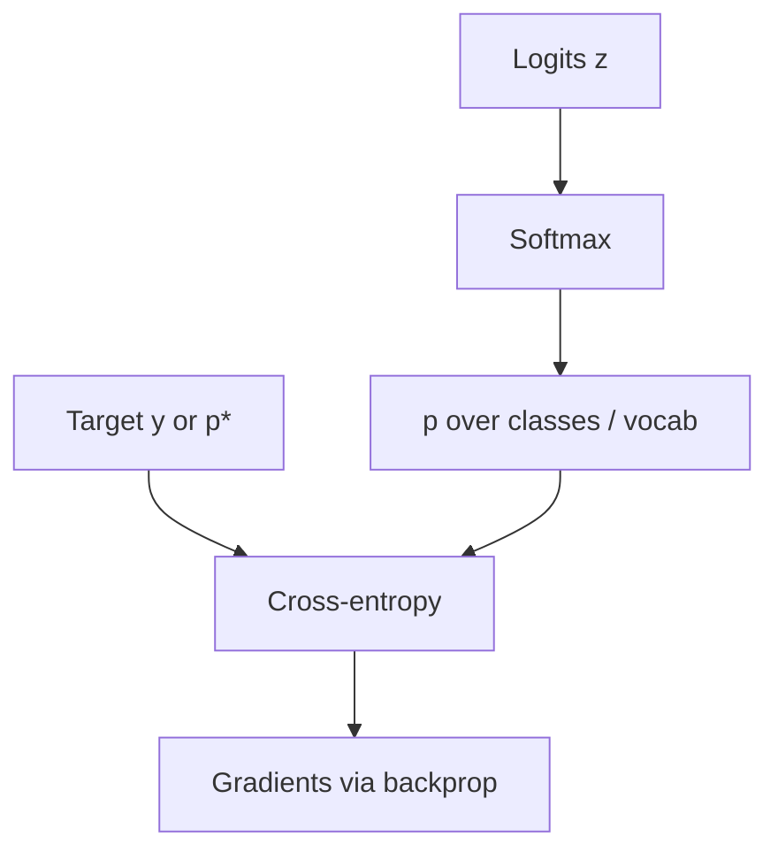

Cross-entropy measures how expensive it is to encode samples from a true distribution $P$ using a code optimized for another distribution $Q$. In information theory:

$$
H(P, Q) = -\mathbb{E}_{x \sim P}[\log q(x)] = -\sum_x p(x)\log q(x)
$$

(with natural log in most ML frameworks; base-2 yields bits). Equivalently,

$$
H(P, Q) = H(P) + D_{\mathrm{KL}}(P \Vert Q)
$$

so minimizing cross-entropy against a fixed data distribution $P$ is the same as minimizing KL divergence to $P$. In classification and next-token training, $P$ is usually a hard one-hot (or sparse) label, so the batch loss collapses to average negative log probability of the correct class or token: $\mathcal{L} = -\log p_y$. That single number ties logits, softmax, maximum likelihood, and backpropagation into one objective.

## Intuition

Shannon entropy $H(P)$ is the ideal average code length if you know $P$. Cross-entropy is the average code length if you *think* the world is $Q$ while data still come from $P$. Every bit of mismatch shows up as extra length; that extra length is exactly KL.

As a training loss, the log turns probability into a steep penalty. Missing the right class with $p_y=0.5$ hurts, while missing it with $p_y=0.01$ hurts far more. Training therefore pushes probability mass toward observed labels and next tokens while shaping the full probability distribution.

## Formula

**Multi-class / next-token (hard label $y$).** After softmax over logits $z$:

$$
p_i = \frac{e^{z_i}}{\sum_j e^{z_j}}, \qquad \mathcal{L} = -\log p_y = -z_y + \log\sum_j e^{z_j}
$$

The second form is log-sum-exp; frameworks compute it for numerical stability instead of materializing $p$ then taking $\log$.

**Soft targets.** With a full target distribution $p^*$ (label smoothing, distillation, mixture labels):

$$
\mathcal{L} = -\sum_i p^*_i \log p_i
$$

**Binary (two-class) cross-entropy.** For label $y \in \{0,1\}$ and predicted probability $\hat{y}$:

$$
\mathcal{L} = -y\log\hat{y} - (1-y)\log(1-\hat{y})
$$

**Maximum likelihood.** For i.i.d. labeled data, average cross-entropy is proportional to negative log-likelihood of the model $p_\theta(y\mid x)$. Minimizing it is maximum likelihood estimation of $\theta$ (Goodfellow, Bengio, and Courville, *Deep Learning*, §6.2).

**Softmax gradient (useful fact).** With one-hot targets, $\partial\mathcal{L}/\partial z_i = p_i - \mathbf{1}[i=y]$. The model updates each logit by how much probability it over- or under-assigned, not by a discontinuous 0/1 error.

## Worked numbers

Natural log throughout.

| $p_y$ | $\mathcal{L}=-\log p_y$ |
|------:|------------------------:|
| $1.0$ | $0$ |
| $0.5$ | $\approx 0.693$ |
| $0.1$ | $\approx 2.303$ |
| $0.01$ | $\approx 4.605$ |
| $0.001$ | $\approx 6.907$ |

A confident wrong answer ($p_y=0.01$) contributes about $6.6\times$ the loss of a coin-flip ($0.5$). That is why a few badly calibrated tokens can dominate a batch average.

For a full soft target $p^*=[1,0,0]$ and model $p=[0.7,0.2,0.1]$:

$$
H(p^*, p) = -\log 0.7 \approx 0.357
$$

Only the correct class's log-prob enters when $p^*$ is one-hot; off-target mass still shapes the softmax (and thus the gradient) through the denominator.

## Example

Next-token training: context ends with `... write to the`, gold token is `cache`. Logits over a tiny vocab $\{$`cache`, `disk`, `file`$\}$ are $z=[1.0, 2.0, 0.5]$. Softmax:

$$
p \approx [0.231, 0.629, 0.140]
$$

so $\mathcal{L}=-\log p_{\text{cache}} \approx 1.464$. After a step that raises the `cache` logit, say $z'=[3.0, 2.0, 0.5]$, then $p_{\text{cache}}\approx 0.690$ and $\mathcal{L}\approx 0.372$. Same target, same vocab; only the model's probability on the gold token moved the loss.

In production training loops this is `F.cross_entropy(logits, targets)` (or `ignore_index` / `-100` for padding and prompt tokens). Perplexity on language-model data is $\exp(\text{mean cross-entropy})$ under the same masking.

```python
import math

def ce_from_logits(logits: list[float], y: int) -> float:
    m = max(logits)
    lse = m + math.log(sum(math.exp(z - m) for z in logits))
    return -logits[y] + lse

print(round(ce_from_logits([1.0, 2.0, 0.5], y=0), 3))  # 1.464
```

## Diagram



## Why it matters here

Cross-entropy is the default objective for classifiers, contrastive row/column losses (e.g. CLIP-style matching), and autoregressive LM pretraining and SFT under teacher forcing. Curriculum topics on softmax, logits, log-sum-exp, perplexity, distillation, and calibration all assume you can read a CE number as "how much probability the model put on the right answer" and know when a falling average loss still hides slice regressions (rare labels, safety strings, exact-answer spans). Optimizers minimize token-level CE, while product quality also requires evaluation of those slices. When you report $\mathrm{exp}(\text{mean CE})$ as perplexity, the exponential must use the same base as the CE average (nats with natural log, or convert bit-CE first).

## Related terms

- [Softmax](glossary://softmax)
- [Logits](glossary://logits)
- [Log-sum-exp](glossary://log-sum-exp)
- [Perplexity](glossary://perplexity)
- [KL divergence](glossary://kl-divergence)
