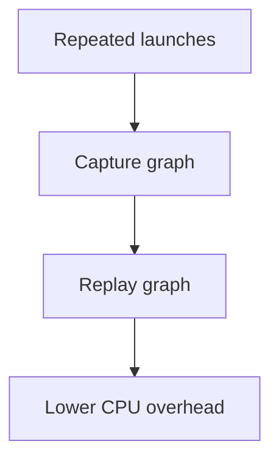

**CUDA Graph** represents operations and their dependencies separately from execution so a workflow can be instantiated once and launched repeatedly with lower CPU overhead. A graph can be built explicitly or recorded through stream capture. See [NVIDIA's CUDA Graphs guide](https://docs.nvidia.com/cuda/cuda-programming-guide/04-special-topics/cuda-graphs.html).

Decode workloads repeat similar operation graphs for small batch shapes, making capture useful. Graph replay still requires compatible tensor addresses, shapes, control flow, streams, and kernels. Dynamic shapes or unsupported operations can force eager fallback.

Graph capture improves launch efficiency, not arithmetic count. Compare graph-hit coverage and CPU gaps in profiler. Capture-size list alone does not prove requests use captured path.

**Recapture** discards or replaces captured state and records compatible execution again, often after a lifecycle event such as model initialization or weight refresh. Recapture may be correct and still expensive. Verify four separate facts: graph mode is enabled, intended shapes were captured, live batches replay those graphs, and outputs remain equivalent after weights change.

## Capture contract

Capture records operation dependencies and parameters for compatible execution. Unsupported synchronous calls, host-side decisions that require GPU results during capture, or unsupported collectives can prevent capture. CUDA also supports graph host-function, memory, and conditional nodes; allocations or callbacks aren't categorically forbidden. Serving engines can pre-capture batch sizes and pad requests to a supported size. Distinguish replay, eager fallback, recapture, and padding in telemetry.

## Diagram

## Example

vLLM captures decode graph for batch size 32, then replays it when request batch matches captured shape. Batch size 29 may use padding or eager fallback depending on runner.

## Why it matters here

Autoregressive decode launches many operations through the model's layers. Graph coverage can reduce host overhead, but dynamic sparse paths and multi-token verification shapes need explicit support.

## Related terms

- [CUDA](glossary://cuda)
- [vLLM](glossary://vllm)
- [Decode phase](glossary://decode-phase)
- [Fused kernel](glossary://fused-kernel)
