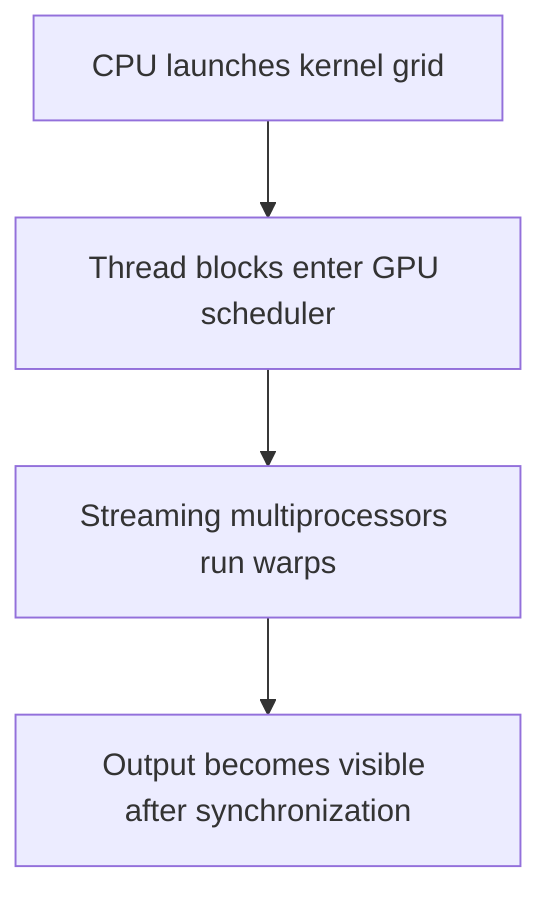

A CUDA kernel is a function launched from host code to execute across many GPU threads. The launch groups threads into blocks and groups blocks into a grid. Hardware assigns those blocks to streaming multiprocessors, where threads cooperate on operations such as matrix multiplication, attention, reduction, or data movement. In this context, a kernel is executable GPU work. Operating systems and machine-learning models use the same word for different concepts.

## Grid, block, and launch perimeter

A launch describes the number of blocks, the number of threads per block, optional shared-memory requirements, and the stream that owns the work. Each thread computes its location from block and thread indices. Blocks may execute in any scheduler-selected order, so correctness cannot depend on one block completing before an unrelated block unless a separate synchronization perimeter enforces that dependency.

Kernel launches are normally asynchronous with respect to the host. Printing or reading a result before its stream or completion event is synchronized can measure dispatch time instead of execution time. Unsupported device capability, excessive shared-memory use, incompatible tensor layout, or an earlier asynchronous failure can all surface around the launch perimeter.

## Example

An elementwise operation over 1,000 values can launch four blocks of 256 threads, creating 1,024 thread slots. Each thread computes `index = block_index * 256 + thread_index`, and threads with `index >= 1000` exit without touching memory. The GPU scheduler chooses where those four blocks run. Moving the same code to a larger input changes the grid size, not the meaning of the per-thread bounds check.

## Why it matters here

FlashAttention, FlashInfer, DeepGEMM, NCCL, and PyTorch all eventually execute GPU kernels, but they own different layers around them. Recognizing the launch perimeter separates model mathematics from scheduling, memory layout, synchronization, and architecture eligibility. It also prevents a fast microbenchmark from being mistaken for proof that the complete serving or training system is fast.

## Related terms

- [CUDA](glossary://cuda)
- [CUDA stream](glossary://cuda-stream)
- [CUDA warp](glossary://cuda-warp)
- [Streaming multiprocessor](glossary://streaming-multiprocessor)
