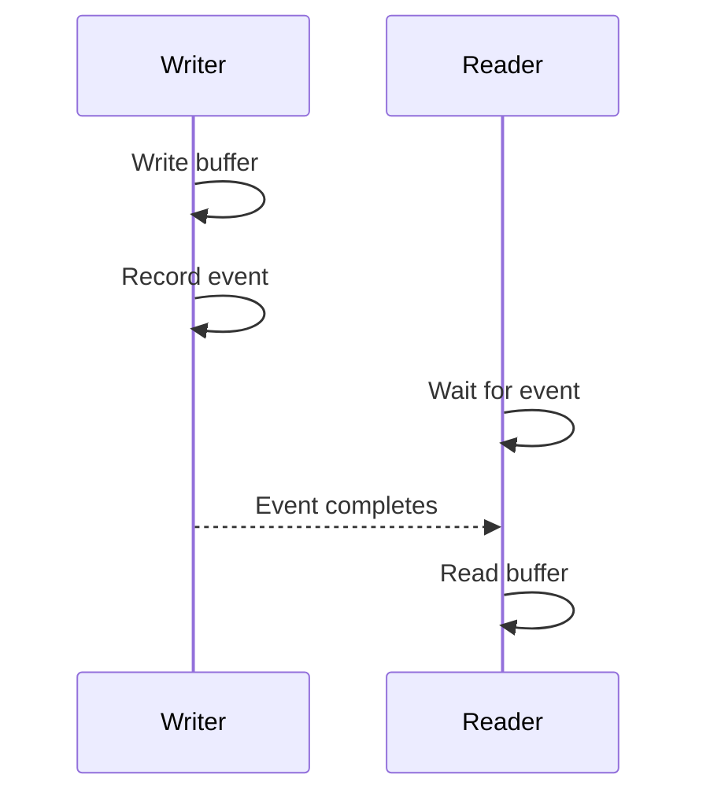

A CUDA stream is an ordered queue of GPU operations such as kernel launches, memory copies, and communication work. Operations submitted to the same stream normally execute in submission order. Different streams may overlap when dependencies and resources permit it. An asynchronous call returning signals host-side progress; use synchronizing APIs to establish GPU completion. See [NVIDIA's asynchronous execution guide](https://docs.nvidia.com/cuda/cuda-programming-guide/02-basics/asynchronous-execution.html).

## Ordering across producer and consumer streams

When one stream writes a buffer and another stream reads it, the consumer needs an explicit dependency. A CUDA event recorded after the producer's write can be waited on by the consumer stream. This preserves useful overlap without blocking the entire device. Global synchronization is safe but can remove concurrency across unrelated requests or distributed ranks.

Default-stream behavior and stream-ordered allocation add extra boundaries. An allocation freed on one stream cannot safely be reused while a different stream still references it. Some default-stream modes introduce implicit ordering, so a program that appeared correct in one configuration can race after switching to nonblocking streams.

## Example

[DeepEP V2's example](https://github.com/deepseek-ai/DeepEP) uses `ElasticBuffer.dispatch(..., async_with_compute_stream=True)` and returns received rows plus an `EventOverlap`. Launch independent computation, then call `event.current_stream_wait()` on the consumer stream before reading `recv_x`. In a hypothetical perfect overlap of a 4 ms dispatch with 3 ms of independent work, the dependent expert waits about 1 ms more. Those times are illustrative; resource contention can reduce overlap.

## Why it matters here

NCCL collectives, FlashInfer page reuse, DeepEP dispatch, model-weight synchronization, and disaggregated KV transfer all cross asynchronous execution boundaries. Stream literacy explains why a completed RPC, returned Python object, or populated pointer is insufficient readiness evidence. It also makes stale-buffer corruption and missing synchronization understandable as ownership bugs instead of mysterious model instability.

## Related terms

- [CUDA](glossary://cuda)
- [NCCL](glossary://nccl)
- [CUDA Graph](glossary://cuda-graph)
- [KV cache](glossary://kv-cache)
