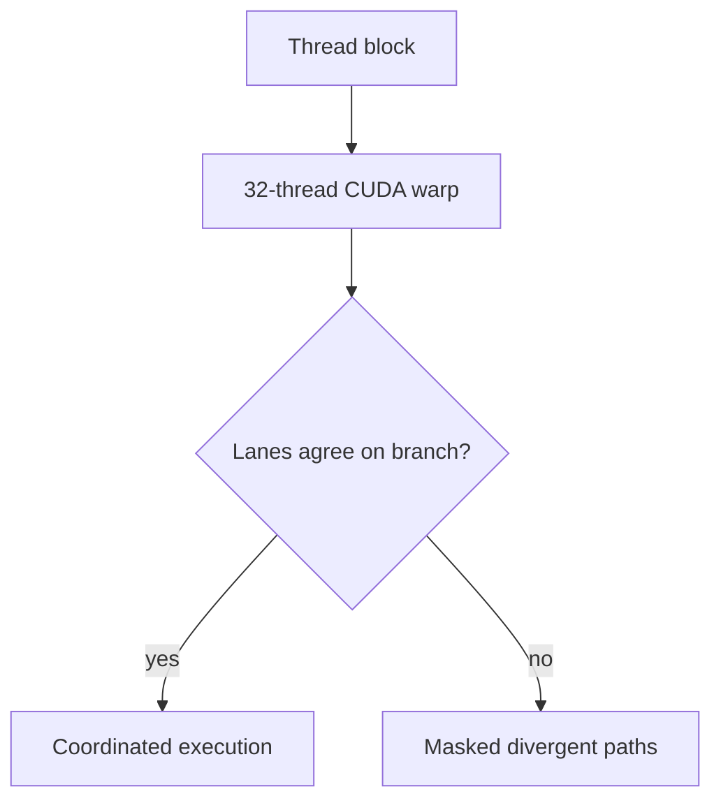

A CUDA warp is a group of 32 GPU threads scheduled together on an NVIDIA streaming multiprocessor. Threads in the same warp have their own registers and execution state, but their work is organized around shared instruction issue. When the active threads follow the same instruction path and access nearby memory, the hardware can execute and move data efficiently. Divergent branches and scattered addresses often reduce that efficiency.

## Divergence and memory access

Suppose every lane in a warp evaluates the same conditional. If some lanes take one branch while others take another, the scheduler may execute both instruction paths with different active-thread masks. That preserves correctness but leaves some lanes inactive on each path. Separate warps can independently follow different branches without creating that same within-warp divergence.

Memory layout also matters. Neighboring lanes reading neighboring values usually require fewer transactions than lanes jumping across distant locations. Attention kernels, matrix-multiplication tiles, and expert-dispatch code choose thread ownership partly to preserve useful access patterns. A warp groups 32 GPU threads for scheduling. It differs from a CPU thread and a GPU block, and branch divergence can leave some lanes inactive.

## Example

A block with 128 threads contains four warps. If one warp handles 32 adjacent BF16 values, those values occupy `32 * 2 = 64` bytes before alignment and transaction details. If the first sixteen lanes handle a valid token while the other sixteen handle padding, half the lanes may be inactive during the useful operation. Packing real tokens and selecting a better tile can improve utilization without changing the model's mathematical result.

## Why it matters here

FlashAttention and DeepGEMM discuss warp specialization, irregular request sizes, and tensor-core pipelines. Those optimizations make sense only when the reader can distinguish a warp from a block, a stream, and a multiprocessor. Warp-level reasoning also explains why equal FLOP counts can produce different measured latency when sparsity, padding, or routing causes divergent execution.

## Related terms

- [CUDA kernel](glossary://cuda-kernel)
- [Streaming multiprocessor](glossary://streaming-multiprocessor)
- [Tensor Core](glossary://tensor-core)
- [FlashAttention](glossary://flashattention)
