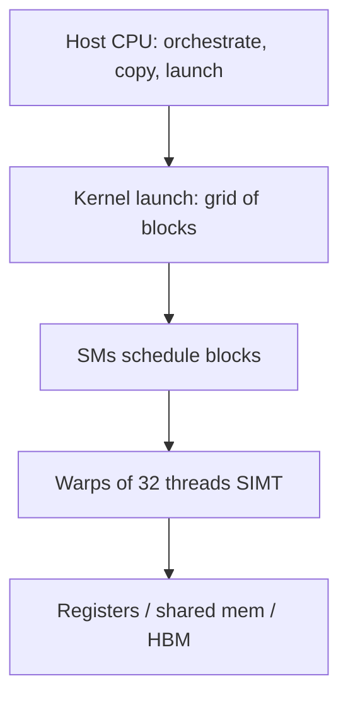

CUDA is NVIDIA's parallel computing platform and programming model for running massively parallel *kernels* on NVIDIA GPUs. The model is heterogeneous: the **host** (CPU and its memory) launches work; the **device** (GPU and its attached memory, often HBM on datacenter cards) executes many lightweight threads on that work. In ML stacks, CUDA is the device layer under frameworks such as PyTorch when tensors live on `cuda:0`.

A kernel is a function launched for execution on the GPU. Launching it starts a **grid** of **thread blocks**. Each block runs on one streaming multiprocessor (SM). Inside a block, threads are grouped into **warps** of 32 that execute under a Single-Instruction Multiple-Threads (SIMT) model: the same instruction stream, with per-thread data and optional divergence masking. High-level ML code rarely names warp ids directly, while warp size, shared memory, and memory coalescing still help explain why one matmul or attention kernel outperforms another.

## How it works



| Layer | What it is | Why ML engineers care |
| --- | --- | --- |
| Host vs device | CPU vs GPU address spaces | Every tensor has a device; accidental CPU↔GPU traffic kills throughput |
| Grid / block / thread | Software launch hierarchy | Batch, sequence, and head dims map onto this grid |
| Warp (32 threads) | Hardware scheduling unit | Divergence and uncoalesced loads waste lanes |
| SM | Hardware processor with registers, shared mem, caches | Occupancy and resource limits cap concurrent warps |
| Global memory | Device DRAM/HBM visible to all SMs | Weights, activations, KV cache live here |
| Shared memory / registers | Fast on-chip storage | Tiling (FlashAttention-style) reuses tiles before returning to HBM |

CUDA work is asynchronous from the CPU's point of view: a kernel launch or many device ops enqueue work and return. Ops on the same stream still run in order on the device, so results stay correct without an explicit host wait. Wall-clock timing without a device sync or CUDA events still measures launch overhead, not kernel time. Accidental syncs (`.item()`, printing device tensors, frequent host copies) stall the pipeline and show up as low GPU utilization.

## Example

Minimal PyTorch path onto CUDA, including the usual timing trap:

```python
import time
import torch

assert torch.cuda.is_available()
device = torch.device("cuda:0")

# Allocate on device (no host copy of this tensor's storage)
x = torch.randn(2048, 2048, device=device, dtype=torch.float16)
y = x @ x  # cuBLAS / Tensor Core path under the hood; also warms the kernel

# Wrong timing: measures enqueue + host work, not GPU finish
t0 = time.perf_counter()
_ = x @ x
ms_fake = (time.perf_counter() - t0) * 1e3

# Honest GPU timing with CUDA events
start = torch.cuda.Event(enable_timing=True)
stop = torch.cuda.Event(enable_timing=True)
start.record()
_ = x @ x
stop.record()
torch.cuda.synchronize()
ms_gpu = start.elapsed_time(stop)

print(f"host timer ~{ms_fake:.3f} ms; CUDA events {ms_gpu:.3f} ms")
```

Worked placement trap: a 7B model in BF16 is roughly $7 \times 10^9 \times 2 \approx 14$ GB of weights alone. CUDA weights and CPU inputs don't generally combine automatically: a PyTorch operation requiring one device can raise a device-mismatch error unless the application moves the input. Repeated explicit host-to-device transfers can also dominate time. PCIe Gen4 x16 has roughly 32 GB/s theoretical unidirectional bandwidth before protocol overhead; small transfers achieve much less. Keep hot-path tensors on the intended device and profile copies separately from kernels.

Attention kernels, optimizer steps, FlashAttention-style tiling, and fused norms all compile down to CUDA (or a compiler such as Triton that targets the same GPU) under the hood. Multi-GPU training adds device-to-device traffic via NVLink/PCIe and collectives (NCCL) on top of single-device CUDA.

## Debug path

1. Confirm device placement: `tensor.device`, `model.parameters()`, and dataloader outputs all on the intended `cuda:N`.
2. Separate host time from device time with `torch.cuda.Event` or Nsight; don't trust bare `time.perf_counter` around async ops.
3. Check peak memory (`torch.cuda.max_memory_allocated`) under real batch and sequence length, not toy shapes.
4. If utilization is low, look for data loading, CPU tokenization, tiny kernels, Python loops launching many small ops, or accidental syncs.
5. If utilization is high but tokens/s are poor, the kernel may be HBM-bound (low arithmetic intensity) rather than under-launched.

## Why it matters here

CUDA is the hardware execution layer behind most NVIDIA-based training and serving. LeetLLM lessons on tensors, kernels, HBM, FlashAttention, Triton, and multi-GPU collectives all sit on this model. The host launches work and SMs run warps. Real speed depends on bandwidth and occupancy as well as peak FLOPs.

## Related terms

- [GPU](glossary://gpu)
- [HBM](glossary://hbm)
- [FlashAttention](glossary://flashattention)
- [Triton language](glossary://triton-language)
- [NCCL](glossary://nccl)
