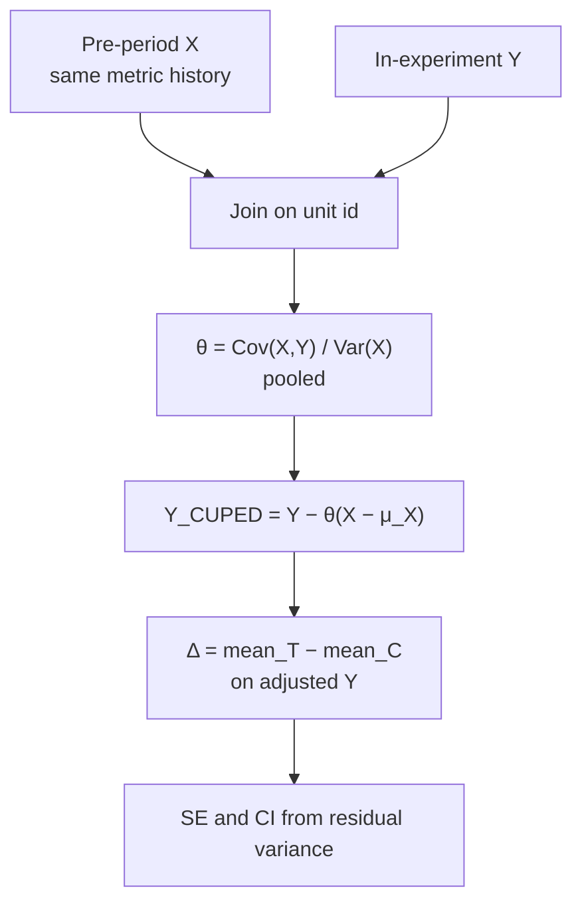

CUPED (**C**ontrolled-experiment **U**sing **P**re-**E**xperiment **D**ata; Deng, Xu, Kohavi, and Walker, 2013) is a variance-reduction method for online A/B tests. After random assignment, you adjust each unit's outcome $Y$ with a pre-assignment covariate $X$ that is correlated with $Y$ but cannot have been moved by treatment. The adjusted outcomes keep the same expected treatment effect under randomization, while residual noise drops by roughly a factor of $1-\rho^2$, where $\rho=\mathrm{Corr}(X,Y)$. That means smaller confidence intervals, higher [statistical power](glossary://statistical-power), or fewer samples for the same minimum detectable effect.

## Intuition

Most experiment noise is not pure randomness. Heavy users stay heavy, high-latency tenants stay noisy, and accounts that accepted many drafts last month tend to accept many this month. A plain difference in means spends statistical power rediscovering those stable baselines.

CUPED subtracts the predictable part of $Y$ that $X$ already explained, then compares arms on the residual. Users who were already high get pulled toward the population mean; users who were already low get pushed up. Treatment and control are adjusted with the **same** $\theta$, so the mean shift from treatment is left alone (as long as $X$ is pre-assignment). Conceptually this is the control-variate trick from Monte Carlo estimation, applied retrospectively to live experiment logs.

## Formula

For outcome $Y$ and pre-experiment covariate $X$, form the control-variate estimator of the arm mean:

$$
\hat{Y}_{\mathrm{cv}} = \bar{Y} - \theta \bar{X} + \theta\,\mathbb{E}[X]
$$

At the unit level (common production form, with $\mu_X$ estimated from the pooled sample):

$$
Y_i^{\mathrm{CUPED}} = Y_i - \theta\,(X_i - \mu_X)
$$

Any fixed $\theta$ keeps the estimator unbiased for $\mathbb{E}[Y]$ when $\mathbb{E}[X]$ is known (or cancels in a treatment-minus-control delta). The variance-minimizing choice is the OLS slope of $Y$ on $X$:

$$
\theta^* = \frac{\mathrm{Cov}(X,Y)}{\mathrm{Var}(X)}
$$

With that $\theta^*$, residual variance of the mean estimator shrinks as

$$
\mathrm{Var}(\hat{Y}_{\mathrm{cv}}) = \mathrm{Var}(\bar{Y})\,(1-\rho^2)
$$

So the treatment-control delta $\Delta_{\mathrm{cv}}$ has

$$
\mathrm{Var}(\Delta_{\mathrm{cv}}) = \mathrm{Var}(\Delta)\,(1-\rho^2)
$$

under the simplifying model where both arms share the relevant covariance structure and the same optimal slope. The exact reduction relies on those shared relationships; treatment can change the variance or the $X$–$Y$ relationship. Estimate a common slope from pooled or fixed historical data, and keep $X$ unaffected by treatment. A pre-trigger covariate is valid only if treatment couldn't affect it before that trigger.

In production you estimate $\theta$ and often $\mu_X$. The population reduction formula is a planning approximation; finite-sample variance depends on the estimator and experiment design. Use inference appropriate to the randomized unit and estimator, including clustering or delta-method treatment for ratio metrics. The [original CUPED paper](https://exp-platform.com/Documents/2013-02-CUPED-ImprovingSensitivityOfControlledExperiments.pdf) discusses these extensions.

## Diagram



## Example

You A/B test a new support-agent prompt. Assignment unit is user; primary metric $Y$ is accepted draft replies per user in a 14-day experiment window. Covariate $X$ is the same metric in the prior 14 days (strictly before each user's assignment time).

| Arm | $n$ | Raw mean $\bar{Y}$ | Pre mean $\bar{X}$ | CUPED mean |
|---|---:|---:|---:|---:|
| Control | 20{,}000 | 4.20 | 4.10 | 4.21 |
| Treatment | 20{,}000 | 4.35 | 4.12 | 4.34 |

Pooled $\mu_X = 4.11$. With $\rho = 0.70$ and $\sigma_Y \approx \sigma_X$ (same metric, similar windows), $\theta^* = \rho\,\sigma_Y/\sigma_X \approx 0.70$. Arm means then adjust as:

$$
\begin{align*}
\bar{Y}_C^{\mathrm{CUPED}} &= 4.20 - 0.70\,(4.10 - 4.11) = 4.207 \approx 4.21 \\
\bar{Y}_T^{\mathrm{CUPED}} &= 4.35 - 0.70\,(4.12 - 4.11) = 4.343 \approx 4.34
\end{align*}
$$

Raw lift $0.15$ becomes CUPED lift $\approx 0.136$. Residual variance scales by $1-\rho^2 = 0.51$, so standard errors shrink by about $\sqrt{0.51} \approx 0.71$ (roughly 29% tighter). Required $n$ scales with variance: the same MDE and power need about half the traffic, or the same traffic detects a smaller effect.

Unit-level sketch for one control user with $X_i=8$, $Y_i=9$, $\mu_X=4.11$, $\theta=0.70$:

$$
Y_i^{\mathrm{CUPED}} = 9 - 0.70\,(8 - 4.11) = 9 - 2.723 = 6.277
$$

Heavy baseline users no longer dominate the arm mean; the comparison focuses on residual change after the prompt ships.

Minimal conceptual analysis sketch:

```python
# X, Y aligned per unit; treatment in {0,1}
mu_x = X.mean()
theta = ((X - mu_x) * (Y - Y.mean())).sum() / ((X - mu_x) ** 2).sum()
y_cv = Y - theta * (X - mu_x)
# then two-sample test / CI on y_cv by treatment arm
```

In Bing production experiments, Deng et al. (2013) reported variance reductions around 45–50% on metrics such as queries-per-user and CTR when the pre-period matched the metric (often 1–2 weeks of history). Metrics with weak autocorrelation (for example, some revenue-per-user series, under 5% reduction in their report) gain little; $\rho$ near 0 means CUPED is nearly a no-op, which is safe if $X$ stayed pre-assignment.

## How it works

1. **Freeze the covariate timeline.** For each unit, define $X$ only from events before assignment (or before first trigger of the experimental feature). Post-treatment latency, answer length after launch, or ratings collected in-experiment are unsafe.
2. **Pick $X$.** Default: the same metric as $Y$ over a pre-window (often 1–2 weeks). Alternatives that still predate treatment: prior spend, baseline latency, engagement tier, or a binary "had pre-period data" flag for cold-start users.
3. **Estimate $\theta$ once** on the pooled sample (or fixed historical data). Do not refit separate slopes per arm after seeing results.
4. **Adjust and analyze.** Form $Y^{\mathrm{CUPED}}$, then run the usual two-sample test or interval on the adjusted metric. Report raw and CUPED lifts side by side.
5. **Audit coverage.** New users and cookie churn cut pre-period coverage. Stratify or indicator-code missing $X$ rather than inventing treatment-correlated fill values.

## Trade-offs

CUPED adjusts the post-assignment estimator while leaving the experiment design intact. Gains track $\rho^2$; low-correlation metrics stay noisy. Check sample ratio mismatch, sticky-assignment bugs, and peeking as separate validity concerns. Related regression adjustments (ANCOVA-style $Y \sim \text{treatment} + X$) are close cousins; CUPED's control-variate form makes the $(1-\rho^2)$ reduction explicit and is easy to bolt onto existing mean-based pipelines. Difference-in-differences with $\theta=1$ is a special case and can be suboptimal when the true slope is not 1.

## Why it matters here

AI product experiments are expensive and noisy: human acceptance, resolution, preference win rate, and long-tail prompt behavior often need large $n$ for small product-relevant lifts. Offline evals and shadow traffic gate quality; live A/B tests still decide ship/hold under real load. CUPED is a cheap way to reclaim power without inventing a new primary metric: use history you already log, keep covariates pre-assignment, and shrink intervals when users have stable baselines. Pair it with power planning, a declared MDE, and integrity checks so a tighter interval is not hiding a timeline leak in $X$.

## Related terms

- [A/B testing](glossary://ab-testing)
- [Variance](glossary://variance)
- [Statistical power](glossary://statistical-power)
- [Minimum detectable effect](glossary://minimum-detectable-effect)
- [Confidence interval](glossary://confidence-interval)
