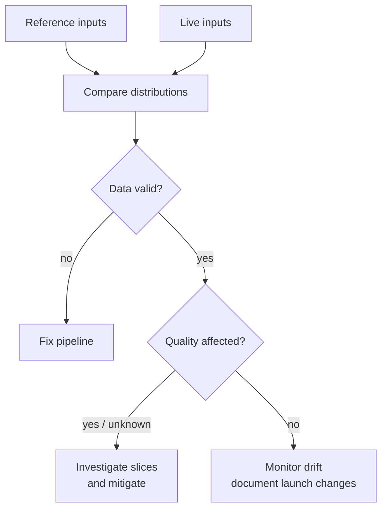

**Data drift** is a change in the distribution of model *inputs* between a reference window (training, validation, or a healthy production baseline) and the traffic the system sees later. Formally, if $X$ is the feature or prompt representation the model consumes, data drift means $P_{\mathrm{ref}}(X) \neq P_{\mathrm{live}}(X)$. The label mapping can still be stable; the world feeding the model moved.

In the classical taxonomy this is closest to **covariate shift**: $P(X)$ changes while $P(Y \mid X)$ may stay the same. That is different from [concept drift](glossary://concept-drift), where $P(Y \mid X)$ itself moves, and from **label shift**, where $P(Y)$ moves (with $P(X \mid Y)$ often treated as fixed). It's also different from [training-serving skew](glossary://training-serving-skew), which is a path mismatch (different transforms, freshness, or defaults) rather than an environmental shift over time. In practice several of these can co-occur; data drift monitoring is the early signal you can run *without* ground-truth labels.

## Intuition

A model is only as reliable as the claim "live inputs look like the data we trained and evaluated on." Data drift weakens that claim. Longer prompts, a new language mix, a shifted document source, missing fields, a product workflow change, or a sudden cohort of enterprise tenants all change $P(X)$. Labels may lag days or weeks, so distribution checks can fire before quality metrics do.

Drift is a **proxy signal** for changing inputs. Intended launches (new region, new product line) produce real drift that you *accept* after expanding eval slices. Pipeline bugs, broken joins, and [schema drift](glossary://schema-drift) also show up as distribution shifts; treat data-quality checks first, then interpret statistical drift alongside quality measures.

## Example

A ticket-routing classifier was trained on short support chats. Reference prompt-length (token count) quantiles:

| window | p50 tokens | p90 tokens | share $\ge 2{,}000$ tokens |
| --- | ---: | ---: | ---: |
| train / eval | 180 | 420 | 2% |
| last 7 days live | 310 | 3{,}600 | 18% |

Offline F1 on the old short-chat eval stays flat at $0.91$. Production escalations rise on "policy paste" tickets. Embedding neighborhoods of live prompts drift toward a long-document cluster that was rare in training. Comparing length histograms and source tags would have flagged the shift days before labels arrived.

For a single categorical feature `channel` (share of traffic):

| bin | $p_{\mathrm{ref}}$ | $p_{\mathrm{live}}$ |
| --- | ---: | ---: |
| chat | 0.70 | 0.45 |
| email | 0.25 | 0.30 |
| portal_paste | 0.05 | 0.25 |

The mass moved into a rare training bin. That is data drift even if the routing rules per channel did not change.

## Formula

For discrete bins with reference mass $e_i$ and live mass $a_i$ (both positive, summing to 1), the **Population Stability Index** (common in credit and production ML monitoring) is

$$
\mathrm{PSI} = \sum_i (a_i - e_i) \ln \frac{a_i}{e_i}.
$$

PSI sums two KL directions over the same bins: $\mathrm{PSI} = D_{\mathrm{KL}}(a \Vert e) + D_{\mathrm{KL}}(e \Vert a)$. Set operational thresholds from stable traffic and shifts with known consequences, then reuse reference bin edges. Empty bins require a declared smoothing policy and renormalization if smoothing changes total mass.

For continuous univariate features, a two-sample **Kolmogorov–Smirnov** statistic compares empirical CDFs $F_{\mathrm{ref}}$ and $F_{\mathrm{live}}$:

$$
D_{n,m} = \sup_x \bigl| F_{\mathrm{ref}}(x) - F_{\mathrm{live}}(x) \bigr|.
$$

On large production volumes, KS p-values can flag tiny shifts with little operational impact. Pair effect-size scores (PSI, Wasserstein / Earth-mover distance, Jensen–Shannon) with business thresholds.

## Worked numbers

Using the `channel` table above:

$$
\begin{align*}
\mathrm{PSI}
&= (0.45-0.70)\ln\frac{0.45}{0.70}
 + (0.30-0.25)\ln\frac{0.30}{0.25}
 + (0.25-0.05)\ln\frac{0.25}{0.05} \\
&\approx (-0.25)(-0.442)
 + (0.05)(0.182)
 + (0.20)(1.609) \\
&\approx 0.111 + 0.009 + 0.322
 = 0.442.
\end{align*}
$$

$\mathrm{PSI} \approx 0.44$ quantifies this shift under these bins. Interpret the score by checking whether `portal_paste` was an intended launch, whether quality moved on that slice, and how much the feature matters to the model.

```python
import math

ref = {"chat": 0.70, "email": 0.25, "portal_paste": 0.05}
live = {"chat": 0.45, "email": 0.30, "portal_paste": 0.25}
psi = 0.0
for k in ref:
    e, a = ref[k], live[k]  # this example has no empty bins
    psi += (a - e) * math.log(a / e)
# psi ≈ 0.442
```

## What to monitor

| Signal | Why it moves |
| --- | --- |
| Numeric features / prompt length | Cohort mix, new workflows, copy-paste docs |
| Categorical mixes (locale, channel, tenant tier) | Product launches, geo expansion |
| Missingness / null rates | Pipeline breaks, optional fields becoming required in practice |
| Embedding / text descriptor distributions | New topics, languages, junk traffic (LLM and RAG systems) |
| Corpus and ACL mix (RAG) | Index churn, deleted pages, permission changes |
| Prediction-score distribution | Often co-moves with input drift; useful when labels lag |

Separate **data quality** (nulls, range violations, type errors) from **distribution drift** of otherwise valid data. Schema and contract checks should fail closed before you debate PSI thresholds.

## Diagram



## Debug path

1. Confirm the comparison windows (same timezone, same filters, no duplicate backfill).
2. Run data-quality and schema checks first.
3. Rank drifted features by model importance or slice impact, not by p-value alone.
4. Join to quality proxies: human review rate, judge fail rate, escalation rate, offline slice metrics.
5. Attribute: launch, seasonality, pipeline bug, corpus change, or true environmental shift.
6. Respond with the smallest fix: reindex, expand [evaluation slices](glossary://evaluation-slice), add guardrails, retrain, or accept the new baseline and refresh the reference window.

Prioritize distribution changes linked to quality loss, stale evidence, policy gaps, or input shapes the model has not seen.

## Why it matters here

Production AI systems (classifiers, rankers, RAG apps, agents) live in non-stationary traffic. Data drift helps identify when yesterday's eval no longer describes today's inputs, especially when labels are late or sparse. Track drift alongside concept drift (the right answer moved), training-serving skew (the path moved), and slice-level observability together with global averages. For LLM products, watch prompt shape, language mix, retrieval corpus churn, and embedding neighborhoods with the same discipline classical ML applies to tabular features.

## Related terms

- [Concept drift](glossary://concept-drift)
- [Training-serving skew](glossary://training-serving-skew)
- [Evaluation slice](glossary://evaluation-slice)
- [Schema drift](glossary://schema-drift)
- [KL divergence](glossary://kl-divergence)
