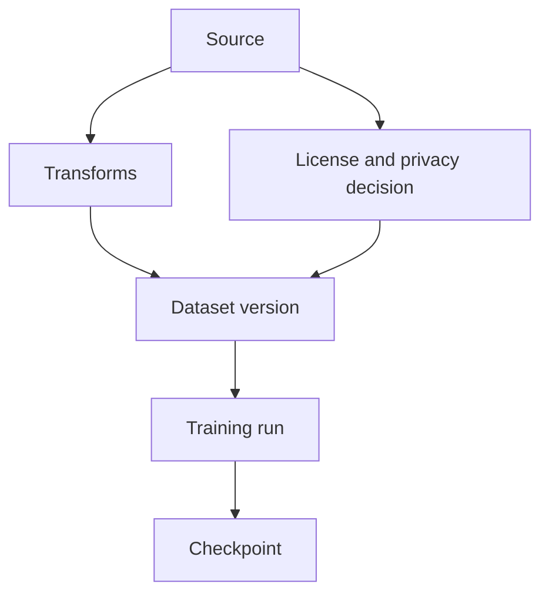

**Data governance** defines ownership, lineage, quality, access, privacy, retention, licensing, permitted use, and deletion across data lifecycle.

For model training, one row may propagate into a normalized dataset, token shard, trajectory, cache, checkpoint, and evaluation artifact. Governance tracks lineage across those derivatives alongside source-table access controls. Deleting the source row leaves derived copies and any learned influence in model weights; checkpoint handling can require retraining, validated unlearning, or a separately defined disposition policy.

## Required evidence

- Source owner, retrieval time, content hash, terms snapshot
- Declared and concluded license
- Privacy/consent basis and sensitive-data class
- Transform code/config and input/output hashes
- Train/eval restrictions and contamination scan
- Retention tier, access log, deletion path
- Approval for allowed and excluded uses

Validate lawful acquisition and permitted training use separately from license detection. Redaction after transmission leaves existing copies intact.

## Example

One telemetry archive produces normalized incidents, rollouts, reward records, and checkpoint updates. Manifest links every derivative to source terms and deletion identifier.

## Why it matters here

Model artifacts inherit data obligations. Traceable lineage is required to investigate contamination, honor deletion, review licensing, and reproduce run.

## Related terms

- [lineage](glossary://provenance)
- [Benchmark contamination](glossary://benchmark-contamination)
- [Secrets management](glossary://secrets-management)
- [AI governance](glossary://ai-governance)
