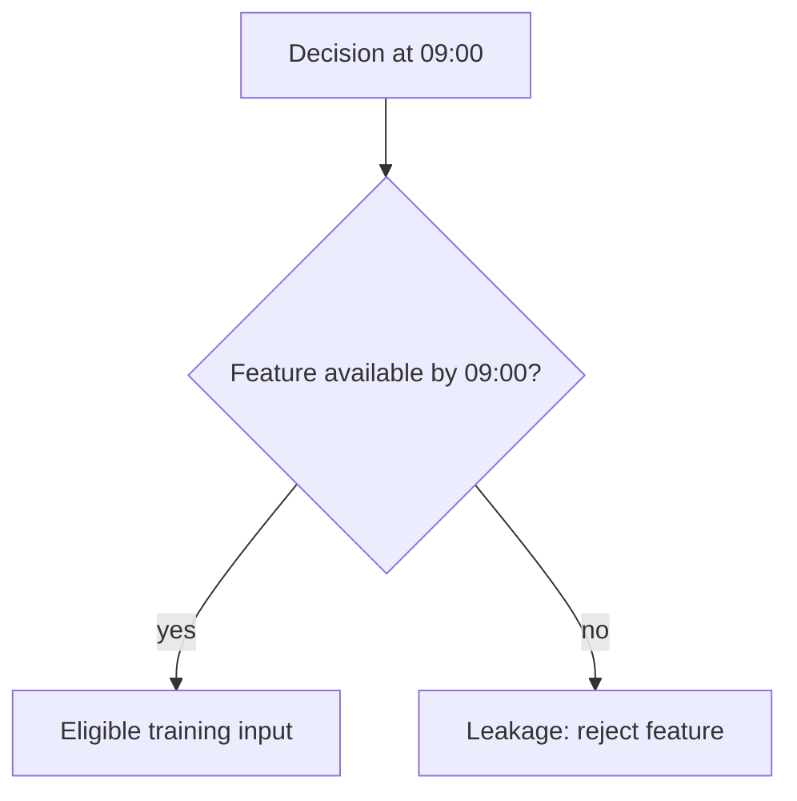

Data leakage occurs when model training or evaluation uses information that would be unavailable for the real prediction being measured. Leakage can enter through future events, target proxies, related examples split across training and evaluation, preprocessing fitted on all rows, or repeated tuning against a supposed test set. The resulting score is optimistic because the experiment gives the model an unfair informational advantage.

## Event time and availability time

A feature is valid only if the fact occurred and became available before the prediction timestamp. A purchase made yesterday but ingested tomorrow cannot be used for a decision made today. Likewise, an account appearing in both training and validation can leak identity even when every individual row has a valid timestamp. Leakage must be audited at feature, entity, transformation, and evaluation boundaries.

## Example

An access request opens at 09:00, receives manager approval at 10:22, and is audited the following week. The final ticket contains all three timestamps. A classifier built to decide at opening may use evidence already available at 09:00. Manager approval and later audit outcomes are consequences or labels, not legal input features. Including them can create excellent offline accuracy that the online router cannot reproduce.

## Why it matters here

Feature engineering, retrieval benchmarks, classifier thresholds, fine-tuning datasets, and agent evaluations can all leak through different surfaces. Honest systems freeze prediction time, preserve identity boundaries, fit transformations inside training folds, and protect a final untouched evaluation set.

## Related terms

- [Feature leakage](glossary://feature-leakage)
- [Cross-validation](glossary://cross-validation)
- [Point-in-time join](glossary://point-in-time-join)
