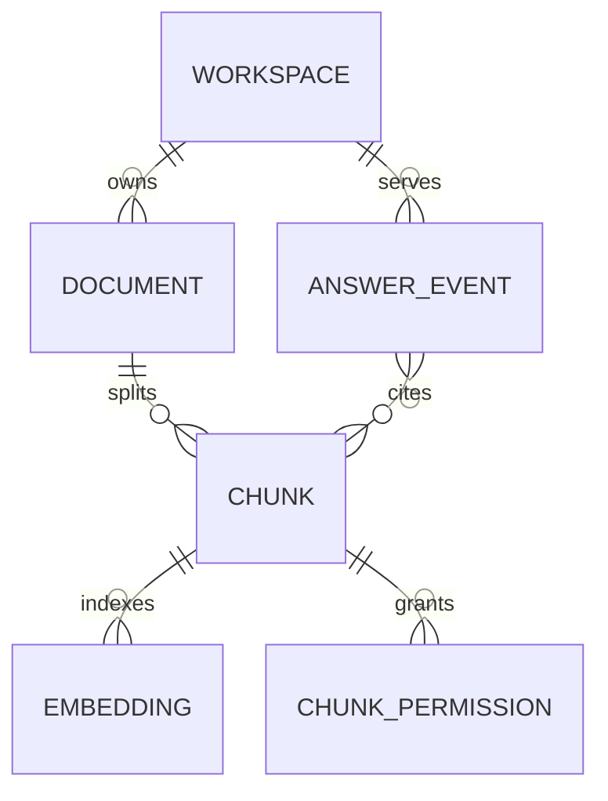

A **data model** is the explicit description of what a system stores: named entities, fields, types, relationships, keys, indexes, ownership, lifecycle states, and retention rules. It is The schema among product logic, storage, APIs, and every ML or retrieval path built on top of those rows.

In the relational tradition introduced by Edgar F. Codd (1970), data lives in tables with rows and columns; primary keys identify rows and foreign keys encode relationships so the database can enforce integrity. In AI products the same idea applies beyond classic OLTP tables: documents, chunks, embeddings, feature rows, tool-call events, labels, eval test cases, and audit logs all need stable identity and join rules, or "model behavior" becomes impossible to explain.

A schema is the blueprint (names, types, constraints). An instance is the rows present at a moment in time. The data model is the design intent behind both: what exists, who owns it, when it was true, how it joins, and what happens when it is corrected, deleted, or backfilled.

## Intuition

Loose JSON blobs feel flexible until you need point-in-time features, tenant isolation, deletion, audit, or a fair offline eval. A clear data model names those answers up front. Weak models make debugging circular: the model, the prompt, and the retriever all look plausible while the underlying rows never had a trustworthy lifecycle.

Think in four questions for every entity:

1. **Identity:** What unique key stops duplicates and makes joins safe?
2. **Truth:** Who is the source of truth, and is the row mutable or append-only history?
3. **Time:** When did the fact occur (`event_time`), when did the system learn it (`available_time`), and when may it be deleted?
4. **Access:** Which tenant, principal, or ACL may read or mutate it?

If you cannot answer those, features, citations, and agent trajectories will inherit ambiguity.

## Example

A multi-tenant support RAG product might model at least these entities:

| Entity | One row means | Key fields | Critical joins / rules |
|---|---|---|---|
| `Workspace` | one customer tenant | `workspace_id` PK | isolation perimeter for every query |
| `Document` | one source file or page set | `document_id`, `workspace_id`, `checksum`, `acl`, `ingested_at`, `deleted_at` | FK to workspace; soft delete keeps history |
| `Chunk` | one retrievable text unit | `chunk_id`, `document_id`, `ordinal`, `chunk_rule_version`, `chunk_text`, `token_count` | FK to document; unique `(document_id, ordinal)` |
| `Embedding` | one vector for one chunk + model | `chunk_id`, `embedding_model`, `dim`, `vector` | unique `(chunk_id, embedding_model)`; re-embed on model or chunk change, not in place silently |
| `Permission` | one principal allowed on one chunk | `(chunk_id, principal)` PK | deny by default; filter on every retrieve |
| `AnswerEvent` | one served answer | `answer_id`, `workspace_id`, `query`, `cited_chunk_ids[]`, `model_version`, `created_at` | citations must resolve to chunks visible at serve time |

Minimal relational sketch (PostgreSQL-style):

```sql
CREATE TABLE workspaces (
  id          TEXT PRIMARY KEY,
  name        TEXT NOT NULL
);

CREATE TABLE documents (
  id           TEXT PRIMARY KEY,
  workspace_id TEXT NOT NULL REFERENCES workspaces(id),
  title        TEXT NOT NULL,
  checksum     TEXT NOT NULL,
  acl          TEXT NOT NULL,
  ingested_at  TIMESTAMPTZ NOT NULL,
  deleted_at   TIMESTAMPTZ
);

CREATE TABLE chunks (
  id                 TEXT PRIMARY KEY,
  document_id        TEXT NOT NULL REFERENCES documents(id),
  ordinal            INT  NOT NULL,
  chunk_text         TEXT NOT NULL,
  chunk_rule_version TEXT NOT NULL,
  UNIQUE (document_id, ordinal)
);

CREATE TABLE chunk_permissions (
  chunk_id  TEXT NOT NULL REFERENCES chunks(id),
  principal TEXT NOT NULL,
  PRIMARY KEY (chunk_id, principal)
);
```

This minimal schema records document/chunk identity and current permission rows. Enforce tenant isolation through explicit access checks. Production auditing also needs immutable document revisions, parser versions, permission history, and answer events bound to the retrieved snapshot. A foreign key records a relationship; authorization checks separately decide whether a caller may read it. A coding-agent product uses analogous `Task`, `RepositorySnapshot`, `ToolCall`, `Patch`, `TestRun`, and `Submission` records.

## Entity checklist

For each entity, write down and test:

| Concern | What to specify |
|---|---|
| Owner | Team or service accountable for the table |
| Source of truth | Which write path is canonical (API, ETL, human label UI) |
| Keys | Primary key, natural uniqueness, foreign keys |
| Lifecycle | States such as `draft` / `active` / `archived` / `deleted` |
| Timestamps | `created_at`, `updated_at`, `event_time`, `available_time` as needed |
| Mutability | In-place update vs append-only version or event log |
| Retention | TTL, legal hold, hard vs soft delete, cascade rules |
| permission scope | Tenant column, ACL table, row-level policy |
| Indexes | Lookups you actually run (tenant + time, document, idempotency key) |

Then exercise the edges that whiteboards skip: deletion of a parent document, late-arriving events, backfill of corrected labels, schema migration with dual-write, and a retried write with an [idempotency](glossary://idempotency) key. Those cases reveal whether the model is durable or only clean in the happy path.

## Diagram



## Where weak models leak into ML and agents

| Weakness | What breaks |
|---|---|
| Ambiguous or missing timestamps | Future leakage in training; offline metrics that cannot match online |
| Mutable "current state" only | Lost historical truth; [point-in-time join](glossary://point-in-time-join) impossible |
| Missing owner / tenant columns | Broken [tenant isolation](glossary://tenant-isolation) and ACL filters |
| Weak or colliding IDs | Duplicate documents, impossible joins, silent double-counting |
| No retention or soft-delete fields | Compliance deletes become full-table rewrites or silent hard drops |
| Features without entity keys | [Feature store](glossary://feature-store) rows that cannot join labels or predictions |
| Chunks without document lineage | Citations that cannot be audited; RAG bugs look like "the model lied" |
| Tool calls without structured events | Agents that cannot be replayed, graded, or red-teamed |

Feature pipelines need entity keys, prediction timestamps, and availability times. Retrieval needs document ownership, chunk lineage, and permission rows. Agents need durable task and tool-call entities. Eval needs frozen [dataset records](glossary://dataset-record) keyed to the same identity scheme as production.

## Trade-offs

**Normalize for write integrity vs denormalize for read path.** Normalized tables (`document` → `chunk` → `permission`) keep one source of truth and safe cascades. Serving often needs a denormalized projection (chunk text + ACL bits + embedding metadata) for low latency. Model both: the normalized store of record and the derived index, with a versioned rebuild path when rules change.

**Mutable row vs event log.** Updating `status` in place is simple for product UIs. ML and audit usually need history: either SCD-style versions (`valid_from` / `valid_to`) or append-only events. Prefer append for labels, features, and tool trajectories.

**Rigid schema vs document blobs.** Typed columns and foreign keys catch [schema drift](glossary://schema-drift) early. Semi-structured JSON is fine *inside* a typed envelope (`payload JSONB` plus required `id`, `tenant_id`, `event_time`) so The schema still has a hard edge.

## Why it matters here

Clear data models make model behavior debuggable. They connect the abstract system diagram to rows, timestamps, permissions, and artifacts you can inspect, join, and delete safely. In the curriculum, the SQL and data-modeling foundation turns an in-memory retriever into durable tables with keys, joins, and tenant scope; production ML and LLM systems fail the same way when that schema is missing. Features, RAG, agents, and evals are only as trustworthy as the entities underneath them.

## Related terms

- [feature schemas](glossary://feature-contract)
- [lineage](glossary://provenance)
- [Point-in-time join](glossary://point-in-time-join)
- [Tenant isolation](glossary://tenant-isolation)
- [Dataset record](glossary://dataset-record)
