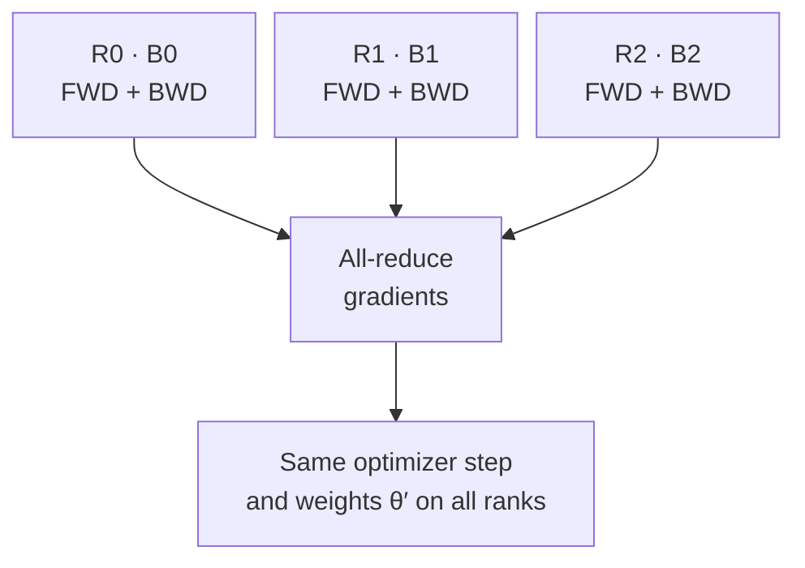

Data parallelism (DP) trains the same model on different mini-batches in parallel, then synchronizes gradients so every worker applies one consistent optimizer step. Each rank keeps (or later shards) a replica of the model, runs forward and backward on its own microbatch, and joins a collective so the averaged gradient matches what a single process would see on the combined global batch. Tensor parallelism partitions computations within layers; pipeline parallelism partitions the model's depth.

In production stacks this is the default multi-GPU path: PyTorch `DistributedDataParallel` (DDP) for full replicas, and ZeRO / FSDP when you still split batches but also partition optimizer state, gradients, or parameters so memory scales with the data-parallel group.

## Intuition

Think of $N$ identical workers, each holding the same weights $\theta$. Rank $r$ draws a disjoint microbatch $B_r$ and computes local gradients $\nabla_{\theta} \mathcal{L}(\theta; B_r)$. An all-reduce averages those gradients so every rank holds

$$
\nabla_{\mathrm{sync}} = \frac{1}{N}\sum_{r=0}^{N-1}\nabla_{\theta}\mathcal{L}(\theta; B_r)
$$

and then applies the same AdamW (or other) update. This unweighted average matches a global mean only when local losses use equal denominators. With uneven valid-token counts, scale local loss sums by the global count and the collective's averaging convention. Replicas stay identical when their initial parameters, optimizer states, and updates agree.

Tensor parallelism cuts matrices *inside* a layer. Pipeline parallelism cuts the *depth* of the stack. Data parallelism multiplies throughput (and global batch) by adding more full or sharded replicas.

## Diagram



## Formula

**Global batch size.** With per-rank microbatch $B_{\mathrm{micro}}$, gradient-accumulation steps $G_{\mathrm{accum}}$, and data-parallel degree $N$:

$$
B_{\mathrm{global}} = B_{\mathrm{micro}} \times G_{\mathrm{accum}} \times N
$$

$B_{\mathrm{global}}$ is what the optimizer "sees" per step (tokens or examples, depending how you count). Raising $N$ without changing microbatch multiplies global batch; if the learning-rate schedule was tuned for a smaller batch, validation can move even while step time improves.

**Linear scaling rule (heuristic).** For large-batch SGD-style training, a common starting rule (Goyal et al., ImageNet large-minibatch work) is to scale learning rate with batch size:

$$
\eta' \approx \eta \cdot \frac{B_{\mathrm{global}}'}{B_{\mathrm{global}}}
$$

often with a warmup so early steps stay stable. Transformers and adaptive optimizers do not always follow pure linear scaling; treat it as a calibration starting point, then measure loss curves at matched token budget.

**Replica memory (naive DDP).** Full data parallelism *replicates* parameters, gradients, and optimizer state on every rank. For a model with $P$ parameters in BF16/FP16 weights, roughly:

$$
\mathrm{mem}_{\mathrm{rank}} \approx 2P + 2P + 12P = 16P \text{ bytes}
$$

(weights + gradients + Adam moments and FP32 master weights under a common mixed-precision accounting). Adding data-parallel replicas leaves that per-rank footprint roughly unchanged. ZeRO and FSDP keep the DP *batch* split while partitioning those states, so per-rank memory can fall roughly as $1/N$.

## Example

Eight GPUs, each microbatch size $2$, gradient accumulation $4$, data-parallel degree $8$:

$$
B_{\mathrm{global}} = 2 \times 4 \times 8 = 64
$$

Each step, every rank runs four local microbatches (accumulating grads with DDP `no_sync` or equivalent), then one synchronized reduce, then one AdamW step. Throughput can approach nearly $8\times$ a single GPU if compute hides communication on a fast interconnect (NVLink, InfiniBand). On a weak Ethernet mesh, the all-reduce after backward can dominate step time and scaling stalls well below linear.

In PyTorch, the operational shape is: one process per GPU, `DistributedSampler` so ranks do not see the same samples, wrap the module in DDP, and let autograd hooks trigger NCCL all-reduce as gradients become ready (often bucketed so communication overlaps the rest of backward).

```python
# Conceptual DDP step with equal loss denominators in every microbatch
# and on every rank. Uneven token counts need count-weighted scaling.
G = len(microbatches)
with ddp.no_sync():           # accumulate without all-reduce
    for micro in microbatches[:-1]:
        (ddp(micro).mean() / G).backward()
(ddp(microbatches[-1]).mean() / G).backward()  # all-reduce here
optimizer.step()
optimizer.zero_grad(set_to_none=True)
```

## How it works

1. **Shard the dataset.** Assign intended examples to ranks and record padding or dropped tails. PyTorch's DistributedSampler can pad with duplicate indices when dataset size isn't divisible by rank count; use set_epoch for shuffled epochs and distinguish padding from accidental duplicated data.
2. **Forward and backward locally.** Same graph as single-GPU training; only the batch slice differs.
3. **Synchronize gradients.** Classic DDP uses all-reduce (sum then divide by world size). Sharded DP (ZeRO-2/3, FSDP) often uses reduce-scatter of gradients and all-gather of parameters so no rank holds full state forever.
4. **Optimizer step.** Every rank applies the same update (or each rank updates its owned shard, then parameters are gathered as needed).
5. **Optional gradient accumulation.** Accumulate local grads over several microbatches before the collective so you hit a target global batch without growing per-step activation memory as much as a single huge microbatch.

When model-parallel degrees are also set (tensor, pipeline, context), the *data-parallel group size* is total world size divided by those product factors. Global batch formulas still use that DP degree, not raw GPU count.

## Communication and scaling

DP is a communication problem as much as a FLOPs problem. After backward, you must move roughly $O(P)$ gradient bytes across the DP group (all-reduce volume is on the order of two times the parameter bytes in a ring algorithm). Bucketing, overlapping collectives with remaining backward work, and fast interconnects decide whether you scale.

| Variant | What is replicated | Main collective pattern |
| --- | --- | --- |
| Naive / DDP | Params, grads, optimizer | All-reduce on gradients |
| ZeRO-1 / distributed optimizer | Params + grads full; optimizer sharded | Reduce-scatter / all-gather around optimizer |
| ZeRO-2 / partial FSDP | Params; grads + optimizer sharded | Reduce-scatter grads |
| ZeRO-3 / full FSDP | Everything sharded | All-gather params, reduce-scatter grads |

Prefer full replication when the model fits and you want the simplest debug story. Prefer sharded DP when per-GPU memory is the wall. Prefer tensor or pipeline parallelism when a *single layer* or the *full depth* will not fit even with sharding, or when you need 3D topologies for very large jobs.

## Debug path

Check data sharding (no duplicate samples across ranks), logged $B_{\mathrm{global}}$, learning-rate scaling against the batch you actually train, gradient accumulation and `no_sync` pairing, all-reduce / reduce-scatter time versus compute, and validation parity with a single-GPU or small-world baseline at the *same* global batch. If loss only diverges when $N$ grows, suspect batch and optimizer recipe before architecture. If ranks hang, suspect mismatched collective order, uneven input lengths without a join path, or NCCL topology and timeouts.

## Why it matters here

Data parallelism is the first distributed-training pattern most LLM engineers need. Curriculum topics on FSDP, ZeRO, DeepSpeed, Megatron, and 3D parallelism all assume you can reason about global batch, gradient sync, and the memory cost of replication. In production SFT and pretraining, DP (or sharded DP) is usually the throughput knob; tensor and pipeline degrees are the fit and topology knobs layered on top.

## Related terms

- [NCCL](glossary://nccl)
- [FSDP](glossary://fsdp)
- [ZeRO](glossary://zero)
- [Tensor parallelism](glossary://tensor-parallelism)
- [Pipeline parallelism](glossary://pipeline-parallelism)
