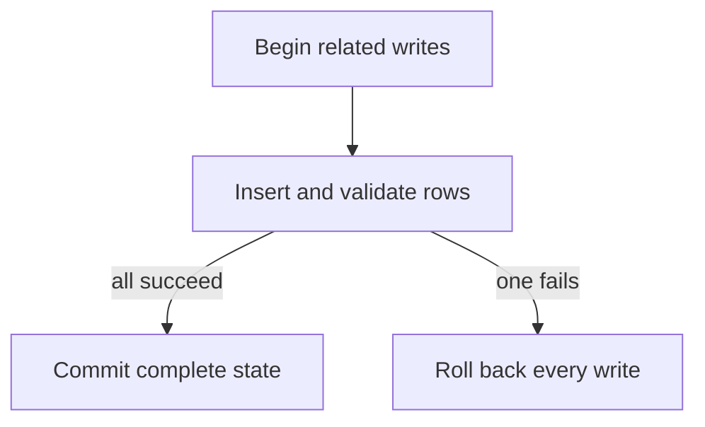

A **database transaction** groups one or more database operations into a controlled unit. Atomicity means the transaction's changes either commit together or roll back together. Isolation controls which concurrently committed changes the transaction can observe. These properties answer different questions and shouldn't be treated as interchangeable.

Suppose document ingestion inserts a source document, several chunks, permission records, and a retry marker. If the third chunk fails validation, an atomic transaction prevents the earlier document and partial chunks from becoming visible as a completed source. A later successful transaction can publish the full consistent set.

## Retry identity needs idempotency

A transaction protects one execution attempt. If it commits and the worker times out before responding, a second attempt doesn't automatically know the first succeeded. Store a unique idempotency key in the same transaction as the protected rows so a retry can detect and avoid duplicating a committed operation.



## Example

```python
with conn:
    conn.execute("INSERT INTO documents (id, title) VALUES (?, ?)", ("d7", "Policy"))
    conn.execute("INSERT INTO chunks (id, document_id) VALUES (?, ?)", ("c7", "d7"))
```

This fragment assumes a Python SQLite connection with transaction control enabled and compatible tables already created. If the second insert raises, the connection context manager rolls back the open transaction. With autocommit enabled, entering `with conn` doesn't create that transaction, so the same atomicity claim wouldn't follow. See [Python's sqlite3 documentation](https://docs.python.org/3/library/sqlite3.html#how-to-use-the-connection-context-manager).

## Why it matters here

Retrieval snapshots, permission updates, document versioning, and idempotent workers need consistent database boundaries. Atomic writes prevent incomplete committed evidence; appropriate isolation is additionally needed for consistent reads. Unique retry identity prevents duplicate committed operations within the same transactional store, not side effects in unrelated external services.

## Related terms

- [Rollback](glossary://rollback)
- [Idempotency](glossary://idempotency)
- [Foreign key](glossary://foreign-key)
- [PostgreSQL](glossary://postgresql)
