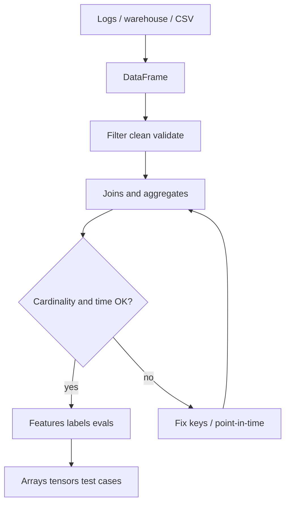

A DataFrame is a two-dimensional, labeled table: each **row** is one observation (a request, job, training example, or eval case), and each **column** is a named field with its own type. It provides table operations such as filtering, joins, grouping, aggregation, and validation before rows become features, labels, charts, tensors, or test cases.

In Python the default interface is [pandas](https://pandas.pydata.org/docs/user_guide/dsintro.html) (`pd.DataFrame`): size-mutable, potentially heterogeneous columns, with labeled row and column axes. The same *idea* appears in Polars, Spark, and Apache Arrow Tables. The libraries differ in memory layout and execution model; each still needs explicit schema, key, time, and cardinality checks.

## Intuition

A DataFrame is the workbench between raw logs and model inputs. Its strength is expressive slicing and joins on named columns. Its risk is that a one-line `merge` or filter can change meaning without raising an error: rows silently multiply, future labels leak into features, or a dtype quietly becomes `object` and breaks a later cast. ML bugs often start as a table operation that still "succeeds."

## Example

Build a small training-job table, derive a start-SLO label, then fail a join that would corrupt training cardinality:

```python
import pandas as pd

jobs = pd.DataFrame({
    "job_id": ["J1", "J2", "J3"],
    "requested_gpus": [8, 1, 4],
    "start_slo_at": pd.to_datetime(
        ["2026-03-01 12:05", "2026-03-01 13:05", "2026-03-01 14:05"]
    ),
    "started_at": pd.to_datetime(
        ["2026-03-01 12:07", "2026-03-01 13:02", "2026-03-01 14:09"]
    ),
})
jobs["missed_start_slo"] = jobs["started_at"] > jobs["start_slo_at"]
# J1 late, J2 on time, J3 late  ->  miss rate = 2/3

# Bad join: features has two rows for J1 (duplicate key)
features = pd.DataFrame({
    "job_id": ["J1", "J1", "J2", "J3"],
    "queue_backlog": [40, 55, 10, 22],
})
before = len(jobs)
joined = jobs.merge(features, on="job_id", how="left")
assert len(joined) == before, (
    f"row count {before} -> {len(joined)}; check duplicate keys"
)
```

That assert is the habit: after every join, compare row count (and unique entity count) to what the key semantics promise.

## How it works

| Piece | Role in ML work |
| --- | --- |
| Columns + dtypes | Schema surface: names, types, nulls, units |
| Rows | Examples or events; length is sample size |
| Index (pandas) | Row labels for alignment; easy to misuse as a feature |
| Keys | Join identity (`user_id`, `job_id`, `(entity, ts)`) |
| Operations | filter, select, assign, groupby, merge, pivot, resample |

pandas aligns arithmetic and many ops by **labels** (index and column names), so rows can line up across different positions. This is powerful for analysis; joins between frames with different grain can still multiply rows unexpectedly. Polars drops the multi-index model and uses Apache Arrow columnar memory with eager or lazy (query-optimized) execution; Spark DataFrames push the same table algebra across a cluster. For training you eventually export numeric blocks (`to_numpy()`, Arrow batches, or dataset loaders) into tensors. The DataFrame stage is where correctness is cheapest to check.

## Diagram



## Join and time risk

Count rows before and after every merge. Check duplicate keys on both sides. A many-to-many join can turn $n$ training rows into $n \times k$ without a warning, and metrics can look "better" only because labels were duplicated.

For supervised ML, track at least four clocks when tables meet: **event time** (when the world changed), **label time** (when the outcome is known), **feature time** (when the feature value is about), and **available time** (when the value was visible to the system). A DataFrame will happily join a 12:00 fact onto a 09:00 prediction row. Enforce point-in-time correctness in the join and filter logic by checking both event and availability time.

## Debug path

Before training or freezing an eval set, print:

1. `len(df)`, unique entity count, and primary-key uniqueness
2. Missingness per column and unexpected dtypes (`object` where you expected float/datetime)
3. Timestamp min/max and timezone consistency
4. Target distribution and class balance
5. Split membership (no entity leakage across train/val/test)

After joins, assert expected cardinality. If a metric jumps right after a merge or groupby, check for duplicated rows and leakage before attributing the change to model quality.

## Why it matters here

Almost every predictive pipeline, offline eval, and data-quality check starts as a DataFrame: inspect slices, enforce a feature schemas, build point-in-time training rows, and only then materialize arrays or test cases. Fluency with the table model (and skepticism about silent joins) is a foundation skill for feature stores, eval harnesses, and LLM offline analysis alike.

## Related terms

- [Dataset record](glossary://dataset-record)
- [feature schemas](glossary://feature-contract)
- [Point-in-time join](glossary://point-in-time-join)
- [Feature leakage](glossary://feature-leakage)
- [Schema drift](glossary://schema-drift)
