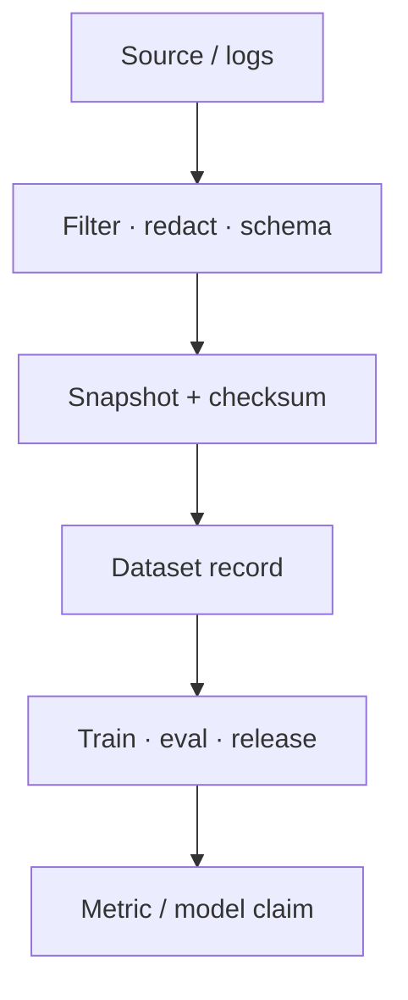

A **dataset record** is the durable identity and documentation for a concrete *dataset snapshot*: where its rows came from, how they were collected and labeled, which schema and fields they use, which version and split they are, and how sensitive content was handled. It is the log that makes a training run, offline metric, or release gate interpretable and reproducible. A single graded case is an [eval row](glossary://eval-row); the dataset record is what you pin so every case in that claim comes from the same frozen set.

A chart that says "accuracy $0.81$" is only as good as the frozen set of examples behind it. Labels get corrected, documents get re-crawled, filters tighten, PII fields disappear after privacy review, and hard slices get expanded. Without a versioned record (identity + checksum + policy), last month's number and this month's number can describe different worlds even when the model string looks unchanged.

Public documentation patterns make the same idea explicit at scale. *Datasheets for Datasets* (Gebru et al.) propose a datasheet covering motivation, composition, collection process, preprocessing, distribution, maintenance, and legal or ethical considerations so creators and consumers share a schema. Hugging Face **dataset cards** put similar metadata (license, language, size, task tags, structure, known limitations) next to loadable data. In product ML and LLM ops, a dataset record is the operational form of that schema: short enough to attach to a run, strict enough that two teams cannot mean different rows when they say "the support eval."

## Intuition

Think of three layers that often get collapsed into one filename:

| Layer | What it answers | Example |
| --- | --- | --- |
| **Corpus / source** | Where raw material came from | Zendesk export, PDF dump, red-team log |
| **Dataset version** | Which cleaned, labeled, filtered snapshot | `support-triage-v7` |
| **Split / slice** | Which subset was used for a claim | `eval_hard_v3`, train vs holdout |

The dataset record binds those layers to hashes, owners, and policies. lineage is the paper trail of transformations; the record is the named artifact you pin in experiment metadata, eval harness config, and release packages.

## Example

An offline eval for support-ticket triage reports macro-F1 $= 0.81$ on $400$ tickets. The attached dataset record might look like:

```python
dataset_record = {
    "dataset_id": "support-triage-v7",
    "split": "eval_hard_v3",
    "n_rows": 400,
    "source": "zendesk_export_2026-03-12",
    "content_sha256": "sha256:9f2a…",  # frozen normalized rows
    "schema": ["ticket_id", "subject", "body_redacted", "label", "lang"],
    "label_policy": "guidelines-2026-02",
    "labeling": {
        "annotators": 2,
        "adjudication": "second_reviewer_on_disagreement",
        "label_set": ["billing", "access", "bug", "other"],
    },
    "exclusions": ["internal_tickets", "unredacted_pii"],
    "sensitive_fields": {"body": "redacted", "email": "dropped"},
    "license": "internal-eval-only",
    "collected_at": "2026-03-12",
    "owner": "support-ml",
    "retention_days": 90,
    "caveats": [
        "Spanish under-sampled (~8% of rows)",
        "access policy changed 2026-03-01; older labels may lag",
    ],
    # AI-eval extras
    "test cases": "fixture_ids@v3",
    "prompt_version": None,          # model under test, not baked in
    "judge_version": "rubric-f1-v2", # if graded by a judge
}
```

Two runs that both claim F1 on "the support eval" but point at different `dataset_id`, checksum, or exclusion counts are not comparable. If F1 drops from $0.81$ to $0.74$, diff the records first: a quietly expanded hard slice (e.g. $400 \to 520$ rows after adding denied-access requests) can move the chart without any model change.

Curriculum-style release packaging keeps the same idea next to a system card. A promotion-assistant gate might require both:

- **System card:** model version, policy version, tools, tests, rollback owner.
- **Dataset record:** attack test cases, benign examples, lineage, labeling guide, sensitive-field handling, frozen evaluation split, retention rule.

A complete system card with a missing dataset record still leaves reviewers unable to replay or audit the score.

## What to pin

Minimum identity for any serious claim:

1. **Stable id + version** (`dataset_id`, semantic or content version).
2. **Split name** and **row count** (and slice definitions if slices are first-class).
3. **Content digest** (SHA-256 or equivalent) over the frozen, normalized bytes you actually scored or trained on.
4. **Schema** (field names, types, required fields) and **label policy** id.
5. **Source and collection window** (export name, URI, time range).
6. **Exclusions, sensitive-field handling, license, owner, retention, known caveats.**

For LLM evals and RAG, also pin case IDs, any retrieval corpus version used to build the set, prompt or chat-template version if the dataset embeds prompts, and judge or rubric version if grading is model-mediated. For training sets, record split construction (user-level, time-based, document-level) so leakage is inspectable later.

Checksums answer "same bytes?"; the record answers "same documented snapshot?" by pairing the digest with the recipe that produced those bytes (parser version, redaction, filters). Hash raw exports when download integrity matters; hash normalized tables when the post-processed snapshot is the artifact you ship.

## Diagram



Link each claim to `rec` so its rows, labels, and exclusions remain auditable as the dataset changes.

## When a metric moves

Compare dataset records before retraining or blaming the model:

- Diff `dataset_id`, split, `n_rows`, and content checksum.
- Diff exclusion counts and slice membership definitions.
- Diff label policy / adjudication rules and judge version.
- Confirm the harness loaded the pinned revision, not `latest`.

A model regression and a quietly expanded hard slice can produce the same chart. Dataset records turn that ambiguity into a short checklist.

## Why it matters here

Evaluation, lineage, privacy review, and reproducibility meet in one artifact. Dataset records keep golden sets, evaluation slices, and training snapshots inspectable over time so AI metrics, release gates, and training claims stay comparable instead of becoming folklore attached to a path on disk.

## Related terms

- [Evaluation slice](glossary://evaluation-slice)
- [Golden dataset](glossary://golden-dataset)
- [lineage](glossary://provenance)
- [Checksum](glossary://checksum)
- [Eval row](glossary://eval-row)
