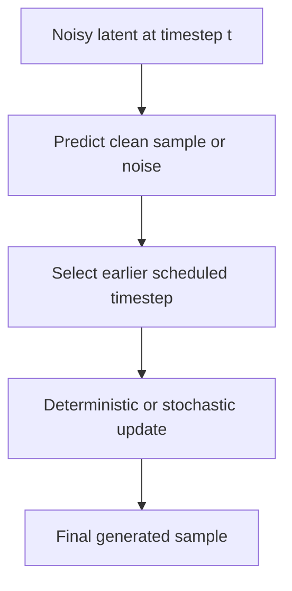

A denoising diffusion implicit model (DDIM) is a family of sampling procedures that can reuse a diffusion model's training objective while choosing different reverse trajectories from the standard stochastic DDPM chain. A commonly used configuration takes deterministic steps and skips selected training timesteps, reducing the number of denoiser evaluations needed to generate an image. Deterministic means the configured trajectory introduces no additional sampling noise; hardware, model versions, and numeric kernels can still produce different results.

## Skipped timesteps and deterministic trajectories

At each selected timestep, the model predicts information about the current noisy sample. The scheduler estimates the underlying clean sample, then projects it onto the next chosen timestep. An optional noise parameter controls whether extra randomness is injected. Setting that parameter to zero produces the familiar deterministic DDIM trajectory for fixed inputs, model, schedule, and arithmetic behavior.

Fewer steps reduce compute but can also change quality, texture, and prompt adherence. The correct comparison keeps the checkpoint, prompt, resolution, guidance method, hardware, and evaluation protocol fixed while varying the schedule.

## Example

Assume a model was trained with 1,000 noise levels. A DDIM-style inference schedule might visit 50 selected levels instead of all 1,000. With ordinary classifier-free guidance, those 50 sampling steps still require 100 conditional and unconditional branch evaluations. A retry that restores the same latent, selected timestep, model revision, scheduler parameters, and deterministic setting can follow the same mathematical trajectory; changing guidance scale changes the trajectory immediately.

## Why it matters here

The image-generation capstone must size worker capacity in denoiser evaluations and preserve enough state to explain or reproduce a generated asset. DDIM makes the tradeoff between preview speed and final quality explicit. It also distinguishes deterministic scheduler configuration from the stronger operational claim that a distributed deployment will reproduce bit-identical output after a restart.

## Related terms

- [DDPM](glossary://ddpm)
- [Diffusion scheduler](glossary://diffusion-scheduler)
- [Classifier-free guidance](glossary://classifier-free-guidance)
- [Inference scheduler](glossary://inference-scheduler)
