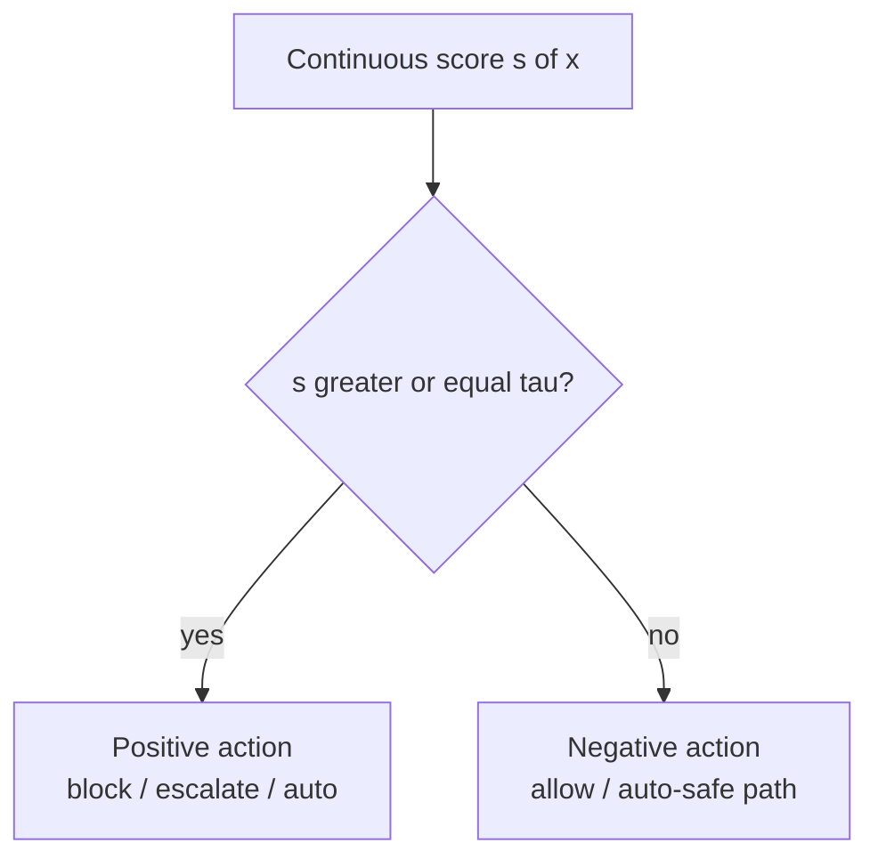

A **decision threshold** is a cutoff that turns a continuous model score into a discrete product action or class label. The model can keep the same weights while product behavior changes when you move the cutoff. Classification has two stages: learn scores (ideally probabilities), then choose actions from those scores. The threshold is the second stage.

For a binary score $s(x)$ (for example $P(y=1 \mid x)$ or a raw decision margin), a hard rule is:

$$
\hat{y}(x) =
\begin{cases}
1 & \text{if } s(x) \ge \tau \\
0 & \text{otherwise}
\end{cases}
$$

The operating point $\tau$ is configuration with production impact. Version it, review it, and roll it out like a deploy.

## Intuition

Scores live on a continuum; product decisions do not. "Block," "escalate," "auto-reply," "charge," and "abstain" each need a line in the sand. Moving that line rebalances false positives and false negatives without retraining. A threshold of $0.5$ is optimal for a calibrated deployment probability under equal error costs and no other constraints. Balanced class counts are not required: prevalence is already included in that posterior probability. A raw margin's conventional cutoff of $0$ has no universal cost interpretation.

Think of the score as ranking risk and the threshold as capacity and cost policy. The ROC or precision-recall curve shows every achievable trade-off; shipping chooses one point on that curve (or a small set of points for multi-action policies).

## Formula

On a fixed labeled set, each $\tau$ induces a [confusion matrix](glossary://confusion-matrix) with counts $\mathrm{TP}(\tau)$, $\mathrm{FP}(\tau)$, $\mathrm{FN}(\tau)$, $\mathrm{TN}(\tau)$. [Precision and recall](glossary://precision-recall) at that point:

$$
\mathrm{precision}(\tau)=\frac{\mathrm{TP}(\tau)}{\mathrm{TP}(\tau)+\mathrm{FP}(\tau)},
\qquad
\mathrm{recall}(\tau)=\frac{\mathrm{TP}(\tau)}{\mathrm{TP}(\tau)+\mathrm{FN}(\tau)}.
$$

On a fixed labeled set, raising $\tau$ cannot increase recall or the number of false positives. Precision can move either way, depending on which cases leave the predicted-positive set; it is undefined when that set is empty. For asymmetric costs $c_{\mathrm{FP}}$ and $c_{\mathrm{FN}}$ (correct predictions treated as free), a common objective is total validation misclassification cost:

$$
\mathrm{Cost}(\tau)
=
c_{\mathrm{FP}}\,\mathrm{FP}(\tau)
+
c_{\mathrm{FN}}\,\mathrm{FN}(\tau).
$$

Pick $\tau^{*}$ that minimizes $\mathrm{Cost}(\tau)$ on a validation set that matches production slices, or that hits a hard constraint (for example recall $\ge 0.95$ at minimum false-positive load).

If $s(x)$ is a well-calibrated probability of the positive class, a Bayes decision rule under constant costs predicts positive when:

$$
s(x) \;\ge\; \tau^{*}
=
\frac{c_{\mathrm{FP}}}{c_{\mathrm{FP}}+c_{\mathrm{FN}}}.
$$

Example: if a missed fraud case costs $9\times$ a false block, then $\tau^{*} = 1/(1+9)=0.1$. Use this as a probability threshold when scores are calibrated; raw logits need calibration or empirical tuning. When scores only rank, treat $\tau$ as a rank cutoff and re-tune after any score shift (new model, calibration map, traffic mix).

## Example

A support risk classifier emits $p \in [0,1]$. Policy:

- $p \ge 0.35$: human review queue
- $p < 0.35$: guarded automated workflow

On a week of 10,000 tickets, $\tau = 0.35$ might send 1,200 to review and miss 40 high-risk cases. Raising to $0.55$ might drop review load to 600 but miss 95 high-risk cases. Both changes move the operating point; compare quality under matched data and product costs to decide whether behavior improved. Capacity (review seats) and miss cost jointly choose $\tau$.

```python
import numpy as np

def apply_threshold(scores: np.ndarray, tau: float) -> np.ndarray:
    """Binary decisions from scores. scores: P(positive) or ranked risk."""
    return (scores >= tau).astype(int)

# Nonempty, aligned 1-D arrays: finite scores and labels in {0, 1}.
def best_threshold(scores, labels, c_fp=1.0, c_fn=1.0):
    # Unique scores cover all nonempty positive sets; inf covers predict-none.
    candidates = np.append(np.unique(scores), np.inf)
    best_tau, best_cost = 0.5, float("inf")
    for tau in candidates:
        pred = scores >= tau
        fp = np.sum((pred == 1) & (labels == 0))
        fn = np.sum((pred == 0) & (labels == 1))
        cost = c_fp * fp + c_fn * fn
        if cost < best_cost:
            best_cost, best_tau = cost, float(tau)
    return best_tau, best_cost
```

## Worked numbers

Suppose validation has 1,000 cases with **100 actual positives** (prevalence $10\%$), and costs $c_{\mathrm{FP}}=1$, $c_{\mathrm{FN}}=5$ (misses are five times worse than false alarms). True positives at a threshold are $\mathrm{TP}=100-\mathrm{FN}$, not the prevalence itself.

| $\tau$ | FP | FN | Cost $=1\cdot\mathrm{FP}+5\cdot\mathrm{FN}$ | Precision | Recall |
|--------|----|----|---------------------------------------------|-----------|--------|
| 0.80   | 10 | 40 | $10+200=210$                                | $60/70\approx0.86$ | $0.60$ |
| 0.50   | 40 | 20 | $40+100=140$                                | $80/120\approx0.67$ | $0.80$ |
| 0.30   | 90 | 8  | $90+40=130$                                 | $92/182\approx0.51$ | $0.92$ |
| 0.20   | 140| 4  | $140+20=160$                                | $96/236\approx0.41$ | $0.96$ |

Under this cost matrix, among the rows shown, $\tau\approx 0.30$ beats the default $0.50$. F1 would prefer a different point; product cost picks the row you ship. If the false-positive budget is 50, constrain the sweep to $\mathrm{FP}\le 50$ and take the lowest cost among feasible $\tau$. Actual review capacity constrains all alerts, $\mathrm{TP}+\mathrm{FP}$, rather than false positives alone. If scores are well calibrated, the constant-cost Bayes bar would be $\tau^{*}=1/(1+5)\approx0.17$; the table is an empirical sweep on finite validation counts, which can land nearby but not exactly there.

## Diagram



Multi-action products often use **bands**, not one cut: high $\tau_h$ for auto-block, mid band for human review, low for allow. That is still threshold policy; it just maps intervals of $s$ to actions.

## How to set and operate it

1. **Freeze ranking quality first.** Compare models with ROC-AUC or PR-AUC; then choose $\tau$ on a fixed score pipeline.
2. **Define the utility.** Cost matrix, capacity limits, declared minimum recall, or max false-positive rate. Do not maximize F1 by default if F1 ignores asymmetric cost.
3. **Tune on held-out data only.** Never fit $\tau$ on the final test set. Prefer a validation slice that matches production traffic, or cross-validated threshold search after the model is trained (post-hoc threshold tuning).
4. **Check calibration.** Calibrated probabilities make cost-based $\tau^{*} = c_{\mathrm{FP}}/(c_{\mathrm{FP}}+c_{\mathrm{FN}})$ meaningful. With uncalibrated scores, tune a rank threshold empirically and avoid interpreting its numeric value as a probability budget.
5. **Slice.** Global $\tau$ often fails when risk differs by language, tenant, channel, or label quality. Store slice overrides with the base threshold.
6. **Ship as config.** Persist model version, feature version, threshold version, slice map, and rollout state together. Canary a threshold change the same way you canary a model.

## Trade-offs

| Move | Typical effect | When you accept it |
|------|----------------|--------------------|
| Lower $\tau$ | Higher recall, more false positives, more human or block load | Misses are expensive (fraud, safety, medical triage) |
| Raise $\tau$ | Nonincreasing recall and alert load; precision may improve | False alarms are expensive (automatic rollbacks, aggressive blocks) |
| Default $0.5$ | Equal-cost Bayes rule for calibrated probabilities | Equal error costs and no capacity constraint |
| Single global $\tau$ | Easy ops | Breaks under heterogeneous risk or capacity |
| Bands / abstain gap | Extra path for uncertain scores | Review budget exists; abstention is allowed |

After major drift, a new calibration map, or a model swap, the old $\tau$ is stale even if ROC-AUC looks similar. Re-sweep costs on fresh labeled traffic.

## Why it matters here

Thresholds are how ML and LLM scores become product decisions. Safety classifiers, policy gates, retrieval confidence cuts, eval gates, and abstention policies all pick operating points. Teaching the threshold as separate from the model makes two habits stick: you can change production behavior without retraining, and you must measure precision, recall, cost, and capacity at the point you actually ship, alongside aggregate ranking metrics.

## Related terms

- [Confusion matrix](glossary://confusion-matrix)
- [Precision and recall](glossary://precision-recall)
- [Probability calibration](glossary://probability-calibration)
- [ROC-AUC](glossary://roc-auc)
- [Abstention](glossary://abstention)
