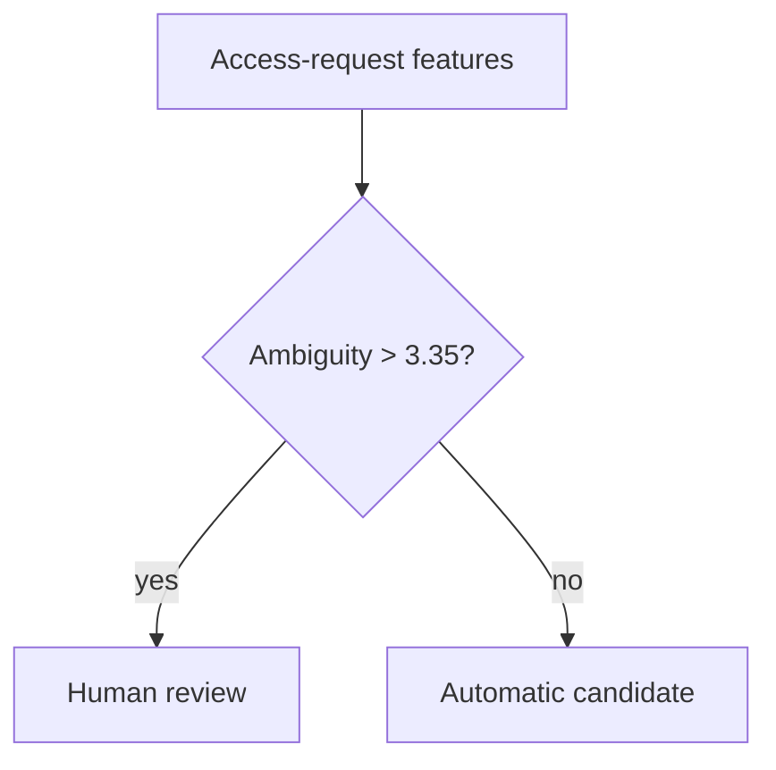

A decision tree predicts an outcome by routing each example through a sequence of feature-based tests. Every internal node chooses a split, every edge represents an outcome of that test, and every leaf stores a prediction. For numeric features, ordinary classification trees commonly ask whether a value is below a learned threshold.

## Splits and generalization

A classification tree chooses splits that reduce class impurity, often measured with Gini impurity or entropy. A regression tree usually minimizes squared error within its leaves. Repeated axis-aligned splits can model nonlinear decision regions and feature interactions without requiring feature standardization. Excessive depth can isolate individual training rows, yielding perfect training accuracy and poor performance on held-out examples.

## Example

Eight access requests contain an ambiguity score and a binary review label. Splitting at ambiguity 3.35 sends three review-required requests to a pure right leaf and five requests to a left leaf containing one missed review. The left leaf predicts review probability $1/5=0.20$; the right leaf predicts $3/3=1.0$. Whether to review a 0.20-score request depends on the cost of mistakes, not on the tree alone.

## Why it matters here

Decision trees make classification boundaries, overfitting, missing-value policies, and feature attribution visible on small tables. Random forests and gradient boosting build directly on the same split-and-leaf machinery, so understanding one tree is necessary before diagnosing production tree ensembles.

## Related terms

- [Gini impurity](glossary://gini-impurity)
- [Random forest](glossary://random-forest)
- [Gradient boosting](glossary://gradient-boosting)
