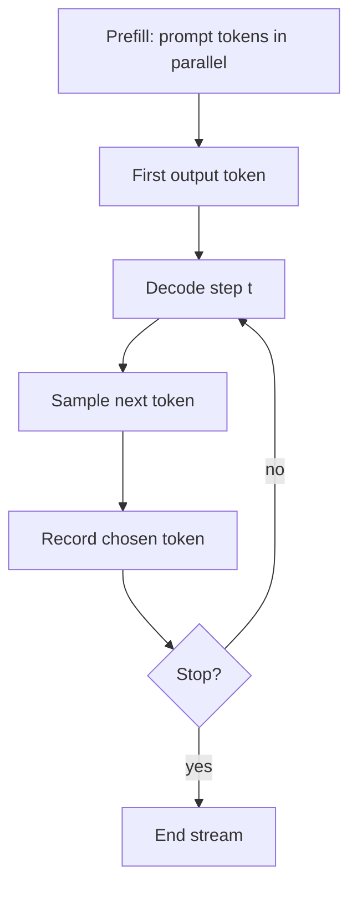

The **decode phase** is the autoregressive serving stage after [prefill](glossary://prefill): the model generates output tokens one at a time, conditioning each new token on the prompt and every token already produced. Prefill processes the full prompt largely in parallel and builds initial state (including the [KV cache](glossary://kv-cache) for the prompt). Decode is the sequential loop that follows until a stop condition.

Each decode step typically does four things:

1. Take the last chosen token (or its embedding) as the only new input position.
2. Compute that position's keys and values, append them to the KV cache.
3. Run attention of the new query against the full cached history, then the rest of the transformer layers.
4. Turn logits into one next token (greedy, temperature sampling, top-$k$/top-$p$, or a constrained decoder) and stream it if the API streams.

Without a KV cache, every step would re-run the full forward pass over the whole prefix (projections, attention, and MLPs for every prior position). With a cache, the step still pays weight loads and attention over growing context, but it only materializes the new position and reuses stored $K$/$V$.

## Diagram

## How it works

Decoder-only LLMs generate by factorizing the sequence left to right. After the prompt is in the cache, step $t$ predicts $x_t$ from $x_{<t}$ only. In conventional single-token decoding, the input to step $t+1$ is the choice made at step $t$. Speculative decoding can propose and verify several candidates together while preserving the target distribution's causal dependency. A newly sampled token gets its own cached keys and values when it is processed by the next forward pass.

On modern GPUs the two phases have different hardware shapes (NVIDIA inference guides and serving literature describe this split consistently):

| Phase | Work shape | Typical bottleneck (low concurrency) | User metric |
|-------|------------|--------------------------------------|-------------|
| Prefill | Large matrix-matrix work over $N$ prompt tokens | Often compute-bound (FLOPs) | [TTFT](glossary://ttft) |
| Decode | Near matrix-vector work for 1 new token (or small batch) | Often memory-bandwidth bound | [TPOT](glossary://tpot) / [ITL](glossary://itl) |

**Why decode is often memory-bound.** For a small effective batch, each linear layer streams a large weight matrix to produce a thin activation. Arithmetic intensity (FLOPs per byte moved from HBM) is low: the chip spends much of the step waiting on bandwidth rather than saturating tensor cores. Growing KV traffic adds another read path each step. Batching many concurrent decode streams raises intensity and aggregate [tokens per second](glossary://tokens-per-second), which is why [continuous batching](glossary://continuous-batching) exists.

**What stops the loop.** EOS token, `max_tokens`, stop strings, client cancel, or policy abort. Streaming APIs ship tokens as steps complete because the algorithm is already sequential.

## Example

In a hypothetical timing trace, a chat request has a 2,000-token prompt. Prefill finishes in about 120 ms and the first answer token appears (TTFT includes queueing and prefill). The model then streams 400 more tokens at roughly 25 ms each:

$$
T_{\mathrm{decode}} \approx 400 \times 25\,\mathrm{ms} = 10\,\mathrm{s}
$$

Decode wall time dominates even though first token was relatively fast. Raising `max_tokens` from 200 to 800 roughly multiplies the decode budget by four for long answers; shortening the prompt mainly helps TTFT, not that $10\,\mathrm{s}$ stream (unless shorter context also shrinks per-step attention cost).

Under concurrent load the same request may see ITL spikes when the scheduler admits heavy prefills into the batch: other users' prompts can stall your stream even if your own decode math is cheap.

## What drives decode cost

- **Output length:** one model step per new token per sequence (before speculative tricks).
- **KV cache size and bandwidth:** sequence length $\times$ layers $\times$ KV heads $\times$ head dim; GQA/MQA shrink KV bytes and help bandwidth.
- **Active batch:** more concurrent decode sequences improve GPU occupancy and aggregate TPS, but can raise per-user TPOT.
- **Scheduler policy:** continuous batching, chunked prefill, and prefill-first vs decode-friendly scheduling trade TTFT against smooth ITL.
- **Sampling and constraints:** top-$p$, grammars, and tool-call structure add CPU/GPU work after logits; usually smaller than the forward pass, but not free at huge vocabularies or tight schemas.
- **Optimizations aimed at the loop:** PagedAttention-style cache management, weight/KV quantization, speculative decoding (draft-verify to skip some serial target steps), and prefill-decode disaggregation (separate GPU pools so long prefills do not interrupt decode cadence).

## Debug path

Split request time into queue, prefill, first token (TTFT), repeated decode gaps, and stream flush. Bucket by output length and concurrent sequences.

| Symptom | Likely owner |
|---------|----------------|
| Long silence, then smooth stream | Prefill, queue, or long prompt |
| Fast first token, slow or choppy stream | Decode batch size, KV pressure, prefill interruptions |
| Total latency linear in output length | Decode dominates; check TPOT and max tokens |
| Aggregate TPS high, users still unhappy | Per-request TPOT/ITL vs fleet throughput |

Track tokens per second for capacity and TPOT/ITL for stream rhythm. If p95 ITL spikes while TTFT is stable, inspect decode occupancy, KV allocation, and whether prefills are starving decode steps.

## Why it matters here

Decode behavior shapes generation throughput, streaming UX, and output-token cost. It is where KV-cache reuse, batching policy, memory bandwidth, and sampling choices turn into inter-token latency. Curriculum lessons on TTFT vs TPS, continuous batching, and inference optimization all hang on this phase split: prefill answers "when does the first token arrive?"; decode answers "how fast does the rest of the answer move?"

## Related terms

- [Prefill](glossary://prefill)
- [KV cache](glossary://kv-cache)
- [Continuous batching](glossary://continuous-batching)
- [TPOT](glossary://tpot)
- [Arithmetic intensity](glossary://arithmetic-intensity)
