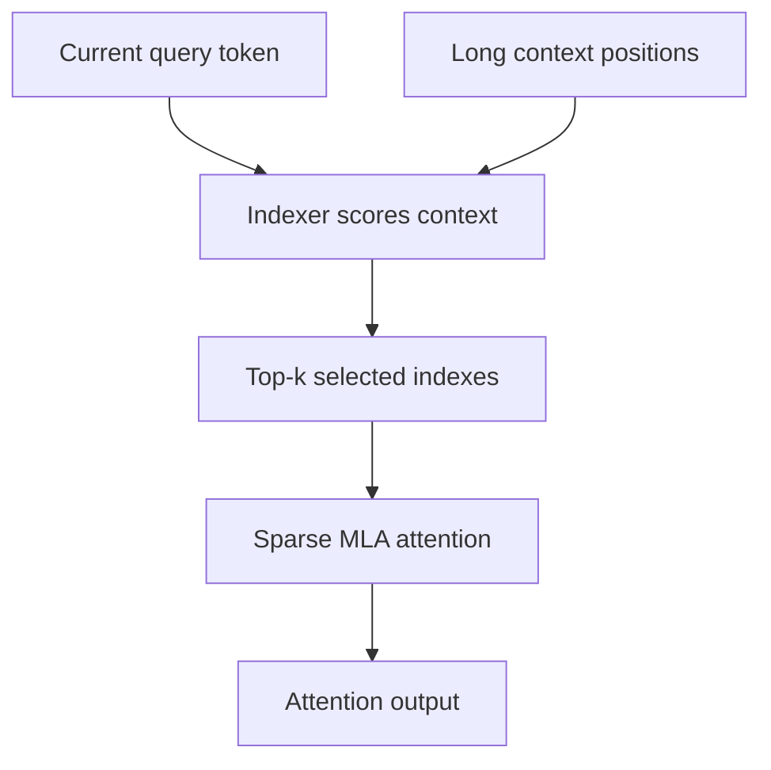

**DeepSeek Sparse Attention (DSA)** is a content-dependent sparse-attention design that uses an indexer to select a limited set of relevant past positions, then runs attention over that subset instead of every token in the full context.

DSA selects positions per query using learned indexer scores, so the selected set can change with query content. The discrete top-k operation's speed and determinism matter, especially when rollout and training stacks use different kernels or precisions.

## Selection before attention

The indexer scores candidate context positions, chooses top-k indexes, and passes those indexes to sparse MLA attention. Storage and compute remain separate questions: MLA compresses context state, while DSA limits how many positions participate in attention.

## Diagram

## Example

GLM-5.3 selects up to 2,048 positions, as specified by `index_topk` in its [official model configuration](https://huggingface.co/zai-org/GLM-5.3/blob/main/config.json). For a hypothetical 100,000-token context, the main sparse-attention operation can use roughly two percent of available positions. The indexer still performs selection work, and other attention-related operations may process additional positions.

## Why it matters here

DSA sits in both trainer and rollout critical paths, but TileLang and FlashInfer may implement those paths differently. Deterministic top-k and CP-aware global selection protect rollout-to-learner parity.

## Related terms

- [Multi-head latent attention](glossary://multi-head-latent-attention)
- [Top-k](glossary://top-k)
- [IndexShare](glossary://indexshare)
- [Context parallelism](glossary://context-parallelism)
- [FlashInfer](glossary://flashinfer)
