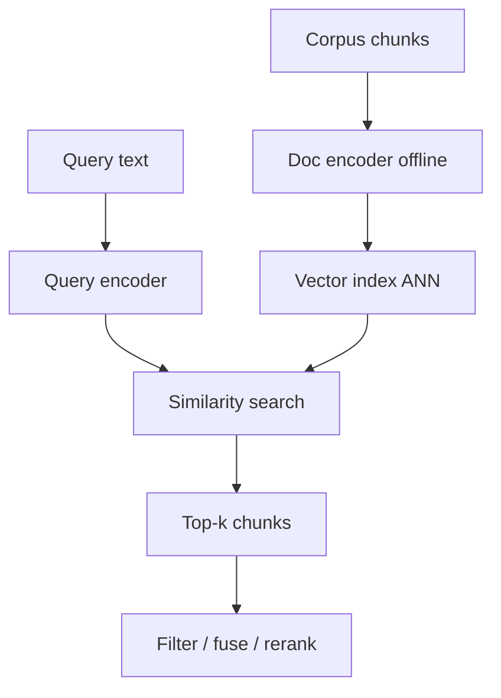

**Dense retrieval** finds relevant text by mapping queries and documents into fixed-size embedding vectors, then ranking by vector similarity (usually a dot product or cosine). Unlike sparse lexical retrieval (BM25, TF-IDF), which scores overlapping terms, dense retrieval scores geometry in a learned space: paraphrases and synonyms can rank highly even when surface words barely match.

A common single-vector design uses a **bi-encoder** (dual encoder): a document encoder embeds every chunk offline into a vector index; a query encoder embeds only the live query; exact or approximate nearest neighbor (ANN) search returns the top-$k$ neighbors. That reusable document index makes dense retrieval a practical first stage of RAG. A cross-encoder that jointly attends over query and document can improve fine ranking, but its query-dependent scores cannot be precomputed for arbitrary future queries, so it is usually reserved for a shortlist.

## How it works

1. **Chunk and embed offline.** Split the corpus into retrieval units (passages, sections, tickets). Run the document encoder $E_P$ on each unit and store vectors plus metadata (source id, tenant, ACL).
2. **Build a vector index.** Exact search scans the vectors; for larger corpora, HNSW or IVF can reduce candidate work by trading exact recall for speed. Query complexity depends on the index, filters, and recall target; measure the deployed configuration.
3. **Embed the query online.** $q = E_Q(\text{query})$. Often $E_Q$ and $E_P$ share architecture; some systems use the same weights (Siamese / Sentence-BERT style), others keep separate towers (as in Dense Passage Retrieval).
4. **Rank by similarity.** Apply tenant and permission constraints before candidates enter downstream context. Return the top-$k$ eligible vectors under the training metric, then optionally fuse with BM25 and rerank.

The similarity function must be **decomposable**: the document vector cannot depend on the query. That is the contract that allows offline indexing.

## Formula

Dense Passage Retrieval (DPR; Karpukhin et al., EMNLP 2020) defines similarity as the inner product of independently encoded vectors:

$$
\mathrm{sim}(q, p) = E_Q(q)^\top E_P(p)
$$

With L2-normalized embeddings this equals cosine similarity. Training pushes the positive passage $p^+$ above a set of negatives with negative log-likelihood (in-batch gold negatives plus optional hard BM25 negatives):

$$
\mathcal{L}(q_i, p_i^+, \{p_{i,j}^-\}) = -\log \frac{e^{\mathrm{sim}(q_i, p_i^+)}}{e^{\mathrm{sim}(q_i, p_i^+)} + \sum_j e^{\mathrm{sim}(q_i, p_{i,j}^-)}}
$$

At inference, retrieval is maximum inner product search (MIPS) over the indexed passage matrix. Modern embedding models often use the same structure as InfoNCE with a temperature $\tau$.

## Diagram

## Example

Support corpus: $2$ million policy and runbook chunks, each embedded to $768$-d float32 (~$6$ GB raw vectors before index overhead). Query: "rotate leaked credentials."

- Dense search surfaces "Reset compromised API keys" even though lexical overlap is thin (`rotate`/`reset`, `credentials`/`API keys`).
- BM25 alone may miss that paraphrase but wins on `CVE-2024-12345` or `order_id=A19XZ` when those exact tokens appear in only one doc.
- ANN returns $k=100$ neighbors; a cross-encoder reranks to $8$ for the prompt. Measure latency and recall under the real filters and load rather than assuming a fixed millisecond budget.

On open-domain QA, DPR reported large gains over Lucene-BM25 on Natural Questions top-20 passage accuracy ($78.4\%$ vs $59.1\%$ when trained on NQ alone), which is the classic demonstration that a well-trained dual encoder can beat strong lexical baselines on meaning-heavy questions. Hybrid stacks still matter when queries mix paraphrase with rare identifiers.

## Intuition

Sparse methods need overlapping tokens. Dense retrieval is strong at **meaning match**: "bad guy" can land near "villain" if training pairs taught that geometry. The cost of that smoothing is that rare identifiers, version strings, negation, and exact constraints can blur unless the embedding model, hard negatives, chunking, and evaluation cover them.

Think of dense retrieval as the recall gate before generation. If the gold chunk never enters the top-$k$, no prompt tweak or generator temperature will invent the missing source. Measure candidate **recall@k** on labeled queries before judging answer quality.

## Index, metric, and freshness

- **Metric contract.** Train, index, and query under the same similarity (inner product vs cosine vs $L_2$). Many systems L2-normalize once at write and query time, then search with inner product.
- **ANN vs task recall.** Task recall depends on both the embedding space and retrieval path. High ANN fidelity against exact $k$-NN can still miss relevant items when embeddings rank them poorly; a strong embedding can lose its best neighbor through HNSW/`nprobe` settings or post-filters.
- **ACL and tenancy.** Apply permission filters in the retrieval path before candidates enter generated context. Filtered ANN behavior can tank recall even when unfiltered ANN looks healthy.
- **Stale vectors.** After document updates or encoder upgrades, re-embed and rebuild. Mixed embedding versions silently scramble ranking: the right text exists, the vector is wrong.

With appropriate access and retention controls, record embedding model version, candidate IDs and scores, filters, and the gold document's rank when known. Retain query text only when needed and permitted. That trace separates "never retrieved" from "retrieved but demoted" from "retrieved but unused by the LLM."

## Why it matters here

Dense retrieval is the semantic first stage of RAG, semantic search, and evidence-grounded assistants. Curriculum lessons on embeddings, bi-encoders, ANN indexes, hybrid search, and rerankers all hang on this pipeline: offline vectors, online query encode, top-$k$ candidates, then everything downstream.

## Related terms

- [Embedding](glossary://embedding)
- [Bi-encoder](glossary://bi-encoder)
- [ANN search](glossary://ann-search)
- [Hybrid search](glossary://hybrid-search)
- [Sparse retrieval](glossary://sparse-retrieval)
