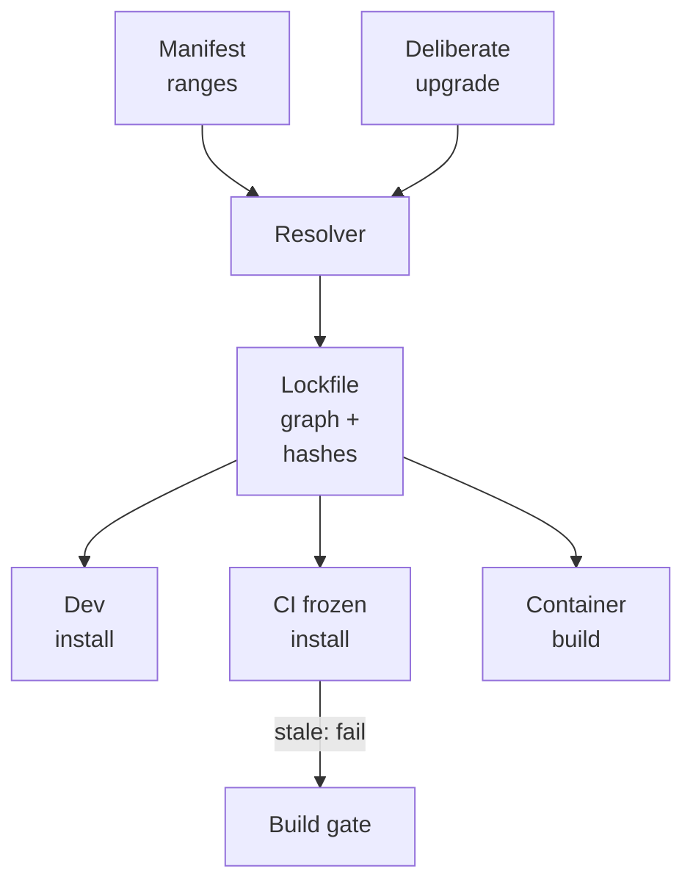

A **dependency lockfile** is a machine-generated record of the package versions a project resolved, usually including direct and transitive dependencies, artifact locations, and integrity hashes. Manifests such as `package.json` or `pyproject.toml` declare *constraints* (`^1.2.0`, `>=2.1,<3`). The lockfile fixes resolution so installs do not silently select newer versions. Universal locks can record alternatives with environment markers; different machines may select different wheels or platform-specific packages from the same lock.

Common names: `pnpm-lock.yaml`, `package-lock.json`, `yarn.lock`, `poetry.lock`, `uv.lock`, `Pipfile.lock`, and the emerging standard `pylock.toml` (PEP 751). Without a lockfile, "same source, different install day" can silently pick a newer Markdown parser, tokenizer helper, CUDA wheel, or HTTP client and change outputs you thought were stable.

## Intuition

A manifest declares acceptable dependency ranges, while a lockfile records one fully resolved graph. Resolution fills in packages you never named: your app depends on A, A depends on B, and B depends on C. SemVer ranges on A and B still permit many versions of C. The lockfile chooses one combination and records exact package versions and integrity data.

Pair a lockfile with a [container image](glossary://container-image) and OS pins when you need a reproducible environment. The lockfile freezes *language-package* identity; native libraries, GPU drivers, base image digests, and dataset files each need their own pins.

## How it works

1. **Declare** top-level deps and version ranges in the manifest.
2. **Resolve** a full graph that satisfies every constraint (and platform markers such as Python version or OS).
3. **Write** the lockfile: package name, version, source (registry URL, git commit, path), and often size + cryptographic hashes of the artifact.
4. **Install from the lock** in CI and production so installers skip re-resolution and fail if the lock and manifest disagree.
5. **Upgrade deliberately** with the package manager's update/upgrade command, then review and commit the lockfile diff.

npm documents `package-lock.json` as describing "the exact tree that was generated, such that subsequent installs are able to generate identical trees, regardless of intermediate dependency updates." pnpm, Poetry, and uv follow the same idea under different file formats. Good lockfiles also store integrity strings (for example Subresource Integrity / `sha512-…` on npm, or `sha256` hashes on uv and PEP 751) so installers can refuse a tarball or wheel whose bytes no longer match.

Install-time modes that treat the lock as law:

| Ecosystem | Frozen / CI install |
| --- | --- |
| npm | `npm ci` (requires lock; errors if out of sync; never rewrites it) |
| pnpm | `pnpm install --frozen-lockfile` (default in CI when a lock exists) |
| uv | `uv sync --locked` or `uv run --locked` (error if lock is stale); `--frozen` skips the up-to-date check |
| Poetry | `poetry check --lock` (fail if lock is stale) then `poetry install`; refresh with `poetry update` |

Commit the lockfile for applications and deployable services. Consumers of a published library generally resolve against its declared dependency ranges and their own project's lock. Publication rules depend on the format: npm excludes `package-lock.json`, while `npm-shrinkwrap.json` can be published and control a package's dependency subtree. Library maintainers can still commit a lock for their own CI.

## Example

Suppose `package.json` says:

```json
{
  "dependencies": {
    "remark-parse": "^11.0.0"
  }
}
```

That range allows any `11.x`. On day one the lock might pin:

```text
remark-parse@11.0.0
  → mdast-util-from-markdown@2.0.0
      → micromark@4.0.0
```

If a later `11.x` release or compatible transitive tokenizer update appears, a fresh resolve without a lock can select it. Your app source is unchanged, but the Markdown syntax tree consumed by heading or snippet tools can shift. With a committed lock and `pnpm install --frozen-lockfile` / `npm ci`, the same target environment installs the recorded graph until someone deliberately upgrades and reviews the lock diff.

For ML Python stacks the same story hits harder. A manifest might say `torch>=2.2` and `transformers>=4.40`. Unlocked installs can move:

- CUDA/CPU wheel choice and binary ABI
- `tokenizers` Rust bindings that change encoding of edge-case strings
- `numpy` / `safetensors` versions that alter load paths or dtypes

A training job, eval harness, and serving image then disagree on scores or token counts even when "requirements look the same." Pinning via `uv.lock` / `poetry.lock` (or a hashed `requirements.txt` export from the lock) makes that drift a reviewed change instead of ambient noise.

```bash
# uv: lock once, install exactly in CI
uv lock
uv sync --locked

# Export a portable install list when a host only speaks pip
uv export --format requirements.txt -o requirements.txt
```

## Diagram



## What to review in a lock diff

Treat lockfile diffs as supply-chain and reproducibility changes, not noise:

- Which packages moved, and were any transitive majors or pre-releases introduced?
- Did build tooling, renderers, test runners, or browser automation binaries change?
- For AI work: did packages that touch tokenization, serialization, numerics, data loading, CUDA, or evaluation move?
- After a meaningful lock change, rebuild generated artifacts (diagrams, static pages, eval baselines) if their outputs depend on those tools.

PEP 751 (Final) defines a portable TOML lock format (`pylock.toml`): installers should install without re-resolving and must verify required file hashes. Tool-specific locks (`uv.lock`, `poetry.lock`, `pnpm-lock.yaml`) remain the day-to-day default; many tools can export to `requirements.txt` or `pylock.toml` for hosts that only understand those formats.

## Why it matters here

LeetLLM's site build depends on a committed `pnpm-lock.yaml` for Next.js, MDX/Markdown tooling, diagram and illustration generators, glossary scripts, and tests. A silent transitive upgrade can change rendered pages, heading anchors, or CI behavior without any article edit. Curriculum and production ML work need the same discipline: lock language deps, then layer container digests and dataset [checksums](glossary://checksum) for full environment identity. Review lockfile PRs the way you review dependency upgrades, because that is what they are.

## Related terms

- [Reproducible environment](glossary://reproducible-environment)
- [Checksum](glossary://checksum)
- [Container image](glossary://container-image)
- [Pre-commit hook](glossary://pre-commit-hook)
- [Content pipeline](glossary://content-pipeline)
