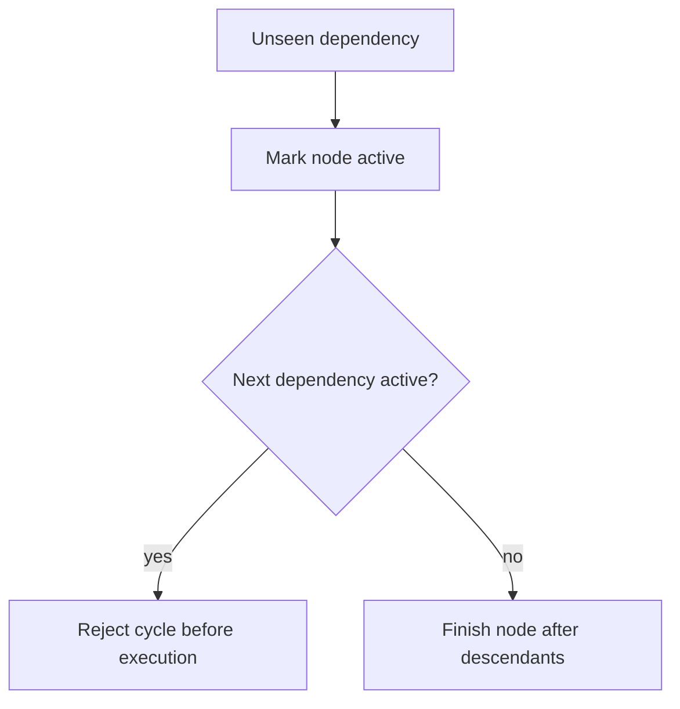

Depth-first search (DFS) follows one graph branch as far as possible before returning to explore another branch. It can be implemented with recursion or an explicit stack. On a directed dependency graph, DFS becomes particularly useful when every node carries a visitation state: unseen, currently active, or completely finished. An edge to an active node identifies a cycle in the current dependency chain.

## Three-state cycle detection

Mark a node active before visiting its dependencies. Once every dependency has finished, mark the node done. Encountering a done node again is harmless because its reachable subgraph has already been checked. Encountering an active node means a descendant points back into the unfinished path, so the graph cannot have a valid execution order.

For $V$ nodes and $E$ edges, the complete check costs $O(V + E)$ when finished subgraphs are not traversed again. A recursive implementation can exceed Python's recursion limit on very deep inputs, so an explicit stack may be more appropriate for an untrusted production graph. Cycle validation must happen before irreversible tasks begin.

## Example

Suppose task `A` requires `B`, `B` requires `C`, and `C` requires `A`. DFS marks `A`, `B`, and `C` active in that order. When `C` reaches `A`, it finds an active ancestor and rejects the entire graph. If independent task `D` is also ready, a scheduler that validates only while executing might run `D` before discovering the cycle. A fail-closed scheduler validates all components first, then executes none when any component contains a cycle.

## Why it matters here

The staged Python systems lesson uses dependency graphs to test invariants rather than rote algorithm recall. DFS explains why a task can be structurally invalid before any worker starts, why active and completed states are different, and why side-effect safety depends on validating the entire graph. The same pattern appears in workflow orchestration, configuration dependencies, and agent planning.

## Related terms

- [Breadth-first search](glossary://breadth-first-search)
- [State machine](glossary://state-machine)
- [Idempotency](glossary://idempotency)
- [Thread safety](glossary://thread-safety)
