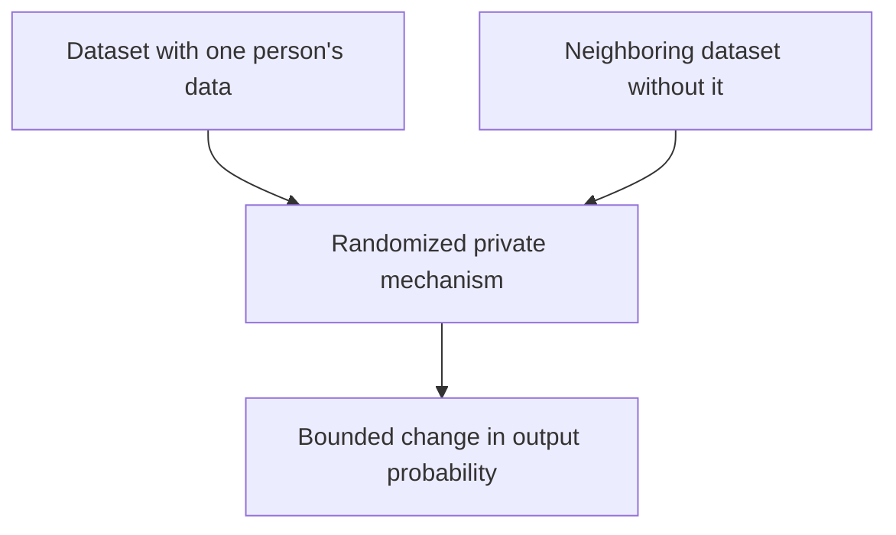

Differential privacy bounds how much the probability of an algorithm's released output can change when one person's protected data is added, removed, or replaced. It is a property of a randomized computation and a precisely defined neighboring-dataset relationship. Removing visible names or hashing identifiers does not, by itself, establish differential privacy.

## The guarantee compares neighboring datasets

An algorithm $M$ is $(\varepsilon,\delta)$-differentially private when every output event $S$ satisfies $P(M(D)\in S)\le e^{\varepsilon}P(M(D')\in S)+\delta$ for every neighboring pair $D,D'$. Smaller $\varepsilon$ gives a tighter multiplicative bound, while $\delta$ permits additive probability slack. It is not simply the chance that a person's data will be leaked. The statement must identify whether one protected unit is a row, user, conversation, or organization; changing that unit changes the guarantee.

## Example

A released count changes by at most one when one user contributes at most one row. Adding noise calibrated to that sensitivity can provide a formal privacy guarantee for the count. If the same user contributes twelve rows, the row-level sensitivity argument does not prove user-level protection. A private training run must similarly define contribution limits, clipping, noise, composition, and accounting before publishing an $(\varepsilon,\delta)$ claim.

## Why it matters here

Fine-tuning, human-feedback datasets, analytics, and evaluation exports can expose sensitive training examples. Differential privacy gives researchers a precise language for protected units, release accounting, and the tradeoff between utility and disclosure risk.

## Related terms

- [Gradient clipping](glossary://gradient-clipping)
- [Data governance](glossary://data-governance)
- [Evaluation science](glossary://evaluation-science)
