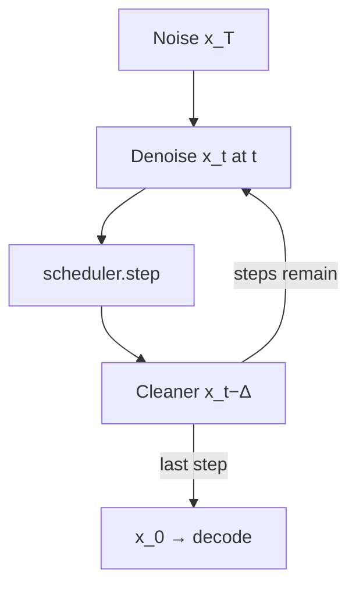

A **diffusion scheduler** defines the noise levels along a diffusion trajectory and how each reverse step turns a model prediction into a less-noisy sample. The denoiser network (U-Net, DiT, or similar) predicts noise, velocity, or a clean estimate at the current noise level; the scheduler owns the discrete (or continuous) timestep grid, the coefficients that mix signal and noise, and the update rule that produces the next latent. Same checkpoint, different scheduler: different images, different step counts, and different wall-clock cost.

In libraries such as Hugging Face Diffusers, the scheduler is a swappable object with `set_timesteps` and `step`. It is *not* the same idea as an [inference scheduler](glossary://inference-scheduler), which batches and prioritizes LLM requests on a GPU.

## Diagram



## Intuition

Think of generation as walking a path from pure noise toward data. The **noise schedule** says how noisy each point on that path is. The **solver** (DDPM, DDIM, Euler, DPM-Solver, and so on) says how to take a step along the path given the network's local prediction. Training often uses a long discrete chain (classically $T=1000$). Sampling can reuse the same trained network with a *subsampled* grid and an ODE/SDE integrator. Some models reach useful quality at 20–50 steps, but the required evaluations depend on the checkpoint, solver, and quality target.

Model weights alone never fully specify an image. Step count, beta/sigma schedule, prediction type (`epsilon`, `v_prediction`, `sample`), guidance scale, and seed all sit outside the weight tensor. Two runs with the same checkpoint and prompt can disagree on sharpness and composition purely because the scheduler changed.

## Formula

**Forward process (DDPM).** Ho et al. (2020) fix a variance schedule $\beta_1,\ldots,\beta_T$ and define

$$
q(x_t \mid x_{t-1}) = \mathcal{N}\!\left(x_t; \sqrt{1-\beta_t}\,x_{t-1},\,\beta_t I\right).
$$

With $\alpha_t = 1 - \beta_t$ and $\bar{\alpha}_t = \prod_{s=1}^{t}\alpha_s$, you can jump to any $t$ in closed form:

$$
q(x_t \mid x_0) = \mathcal{N}\!\left(x_t; \sqrt{\bar{\alpha}_t}\,x_0,\,(1-\bar{\alpha}_t)I\right),
$$

or equivalently $x_t = \sqrt{\bar{\alpha}_t}\,x_0 + \sqrt{1-\bar{\alpha}_t}\,\varepsilon$ with $\varepsilon\sim\mathcal{N}(0,I)$.

**Linear schedule (DDPM default).** $\beta_t$ increases linearly from $\beta_1 = 10^{-4}$ to $\beta_T = 0.02$ at $T=1000$.

**Cosine schedule (Nichol & Dhariwal, 2021).** Define signal retention via a cosine curve (offset $s\approx 0.008$), then recover betas:

$$
\bar{\alpha}_t = \frac{f(t)}{f(0)},\qquad
f(t) = \cos\!\left(\frac{t/T + s}{1+s}\cdot\frac{\pi}{2}\right)^2.
$$

The cosine form changes cumulative signal retention as well as single-step noise variance. Nichol and Dhariwal found the linear schedule destroyed information unnecessarily early on their low-resolution image tasks; compare schedules at the target resolution and quality metric.

**Reverse step (noise prediction).** If the network predicts $\varepsilon_\theta(x_t,t)$, the reverse mean used by DDPM-style sampling is

$$
\mu_\theta(x_t,t) =
\frac{1}{\sqrt{\alpha_t}}\left(
x_t - \frac{\beta_t}{\sqrt{1-\bar{\alpha}_t}}\,\varepsilon_\theta(x_t,t)
\right).
$$

Ancestral DDPM sampling still injects noise: $x_{t-1} = \mu_\theta(x_t,t) + \sigma_t z$ with $z\sim\mathcal{N}(0,I)$ (for $t>1$), where $\sigma_t$ is the reverse-process standard deviation from the schedule (often $\sigma_t^2=\beta_t$ or a $\tilde{\beta}_t$ variant). Omitting $\sigma_t z$ is a different sampler, not vanilla DDPM.

DDIM (Song et al., 2020) keeps the same training objective but uses a non-Markovian reverse process; with $\eta=0$ the path is deterministic given the seed, and you can skip many of the original $T$ indices while still mapping $x_T\to x_0$.

Higher-order multistep solvers (for example DPM-Solver / DPM-Solver++) treat the reverse process as an ODE in continuous time and need far fewer network evaluations for a given quality target. Karras et al. (EDM, 2022) reparameterize the design space around a continuous noise level $\sigma$, with schedule and solver chosen separately from the network architecture.

## How it works at inference

1. **Build a timestep list.** `scheduler.set_timesteps(num_inference_steps)` picks which of the training noise levels to visit (or which continuous $\sigma$ values). Requested inference steps need not equal model evaluations for every solver; inspect the actual grid and loop rather than counting training timesteps.
2. **Start from noise.** Sample $x_T$ (or $x_{\sigma_{\max}}$) in latent space for latent diffusion, pixel space for classical DDPM.
3. **Loop.** At each $t$, run the conditioned denoiser, optionally apply classifier-free guidance by mixing conditional and unconditional predictions, then call `scheduler.step(model_output, t, sample)` to get the previous sample. Standard two-branch guidance processes both predictions; Diffusers commonly batches them into one doubled-batch U-Net call rather than two separate calls.
4. **Decode.** Map the final latent through a VAE (when used) to pixels.

The network never "knows" the step size by itself; the scheduler multiplies predictions by $\alpha$, $\beta$, $\sigma$, or solver coefficients stored in its config.

## Example

**Stable-style latent pipeline, concrete knobs.** You load an SD 1.x-class U-Net trained with $T=1000$ and a scaled-linear beta schedule (classically $\beta$ from about $8.5\times 10^{-4}$ to $0.012$, not the pure DDPM $10^{-4}\to 0.02$ linear ramp). At serve time you attach a multistep DPM solver with `num_inference_steps=25` and guidance scale $7.5$:

- **Cost.** For this multistep loop, $25$ updates process $50$ conditional/unconditional branch examples per image, typically in $25$ doubled-batch U-Net calls. Multistep order reuses earlier predictions; it does not inherently require extra forwards per update. Dropping from $50$ to $25$ updates approximately halves denoiser work if the rest stays fixed, but batching and fixed overhead affect wall time.
- **Quality.** Compare samplers at the same checkpoint, prompt set, guidance, and actual evaluation budget. Fewer steps can degrade detail; a higher-order solver can improve the quality-versus-cost curve without guaranteeing equivalence to a particular DDIM step count.
- **Repro contract.** Record scheduler class name, `num_inference_steps`, `timestep_spacing` / Karras sigma flags, prediction type, guidance scale, seed, prompt, negative prompt, checkpoint hash, VAE, precision, and resolution. Change only the scheduler from DDIM to Euler ancestral with the same seed and you should expect a *different* image, not a bug in the weights.

Sketch of the Diffusers control surface (`model_id` and `prompt` supplied by the caller; CUDA required):

```python
import torch
from diffusers import DPMSolverMultistepScheduler, StableDiffusionPipeline

pipe = StableDiffusionPipeline.from_pretrained(model_id).to("cuda")
pipe.scheduler = DPMSolverMultistepScheduler.from_config(
    pipe.scheduler.config,
    use_karras_sigmas=True,  # optional sigma spacing
)
image = pipe(
    prompt,
    num_inference_steps=25,
    guidance_scale=7.5,
    generator=torch.Generator("cuda").manual_seed(42),
).images[0]
```

**Tiny schedule arithmetic.** With $T=1000$, linear $\beta_1=10^{-4}$, $\beta_T=0.02$, a mid-chain step ($t=500$) has $\alpha_t=1-\beta_t\approx 0.99$ while $\bar{\alpha}_{500}\approx 0.08$. The cumulative product, not the single-step $\beta_t$, sets how much of $x_0$ remains in $x_t$ (signal scale $\sqrt{\bar{\alpha}_t}\approx 0.28$, noise scale $\sqrt{1-\bar{\alpha}_t}\approx 0.96$). Subsampling to $25$ inference indices reuses those precomputed $\bar{\alpha}$ tables at a sparse set of $t$ values; the solver interpolates the reverse trajectory between them.

## Trade-offs

| Choice | Typical effect |
|--------|----------------|
| More steps | Higher quality ceiling until returns diminish; latency and $/image grow roughly linearly with U-Net calls |
| Better ODE solver (DPM, UniPC, Heun) | Often same quality at fewer steps; config mismatch with training prediction type can break samples |
| Stochastic / ancestral sampler | Fresh noise at reverse steps; reproducibility requires the full RNG and execution recipe |
| Deterministic DDIM ($\eta=0$) | Stable for inversion and editing pipelines; less variety |
| Wrong prediction type or beta/sigma config | Washed-out, oversaturated, or pure-noise outputs even with a good checkpoint |

When latency regresses, separate *actual denoiser evaluations* from *milliseconds per evaluation* (batch size, resolution, attention backend, and guidance branch batching). When images "drift" after a library bump, diff scheduler class, config JSON, and default `timestep_spacing` before re-tuning prompts.

## Why it matters here

Schedulers make generation policy explicit and external to the weight file. Curriculum and production work on multimodal models, eval harnesses, and image APIs all need that split: you version the checkpoint *and* the sampling recipe, budget GPU time in steps × cost-per-step, and debug quality with the same rigor used for temperature and top-p in text decoding. Confusing a diffusion scheduler with an LLM request scheduler is a common naming trap; one steps noise levels, the other steps the GPU work queue.

## Related terms

- [Model checkpoint](glossary://model-checkpoint)
- [Inference scheduler](glossary://inference-scheduler)
- [Temperature](glossary://temperature)
- [CLIP](glossary://clip)
- [Cross-attention](glossary://cross-attention)
