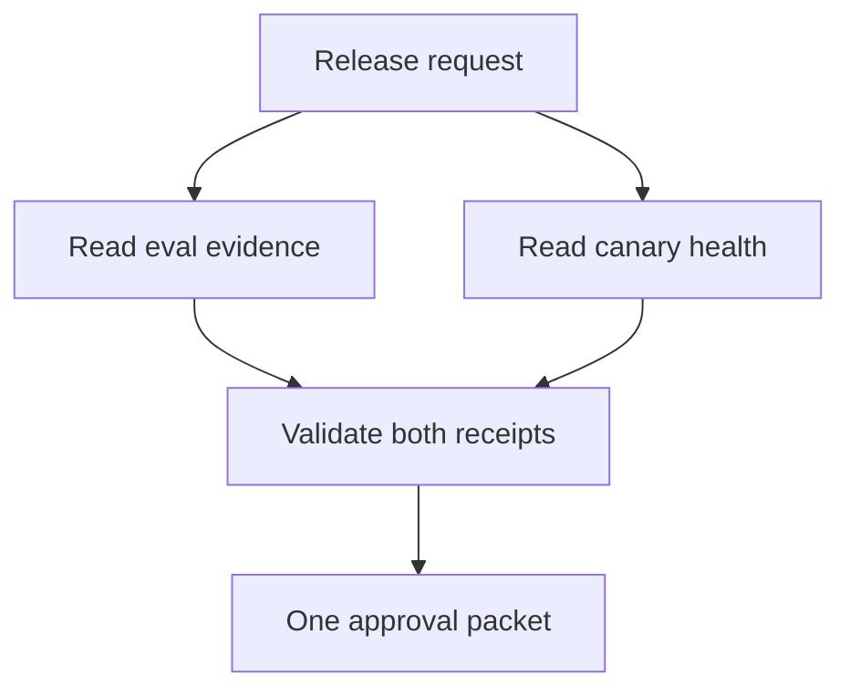

A **directed acyclic graph (DAG)** consists of nodes connected by directed edges, with no directed cycle. In a dependency workflow, a node becomes eligible only after its required predecessors complete. Independent branches can execute concurrently, then synchronize at an explicit fan-in barrier. Other DAGs, such as causal graphs, do not necessarily represent tasks to execute.

A workflow with a logical back-edge to an earlier state isn't a strict DAG. It may contain an acyclic phase, but the complete control flow is a general graph or state machine. Retrying a failed task inside one node does not by itself add an edge or cycle to the dependency graph. Acyclic dependencies also do not prevent replay, persistence, or repeated side effects.

## Fan out independent reads and join once

## Example

A release assistant needs an evaluation report, canary health, and current promotion policy. Those three read-only checks can run in parallel because none depends on another's output. A merge node waits for every expected receipt, validates request and tenant identity, and produces one proposal. Promotion itself remains a separate, approval-bound write.

A topological ordering might execute `triage`, then the three checks, then `merge`. If a health check fails and the workflow returns to `triage`, that retry creates a cycle outside the DAG-shaped read phase.

## Why it matters here

Multi-agent orchestration, scheduling, training pipelines, and content builds all rely on dependency ordering. A DAG provides useful execution structure, but it doesn't grant permissions, validate branch outputs, or make parallel writes safe.

## Related terms

- [State machine](glossary://state-machine)
- [Worker fanout](glossary://worker-fanout)
- [Human in the loop](glossary://human-in-the-loop)
- [Idempotency](glossary://idempotency)
