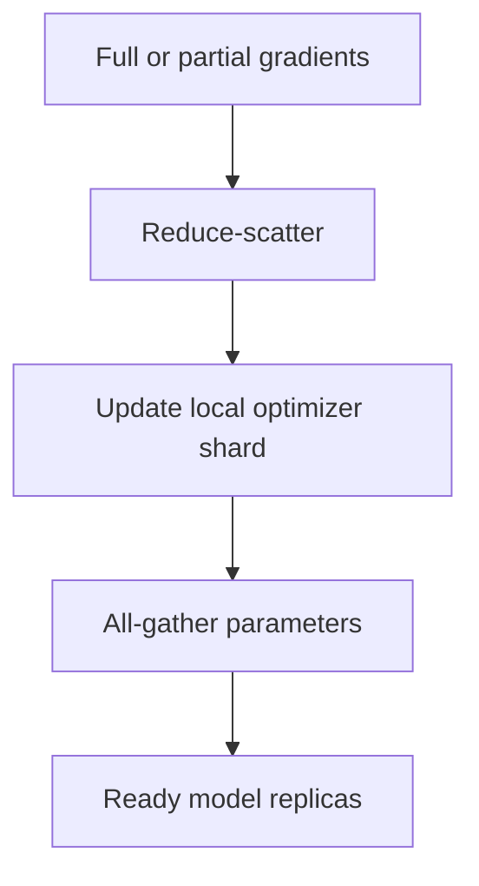

A **distributed optimizer** shards optimizer state across a data-parallel group instead of storing a complete copy on every rank. Each rank owns part of the parameter update state, such as Adam's first and second moments and any higher-precision master weights.

The usual path reduce-scatters gradients into local shards, applies optimizer math on those shards, then all-gathers updated parameter shards when replicas need complete parameters. This resembles ZeRO stage 1 in purpose, though exact layouts and buffers depend on the framework.

## Memory accounting

Adam-style training may store model weights, gradients, two moment tensors, and a master copy. Sharding moments across $D$ data-parallel ranks cuts their per-rank footprint roughly by $D$ before padding, bucket, and replication details. It doesn't solve activation memory or tensors that aren't in the sharded group.

## Diagram

## Example

Four ranks in an optimizer's sharding group can each own one-quarter of Adam moments. Calculate the fraction from the sharding group's actual size. In Megatron, context-parallel ranks replicate dense weights and can join the dense DP-with-CP optimizer group even when conventional DP=1.

## Why it matters here

The GLM-5.3 candidate requests Megatron's distributed optimizer with one independent dense-layer data replica and CP=8. Current Megatron's dense optimizer uses a DP-with-CP group; expert parameters use a separate expert-data-parallel group. Hierarchical optimizer instances can further change the sharding domain. Inspect the candidate's pinned runtime and each parameter family's effective groups before counting memory savings; DP=1 alone does not imply unsharded optimizer state.

## Related terms

- [Optimizer state](glossary://optimizer-state)
- [Optimizer offload](glossary://optimizer-offload)
- [Data parallelism](glossary://data-parallelism)
- [Reduce-scatter](glossary://reduce-scatter)
- [All-gather](glossary://all-gather)
