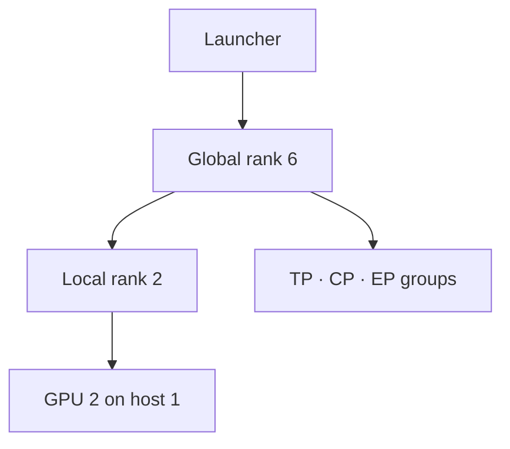

A **distributed rank** is the integer identity of one process participating in a distributed job. If world size is 8, global ranks are 0 through 7. Model layers, experts, and parameter shards are separate units from the rank that runs them.

Many GPU jobs launch one process per GPU, so people casually use “rank” and “GPU” interchangeably. That mapping holds for this common launcher pattern. Other setups let one process control multiple devices or run without a GPU.

## Identity map

A launcher assigns global rank before a process joins the distributed world. The process reads local rank to select a device, initializes the communication backend, then joins one or more process groups. Logs should carry global rank plus host and device because rank alone doesn't reveal physical placement after restart or rescheduling.

## Global, local, and group rank

- **Global rank:** process identity across whole job.
- **Local rank:** process identity on one host, often used to select local GPU.
- **Group rank:** process position inside one process group.
- **World size:** total number of global ranks.

## Example

Two hosts each contain four GPUs. Launcher starts four processes per host. World size is 8, global ranks are 0 through 7, and each host has local ranks 0 through 3. Global rank 6 may select local GPU 2 on second host.

## Why it matters here

Collectives, checkpoint shards, random seeds, logs, and failures are often reported by rank. Correct topology work starts by mapping every rank to host, device, and process groups it belongs to.

## Related terms

- [GPU](glossary://gpu)
- [Process group](glossary://process-group)
- [NCCL](glossary://nccl)
- [Tensor parallelism](glossary://tensor-parallelism)
- [Data parallelism](glossary://data-parallelism)
