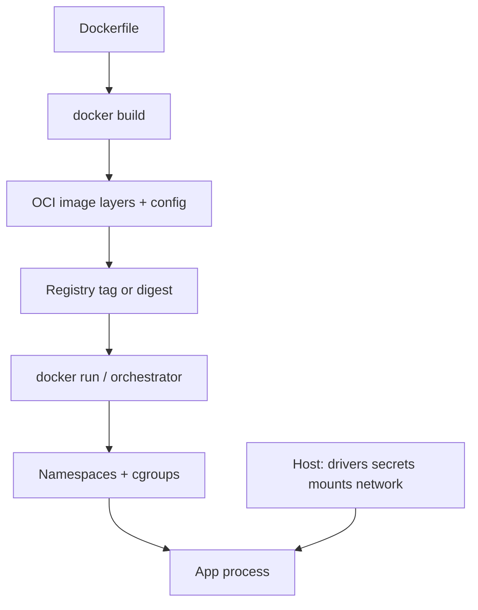

Docker is a platform for building [container images](glossary://container-image), distributing them through registries, and running them as isolated processes on a shared host kernel. You describe the filesystem and startup command in a Dockerfile (or equivalent build definition); `docker build` produces an immutable image; `docker run` (or an orchestrator) starts a container from that image.

On Linux, a **container** is one or more processes whose view of the machine is restricted by namespaces (PID, mount, network, UTS, IPC, and optionally user) and whose CPU, memory, and I/O can be limited by cgroups. Containers share the host kernel, which is why they start faster and use less overhead than full virtual machines. Host GPU drivers, kernel modules, and some security boundaries remain outside the image.

Docker popularized this workflow; the portable artifacts it builds and runs follow the [OCI](https://opencontainers.org/) image, runtime, and distribution specs. Compatible image artifacts can run under Docker Engine, containerd, or a Kubernetes runtime that speaks OCI, subject to CPU architecture and kernel requirements. Linux containers on macOS or Windows typically share a Linux VM's kernel rather than the desktop host's kernel directly.

## Intuition

Docker packages an application filesystem and startup configuration. An image freezes enough of the runtime (language interpreter, system libraries, Python/Node packages, tokenizers, entrypoint) that environment drift becomes less common. Secrets, API keys, mounted weights, host NVIDIA drivers, network policy, service accounts, and production traffic stay external. Reproducibility comes from pinning what enters the image and documenting the external dependencies.

## How it works

1. **Dockerfile** instructions (`FROM`, `COPY`, `RUN`, `ENV`, `CMD`/`ENTRYPOINT`, …) define ordered build steps. Instructions that change the filesystem produce **layers** stacked on a base image.
2. **`docker build`** (BuildKit) executes those steps, reuses cached steps when their inputs have not changed, and writes an OCI image: config JSON + layer digests + manifest.
3. **Registry push/pull** moves the image by digest or tag. Tags are mutable labels; digests identify exact bytes.
4. **`docker run`** unpacks layers into a rootfs, applies config (user, env defaults, working directory, command), creates namespaces and cgroup limits, and starts the process. Ports, volume mounts, and GPU devices are supplied as runtime bindings.

Multi-stage Dockerfiles use several `FROM` stages so a heavy build toolchain (compilers, full SDKs) never ships in the final runtime image. You `COPY --from=build` only the artifacts you need.



## Example

A small FastAPI inference scorer for CI and teammates. Assume `requirements.txt` pins the scorer's dependencies. Dependencies install before app code so layer cache survives source edits. The image holds Python and packages; model weights and secrets are not baked in. The base tag below is convenient for illustration; pin its digest and package hashes for a reproducible production build.

```dockerfile
# syntax=docker/dockerfile:1
FROM python:3.12-slim AS runtime
WORKDIR /app
COPY requirements.txt ./
RUN pip install --no-cache-dir -r requirements.txt
COPY src ./src
ENV PORT=8080
EXPOSE 8080
CMD ["python", "-m", "uvicorn", "src.serve:app", "--host", "0.0.0.0", "--port", "8080"]
```

```bash
docker build -t scorer:dev .
docker run --rm -p 8080:8080 \
  -e MODEL_URI=s3://models/scorer-v3 \
  -e API_KEY_FILE=/run/secrets/api_key \
  -v "$PWD/secrets:/run/secrets:ro" \
  scorer:dev
```

For GPU inference on a Linux host with the [NVIDIA Container Toolkit](https://docs.nvidia.com/datacenter/cloud-native/container-toolkit/latest/index.html) installed, the **driver stays on the host**; the image typically carries CUDA userland and the serving stack. A smoke check:

```bash
docker run --rm --gpus all nvidia/cuda:12.4.1-base-ubuntu22.04 nvidia-smi
```

A vLLM-style service then becomes something like `docker run --gpus all -p 8000:8000 …` with the model path as a volume or object-store fetch, not as an assumed laptop folder.

| Concern | In the image | Outside the image |
| --- | --- | --- |
| App code, lockfile-installed deps | yes | no |
| Tokenizer / chat template files | optional | often accompany mounted or fetched weights |
| Multi-GB model weights | optional (bake vs mount vs fetch) | often yes |
| API keys, cloud credentials | no | env, secrets mounts |
| NVIDIA kernel driver | no | host / node plugin |
| Network policy, IAM, DNS | no | platform |

## Local versus production

Local `docker run` success verifies the image on *that* host with *those* mounts and env vars. Verify Cloud Run concurrency settings, Kubernetes readiness probes, GPU driver/CUDA compatibility, service accounts, egress rules, and cold-start behavior separately under the deployment's real image size. Pull by digest, inject production-like env, and hit readiness the same way the platform will.

Image size can increase [cold starts](glossary://cold-start): uncached layers and baked weights add transfer or load work. Shared caches, lazy image loading, and the platform's startup path affect how much of that work delays readiness. Prefer multi-stage builds, slim bases, and weight strategies that match how often the model changes.

## Why it matters here

Docker packages the same application runtime for local development, CI, and services on Cloud Run or Kubernetes. For AI/ML work it is also the place where CUDA base images, tokenizer artifacts, lockfiles, and GPU device passthrough either line up or fail in ways that look like model bugs. Treat the Dockerfile as part of the runtime contract: pin digests in deploys, keep secrets out of layers, and measure boot with the real image alongside a laptop venv.

## Related terms

- [Container image](glossary://container-image)
- [Reproducible environment](glossary://reproducible-environment)
- [Kubernetes](glossary://kubernetes)
- [Google Cloud Run](glossary://google-cloud-run)
- [Cold start](glossary://cold-start)
