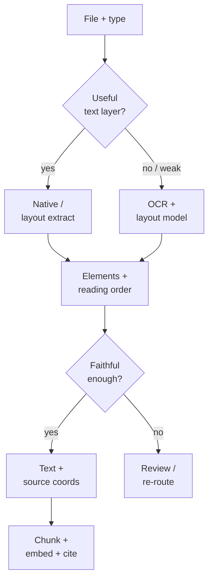

A document parser turns a source file (PDF, HTML, Markdown, DOCX, image, spreadsheet, and similar formats) into **text plus structure** for later stages to validate: plain strings for embedding, element labels for chunking, and locators for citation. A production parsing pipeline is a **route** that chooses how bytes become evidence: native text extraction, layout-aware reconstruction, OCR, HTML main-content isolation, or a structured-element pipeline.

Parsers decide what the retrieval system believes is real. If a table collapses into scrambled cells, columns interleave, headings vanish, code loses indentation, or OCR swaps digits, every later chunk, vector, citation, and answer inherits that damage. Many RAG failures start here, before vector search.

## How it works

A production parser usually does four jobs:

1. **Detect** file type and page character (text layer present, scanned image, multi-column, table-heavy).
2. **Extract** candidates: characters, words, lines, or layout regions with coordinates when available.
3. **Structure** those candidates into ordered elements (title, paragraph, list, table, caption, code) and a **reading order**.
4. **Emit** records with text, element type, locator (page, bbox, URL fragment, heading path), quality flags, and parser identity.

Formats differ sharply:

| Source | What the format actually stores | Typical parser work |
|---|---|---|
| Native PDF | Drawing operators and text runs with positions, not reliable paragraphs | Reconstruct reading order; keep pages and bboxes; special-case tables |
| Scan without a text layer / image | Pixels only | Render page, run OCR, optionally layout model, then treat as text |
| HTML | Tags, but also nav, ads, scripts, footers | Isolate main content; strip boilerplate; preserve headings |
| Markdown | Explicit headings, lists, fences | Keep structure; do not flatten tables and code |
| DOCX / PPTX / XLSX | Styles and cells | Map styles to elements; treat sheets as tables |

PDF is the hard case. A page that *looks* clean on screen may have a broken text layer, two columns written left-to-right across both columns, or no extractable text at all. Rule-based tools (pdfminer.six, pypdf, PyMuPDF) are fast when the text layer is honest. Layout models and multimodal converters (Detectron-style layout detection, DocLayNet-trained segmenters, Nougat-style academic PDF converters, VLM parsers) help when geometry or pixels matter. Tool choice depends on document class: fast extractors often win on simple single-column manuals, while multi-column scientific and patent PDFs usually punish naive extraction and need layout-aware or learning-based paths.

Libraries such as Unstructured formalize the output as typed **elements** (`Title`, `NarrativeText`, `ListItem`, `Table`, …) with metadata (filename, page, language, bounding boxes). PDF strategies include `fast` (pdfminer-style text), `ocr_only`, `hi_res` (layout model + richer structure), and `auto` (route by document characteristics and requested features). These settings select parsing routes; benchmark reading order on representative documents because current Unstructured guidance warns that `hi_res` can struggle with multi-column layouts. The element list is the handoff to structure-aware chunking.

## Diagram



## Example

An incident runbook PDF has three pages that look similar on screen:

| Page | Surface | Native extract | Parser route | Indexed text (excerpt) |
|---:|---|---|---|---|
| 7 | Digital PDF, single column | Clean | `native-pdf@2.1` | `Rollback failure: page on-call within 15 minutes with deploy ID.` |
| 8 | Scan of the same policy | Empty / noise | `ocr@tesseract5` | `Rollback failure: page on-call within 1S minutes with deploy ID.` |
| 9 | Two-column research-style layout | Column A and B interleaved | `layout-hi_res@1.4` | Correct left-column policy, then right-column notes |

A naive top-to-bottom extract on page 9 might yield:

```text
Rollback failure: Routine deploy notes: page on-call within archive within 15 minutes 14 days
```

That string still contains the words `15 minutes`, so a BM25 or dense hit can look "relevant" while the policy is wrong. Page 8's OCR `1S` is worse: the index stores a number that never existed. Downstream systems should treat both as parser/OCR failures, not as model reasoning bugs.

A minimal record after a good parse:

```python
record = {
    "source_id": "incident-runbook-v3.pdf",
    "source_type": "pdf",
    "locator": "page=7",
    "element_type": "NarrativeText",
    "text": "Rollback failure: page on-call within 15 minutes with deploy ID.",
    "parser": "native-pdf@2.1",
    "quality": "ready",
    "checksum": "sha256:6b6379...",
}
```

Sample by document class (native PDF, scan, multi-column, table-heavy HTML, Markdown with fences). Diff extracted text, reading order, tables, and locators against the source. Pin parser versions so a library upgrade cannot silently rewrite the corpus.

## What fails in production

| Failure | How it shows up | What to check |
|---|---|---|
| Wrong reading order | Citations mix columns or captions attach to the wrong figure | Multi-column PDFs; layout strategy |
| Table collapse | Numbers no longer align to headers | Row/column structure; HTML table export vs flat text |
| Boilerplate pollution | Nav/footer phrases dominate retrieval | HTML main-content isolation; repeated header/footer lines |
| Missing text layer | Empty pages or partial paragraphs | Native char count; route to OCR |
| OCR digit/glyph errors | `15` → `1S`, `S0` → `50` | Critical-value checks; keep page crops for review |
| Over-cleaning | Policy lines stripped with chrome | Gold span containment after parse |
| Version drift | Same file, different text after upgrade | Parser id + content checksum in provenance |

Parser output is a **candidate for review**. Quality gates (minimum useful characters, encoding checks, gold anchors, table shape checks) decide whether text is ready to index, needs OCR, or must be held for review.

## Why it matters here

LeetLLM's file-ingestion and document-QA path treat parser quality as evidence quality. Before chunking strategy, embeddings, or rerankers matter, learners need a faithful, provenance-backed text layer. A wrong route here makes retrieval metrics look random and citations look confidently wrong.

## Related terms

- [OCR](glossary://ocr)
- [Chunking](glossary://chunking)
- [Provenance](glossary://provenance)
- [HTML boilerplate](glossary://html-boilerplate)
- [Content pipeline](glossary://content-pipeline)
