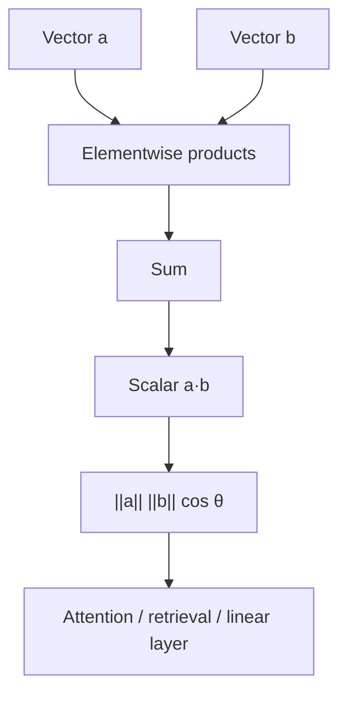

The **dot product** (also called the **inner product** for real vectors) turns two equal-length vectors into one scalar: the sum of their elementwise products. From geometry, $a \cdot b = \lVert a \rVert_2 \lVert b \rVert_2 \cos\theta$: the score is direction ($\cos\theta$) times both lengths. Positive means acute angle, zero means orthogonal, negative means obtuse. Scaling either vector scales the score even when the angle is fixed. In ML and LLM systems this is the primitive behind linear layers ($w \cdot x$), attention scores ($q \cdot k$), and many embedding rankings. Cosine similarity, maximum inner product search (MIPS), and scaled attention are the same operation with different normalization and scaling choices.

## Formula

For $a, b \in \mathbb{R}^n$:

$$
a \cdot b = \sum_{i=1}^{n} a_i b_i = a^\top b = \lVert a \rVert_2 \lVert b \rVert_2 \cos\theta
$$

where $\theta$ is the angle between nonzero $a$ and $b$, and $\lVert a \rVert_2 = \sqrt{\sum_i a_i^2}$ is the Euclidean norm. A zero vector has dot product zero with every vector, but its angle and cosine similarity are undefined. The left form is what code computes. The right form is what the scalar *means*: direction ($\cos\theta$) mixed with length ($\lVert a \rVert \lVert b \rVert$).

**Cosine** divides the norms out:

$$
\cos(a,b) = \frac{a \cdot b}{\lVert a \rVert_2 \lVert b \rVert_2}
$$

If both vectors are L2-normalized to unit length, $\cos(a,b) = a \cdot b$. Production vector indexes often normalize once, then search with **inner product** so ranking by IP equals ranking by cosine.

**Matrix form.** Each entry of a product $C = AB$ is a row-column dot product. A batch of queries against a batch of keys is $QK^\top$: every score is one $q_i \cdot k_j$.

## Intuition

Think of two arrows from the origin. Project one onto the other: the signed length of that projection, times the length of the other arrow, is the dot product. Positive means acute angle (same half-space), zero means orthogonal, negative means obtuse (opposite half-space). Scaling either arrow stretches the scalar even if the angle is fixed. That is the trap in retrieval: a long embedding can outrank a better-aligned short one when you score with raw IP and the model was not trained for that.

A linear layer is the same picture: $w \cdot x$ scores how much of the input $x$ lines up with a learned direction $w$, scaled by both norms. Softmax later turns a *set* of such scores into weights; the dot product itself only produces the raw compatibility numbers.

## Diagram



## Worked numbers

Take $a = [1, 2, 3]$ and $b = [4, 5, 6]$:

$$
a \cdot b = 1\cdot4 + 2\cdot5 + 3\cdot6 = 32
$$

Norms: $\lVert a \rVert_2 = \sqrt{14} \approx 3.742$, $\lVert b \rVert_2 = \sqrt{77} \approx 8.775$, so

$$
\cos(a,b) = \frac{32}{\sqrt{14}\sqrt{77}} \approx 0.974
$$

Scale $a$ to $2a = [2, 4, 6]$: direction is unchanged, cosine is still $\approx 0.974$, but the raw dot product doubles to $64$. That is why embedding pipelines often L2-normalize before indexing when the training contract is cosine / angular similarity.

**Orthogonality check.** $u = [1, 0]$, $v = [0, 1]$: $u \cdot v = 0$, so $\cos = 0$ (right angle). $u \cdot (-u) = -1$ on unit vectors (opposite directions).

Minimal NumPy / PyTorch-style check:

```python
import numpy as np

a = np.array([1.0, 2.0, 3.0])
b = np.array([4.0, 5.0, 6.0])
assert a @ b == 32.0

# unit vectors: cosine == dot
ua, ub = a / np.linalg.norm(a), b / np.linalg.norm(b)
assert abs(ua @ ub - (a @ b) / (np.linalg.norm(a) * np.linalg.norm(b))) < 1e-9
```

In PyTorch, `torch.dot` is only for 1D tensors of equal length; batched scores use `torch.matmul` / `@` (for example `Q @ K.transpose(-2, -1)`).

## Example

**1. Scaled attention scores.** In the Transformer (Vaswani et al., 2017), compatibility is a batch of query–key dots, scaled, then softmaxed:

$$
\mathrm{Attention}(Q, K, V) = \mathrm{softmax}\left(\frac{QK^{\top}}{\sqrt{d_k}}\right)V
$$

Each entry of $QK^\top$ is $q_i \cdot k_j$. The factor $1/\sqrt{d_k}$ matters because if components of $q$ and $k$ behave like independent mean-zero unit-variance variables, then $\mathrm{Var}(q \cdot k) = d_k$. Large $d_k$ makes raw dots huge in magnitude, which drives softmax into a saturated regime with tiny gradients. Scaling keeps score scale roughly independent of head width. Additive attention can match quality without that scale, but multiplicative (dot-product) attention maps cleanly onto fast matrix multiplies, so production transformers use the scaled form.

**2. Dense retrieval / RAG.** Query embedding $e_q$ and document embedding $e_d$ are ranked by $e_q \cdot e_d$ (MIPS: maximum inner product search) or by cosine. After L2 normalization on both sides, the two rankings match. Without normalization, longer vectors can dominate even when angles are similar. Always pair the index metric with the model's training contract: a dual encoder trained for cosine must not be indexed as raw IP on unnormalized vectors (or vice versa) unless you re-measure quality.

**3. Linear layers and the LM head.** A dense layer computes $y = Wx + b$; each output channel is a bias plus a weight-row dotted with $x$. The vocabulary projection that produces logits is the same idea: each token score is roughly a hidden state dotted with an embedding (or weight) row. Understanding the scalar as alignment-plus-magnitude makes "why normalize embeddings?" and "why scale attention?" the same geometric story.

## Metric contract in production

| Scoring choice | Prefer when | Failure mode if mismatched |
| --- | --- | --- |
| Cosine / normalize then IP | Model trained for angular similarity; length should not rank | Nonunit document norms can alter IP ranking. A nonzero unnormalized query against unit documents scales scores but preserves exact ranking; thresholds still change |
| Raw (unnormalized) IP / MIPS | Training used unnormalized IP deliberately (some recommenders, some dual encoders) | Long-norm junk docs float to the top |
| Squared Euclidean on unit vectors | Index only supports $L_2$; vectors are unit | $\lVert a-b\rVert_2^2 = 2(1-\cos)$ only after unit normalization |
| Scaled $q\cdot k / \sqrt{d_k}$ | Attention heads | Missing scale: sharp or dead softmax, training instability |

If rankings look "magnitude-driven" (same long documents always win), inspect embedding norms, the index metric string (`cosine` vs `ip` vs `l2`), and whether query and corpus share the same normalize-at-write / normalize-at-query policy. If attention weights collapse to one position early in training, check head dimension, dtype, and whether the $\sqrt{d_k}$ divide is present.

## Why it matters here

Dot products are the scalar glue of transformers and retrieval: attention scores, linear maps, embedding similarity, and MIPS indexes are all this operation under different packaging. Curriculum work on self-attention, embeddings, dense retrieval, and cosine similarity assumes you can read $a \cdot b$ as geometry, implement it as a sum or matmul, and keep normalization and $\sqrt{d_k}$ scaling consistent with how the model was trained and how the index is configured.

## Related terms

- [Cosine similarity](glossary://cosine-similarity)
- [Vector](glossary://vector)
- [Self-attention](glossary://self-attention)
- [Embedding](glossary://embedding)
- [Softmax](glossary://softmax)
