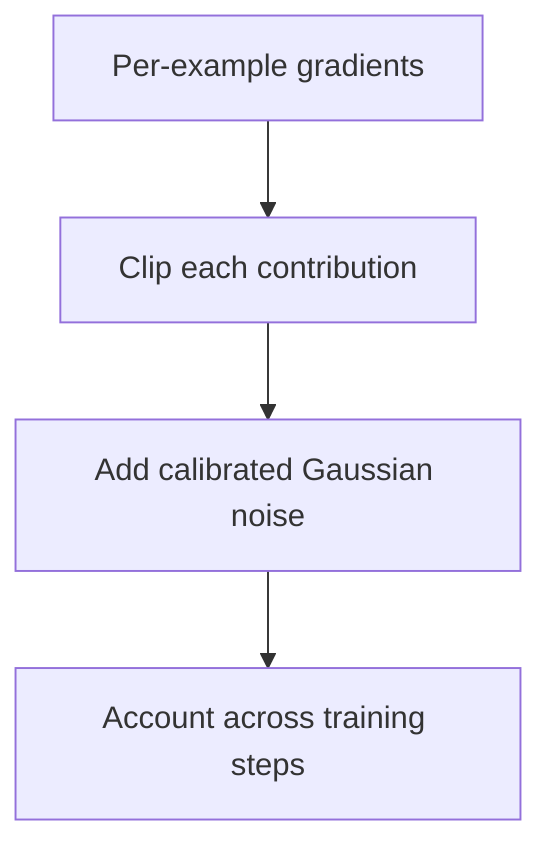

Differentially private stochastic gradient descent modifies training so the released model has a formally accounted privacy guarantee for a declared protected unit. Each example's gradient is clipped to bound its contribution, random noise is added to the aggregated clipped gradients, and a privacy accountant composes the exposure across sampling and training steps.

## Clipping must happen before aggregation

For per-example gradients $g_i$ and clip norm $C>0$, replace each nonzero gradient with $\bar g_i=g_i\min(1,C/\lVert g_i\rVert_2)$; a zero gradient stays zero. Sum the clipped gradients, add Gaussian noise with scale tied to $C$, and divide by batch size before the optimizer update. The accountant must match the sampling and adjacency rules. Clipping one already-averaged batch gradient does not bound an individual example's influence. A fixed seed makes teaching arithmetic reproducible; a deployed private mechanism also needs a secure noise source and a correct privacy accountant.

## Example

Two scalar per-example gradients are 0.5 and 5.0, and the clip norm is 1.0. Individual clipping changes them to 0.5 and 1.0. Their clipped mean is 0.75 before noise, while the unclipped mean would be 2.75. These values illustrate per-example clipping. A user-level privacy analysis must define the user as the protected unit and bound that unit's contribution under the chosen mechanism; grouping examples before clipping is one route, while other analyses may establish the needed sensitivity differently.

## Why it matters here

Sensitive fine-tuning requires more than redaction or a claim that weights hide training rows. DP-SGD joins contribution bounds, randomness, and accounting into a verifiable training contract with measurable quality and compute tradeoffs.

## Related terms

- [Differential privacy](glossary://differential-privacy)
- [Gradient clipping](glossary://gradient-clipping)
- [Privacy budget](glossary://privacy-budget)
