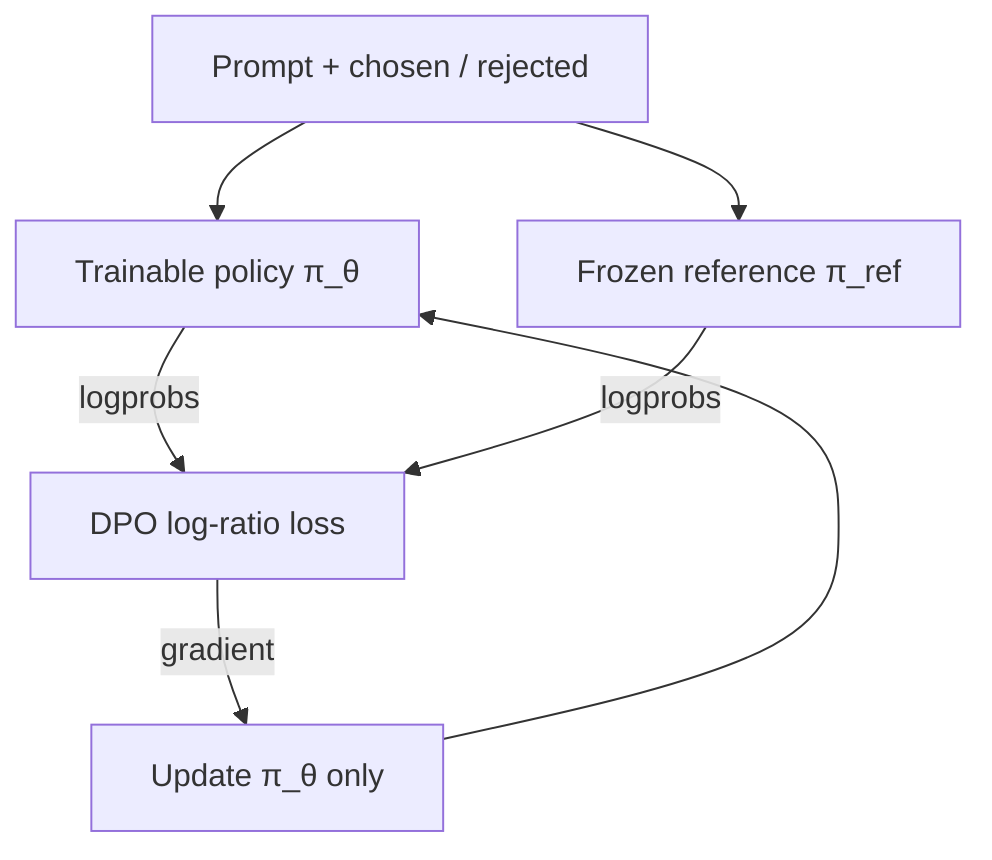

Direct Preference Optimization (DPO; Rafailov et al., 2023) trains a language-model policy from preferred and rejected responses with a binary classification loss. Its loss is derived from the KL-regularized reward objective used in classic [RLHF](glossary://rlhf), but it fits preference likelihood directly, without a separate [reward model](glossary://reward-model) or an online reinforcement-learning loop (for example [PPO](glossary://ppo)). The derivation uses a Bradley-Terry preference model; finite-data DPO and PPO training can produce different policies.

The key move is a change of variables: under the Bradley-Terry preference model, the optimal policy for the usual RLHF objective can be written in closed form in terms of a reward. DPO inverts that relationship so the policy itself plays the role of an *implicit* reward. Preference learning becomes ordinary supervised training on offline triples `(prompt, chosen, rejected)`.

## Intuition

Classic RLHF is a two-stage stack:

1. Fit a reward model so preferred answers score higher than rejected ones.
2. Optimize the policy with RL to raise reward while staying near a reference policy via a [KL](glossary://kl-divergence) penalty.

That stack works, but it is heavy: a second model, on-policy sampling, value/advantage machinery, and many knobs that interact. DPO starts from the same constrained objective (maximize reward, stay close to a reference) and reparameterizes the reward as:

$$
r(x,y)=\beta\log\frac{\pi(y\mid x)}{\pi_{\mathrm{ref}}(y\mid x)}
$$

(up to a prompt-only term that cancels in pairwise comparisons). Plug that form into Bradley-Terry, and the preference probability depends only on $\pi$ and $\pi_{\mathrm{ref}}$. You never materialize a reward head; the language model *is* the object of a logistic loss.

Mechanically, the gradient encourages a larger relative log-likelihood margin for the preferred completion $y_w$ over the rejected completion $y_l$, measured against the reference. Pairwise outcomes depend on the data, initialization, and optimizer trajectory, so inspect preference metrics on held-out pairs. Gradients weight examples more when the current policy still ranks the rejected answer too highly, so easy pairs fade out and hard pairs keep teaching.

## Formula

For prompt $x$, preferred $y_w$, rejected $y_l$, trainable policy $\pi_\theta$, reference $\pi_{\mathrm{ref}}$, and temperature-like coefficient $\beta>0$:

$$
\mathcal{L}_{\mathrm{DPO}}(\pi_\theta;\pi_{\mathrm{ref}})
=
-\mathbb{E}_{(x,y_w,y_l)\sim\mathcal{D}}
\Bigg[
\log\sigma\Bigg(
\beta\log\frac{\pi_\theta(y_w\mid x)}{\pi_{\mathrm{ref}}(y_w\mid x)}
-
\beta\log\frac{\pi_\theta(y_l\mid x)}{\pi_{\mathrm{ref}}(y_l\mid x)}
\Bigg)
\Bigg]
$$

where $\sigma(z)=1/(1+e^{-z})$ is the logistic function and sequence log-probabilities are sums of token [logprobs](glossary://logprob):

$$
\log\pi(y\mid x)=\sum_t\log\pi(y_t\mid x,y_{<t}).
$$

Define the implicit rewards $\hat{r}_\theta(x,y)=\beta\log\frac{\pi_\theta(y\mid x)}{\pi_{\mathrm{ref}}(y\mid x)}$. The argument of $\sigma$ is the *reward margin* $\hat{r}_\theta(x,y_w)-\hat{r}_\theta(x,y_l)$. Loss falls when that margin is large and positive.

$\beta$ is the KL strength from the original regularized RL problem. In that optimal-policy derivation, larger $\beta$ favors staying closer to $\pi_{\mathrm{ref}}$. In practical DPO it also scales the logistic margin and gradient, so measure actual KL rather than assuming monotone behavior under every training recipe. Hugging Face TRL's current `DPOConfig` defaults to $\beta=0.1$; tune it on held-out behavior and distance to the reference.

## How it works

1. **Start from an SFT (or similar) checkpoint.** That model is usually both the initial policy and the frozen reference $\pi_{\mathrm{ref}}$. If you only have preference pairs and no SFT model, practitioners often train a short preferred-completion SFT pass first so the reference is in-distribution.
2. **Build offline preference data.** For each prompt, collect two completions and a label: chosen vs rejected. Sources include human raters, stronger-model judges, or synthetic preference pipelines. Format is typically `(prompt, chosen, rejected)`.
3. **Compute sequence logprobs** under $\pi_\theta$ and $\pi_{\mathrm{ref}}$ for both completions (prompt tokens masked out of the loss).
4. **Minimize $\mathcal{L}_{\mathrm{DPO}}$.** Apply the preference loss directly to policy log probabilities. Reward-model fitting and rollout collection remain separate workflows.
5. **Evaluate outside the training loss.** Win rate vs a fixed baseline, safety/refusal slices, factuality, length, and capability retention all matter more than the DPO classification accuracy alone.

```python
# Conceptual DPO step (sequence-level logprobs already summed)
import torch
import torch.nn.functional as F

def dpo_loss(logp_w, logp_l, logp_ref_w, logp_ref_l, beta=0.1):
    # logp_* : batch of log π(y|x) for chosen (w) / rejected (l)
    pi_logratios = logp_w - logp_l
    ref_logratios = logp_ref_w - logp_ref_l
    logits = beta * (pi_logratios - ref_logratios)
    return -F.logsigmoid(logits).mean()
```

In practice you use a trainer (for example TRL `DPOTrainer`) that handles tokenization, chat templates, reference logprobs, and optional PEFT/LoRA. Variants (IPO, hinge, length-normalized losses, and others) swap the scalar loss while keeping the same pair data shape.

## Diagram



DPO applies a classification objective directly to policy likelihoods for preference pairs. Classic RLHF routes those preferences through a reward model and then PPO.

## Worked numbers

Suppose, after summing token logprobs for one pair (natural log):

| Quantity | Chosen $y_w$ | Rejected $y_l$ |
|---|---:|---:|
| $\log\pi_\theta(y\mid x)$ | $-12.0$ | $-14.0$ |
| $\log\pi_{\mathrm{ref}}(y\mid x)$ | $-11.5$ | $-11.0$ |

Then:

$$
\log\frac{\pi_\theta(y_w\mid x)}{\pi_{\mathrm{ref}}(y_w\mid x)}=-12.0-(-11.5)=-0.5
$$

$$
\log\frac{\pi_\theta(y_l\mid x)}{\pi_{\mathrm{ref}}(y_l\mid x)}=-14.0-(-11.0)=-3.0
$$

With $\beta=0.1$:

$$
z=\beta\big((-0.5)-(-3.0)\big)=0.1\cdot 2.5=0.25
$$

$$
\mathcal{L}=-\log\sigma(0.25)\approx -\log(0.562)=0.576
$$

The policy already assigns a higher *relative* likelihood to the chosen answer than the reference does, so the loss is moderate. If the policy reversed the ordering (rejected relatively more likely), $z$ would go negative and the loss would jump toward $-\log\sigma(\text{large negative})\approx |z|$ for large $|z|$, pushing hard on that pair.

## Example

You run [supervised fine-tuning](glossary://supervised-fine-tuning) on access-policy questions so the model follows your response contract. Raters compare two answers for the same request: the preferred answer cites the controlling policy and asks for the missing environment; the rejected answer invents a permission rule. DPO on thousands of such pairs increases the log-probability gap favoring the preferred behavior relative to the frozen SFT reference.

Data quality decides what you actually optimize. If raters systematically prefer longer answers, DPO will amplify verbosity. If rejected answers are cartoonishly bad, the model learns little about the hard boundary between "almost right" and "right." Prefer *plausibly tempting* rejects: fluent, on-topic answers that still violate a rule you care about (safety, tool use, grounding, tone).

## What to watch in production

| Signal | Healthy pattern | Warning |
|---|---|---|
| Implicit reward margin | Rising on train and held-out pairs | Margin up, offline win rate flat (overfit pairs) |
| Absolute chosen logprob $\log\pi_\theta(y_w)$ | Stays in a reasonable band vs SFT | Margin up while chosen logprob collapses (likelihood displacement; often length bias, bad $\beta$, or weak pairs) |
| KL / distance to reference | Moves with $\beta$ as expected | Collapse: short generic answers, loss of diversity |
| Length | Stable or intentional; track length next to sequence-sum logprobs | Runaway verbosity or extreme brevity that invents margin without better answers |
| Slice evals | Safety, refusal, tool format hold | Preference win rate up while capability/safety drops |
| Reference choice | Same family as the SFT start | Wrong reference or chat-template mismatch corrupts ratios |

DPO reuses fixed preference pairs during optimization, so its training path avoids online rollout collection and preserves whatever coverage and bias those pairs contain. Refresh the preference data and reevaluate when product requirements change; each run reflects the pairs and recipe used to train it.

## Why it matters here

DPO is a standard post-training path in open and industrial LLM stacks and a primary contrast class against full RLHF. On LeetLLM it sits next to reward models, PPO, SFT, and KL regularization so you can reason about *when* pairwise preference data is enough, what $\beta$ and the reference actually control, and why preference win rate alone is a weak release gate. Many later methods (IPO, online DPO variants, group-relative RL for verifiable rewards) are easier to place once this loss and its implicit-reward view are solid.

## Related terms

- [RLHF](glossary://rlhf)
- [Reward model](glossary://reward-model)
- [PPO](glossary://ppo)
- [Supervised fine-tuning](glossary://supervised-fine-tuning)
- [KL divergence](glossary://kl-divergence)
