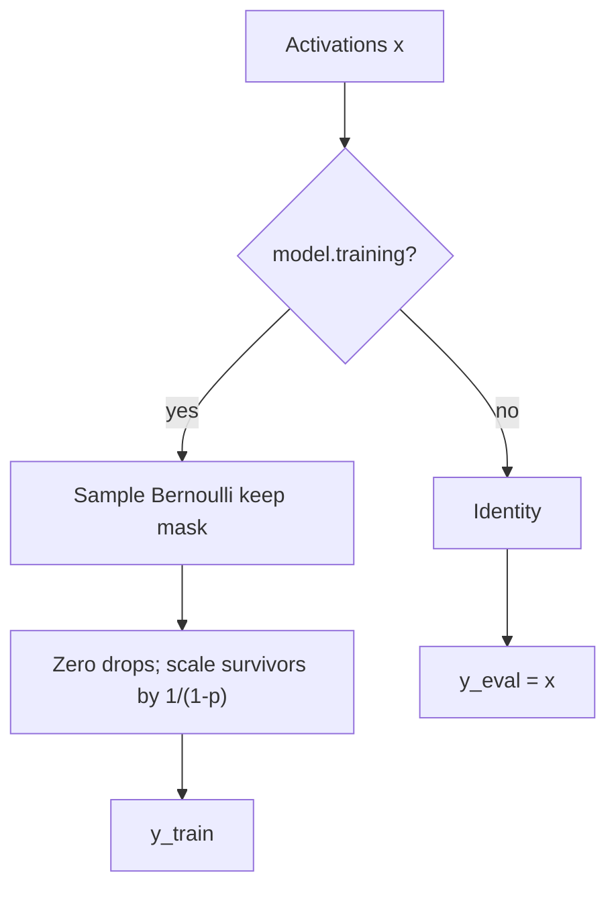

Dropout is a regularization technique that randomly zeros a subset of units (and their connections) on each training forward pass to reduce reliance on co-adapted features (Srivastava et al., 2014). Each step effectively samples a thinned subnetwork; in standard evaluation mode the dropout layer stops sampling masks. Other stochastic or nondeterministic network operations can still affect end-to-end determinism. Modern frameworks commonly use *inverted dropout*: survivors are scaled up during training so evaluation can be a pure identity map.

## Intuition

Without noise, hidden units can specialize in brittle combinations that only appear in the training set. Dropout forces every useful signal to survive under many random masks, which is roughly like training a huge ensemble of thinned nets and then using one average net at test time. The price is extra gradient noise and sometimes slower convergence; the payoff is less overfitting when data is scarce relative to capacity.

## Formula

Let $0\le p<1$ be the probability that an element is zeroed, and let $m_i \sim \mathrm{Bernoulli}(1-p)$ be an independent keep mask. Inverted dropout (what PyTorch `nn.Dropout` implements) does:

$$
y_i =
\begin{cases}
\dfrac{m_i}{1-p}\, x_i & \text{training} \\
x_i & \text{evaluation}
\end{cases}
$$

so $\mathbb{E}[y_i \mid x_i] = x_i$ in training, matching eval magnitude. PyTorch also permits the special case $p=1$: every training output is zero, rather than using the division above. The original paper scaled weights by the keep probability $(1-p)$ only at test time; inverted dropout moves that scale into training so serving code is simpler.

During backprop, dropped units contribute zero local gradient on that step; survivors pass gradient scaled by $1/(1-p)$.

## Example

A vector of four hidden activations and $p = 0.5$ (keep rate $0.5$, scale $2$):

$$
x = [1.0,\ 2.0,\ 3.0,\ 4.0]
$$

One training mask might keep indices $0$ and $2$:

$$
y_{\text{train}} = [2.0,\ 0.0,\ 6.0,\ 0.0]
$$

At eval, dropout is off:

$$
y_{\text{eval}} = [1.0,\ 2.0,\ 3.0,\ 4.0]
$$

In code, the same layer must honor train/eval mode:

```python
import torch
import torch.nn as nn

drop = nn.Dropout(p=0.1)
x = torch.ones(4)

drop.train()
y_train = drop(x)   # ~10% zeros; survivors scaled by 1/0.9

drop.eval()
y_eval = drop(x)    # identical to x (identity)
```

If a serving process leaves `model.train()` on, logits jitter across identical prompts even with temperature $0$, because each forward redraws masks.

## Where it sits in Transformers

Vaswani et al. (2017) set $P_{\mathrm{drop}} = 0.1$ for the base model and applied **residual / sublayer dropout** to each sublayer output *before* residual add (and LayerNorm in the original post-norm stack), plus dropout on the embedding + positional sum. Implementations (tensor2tensor, GPT-2, Hugging Face) also commonly apply **attention dropout** on the softmax attention weights before they multiply $V$; the paper text only names residual dropout in §5.4, though later experiments refer to tuning "attention and residual" rates.

A typical pre-norm block (modern LLMs) looks like:

$$
x \leftarrow x + \mathrm{Dropout}(\mathrm{Attn}(\mathrm{Norm}(x)))
$$
$$
x \leftarrow x + \mathrm{Dropout}(\mathrm{FFN}(\mathrm{Norm}(x)))
$$

Large modern pretraining recipes (LLaMA-style stacks; not GPT-2, which still used nonzero `attn`/`resid` dropout) often set residual and attention dropout to $0$, relying on scale, data volume, and other regularizers. Fine-tunes, smaller models, GPT-2-style code, and libraries that still expose `attn_dropout` / `resid_dropout` still require correct mode handling even when $p = 0$ in the released checkpoint.

## Diagram



## Worked numbers: train vs eval mismatch

Suppose a residual path contributes a fixed signal of magnitude $1.0$ per unit and residual dropout uses $p = 0.1$. Under inverted dropout, expected residual contribution in training still matches eval. If someone implements "classic" dropout *without* the $1/(1-p)$ train-time scale *and* forgets to multiply by $(1-p)$ at test time, train sees expected magnitude $0.9$ while eval sees $1.0$: every residual branch is about $11\%$ larger at eval than training expected. That shifts LayerNorm inputs and can move loss curves for no good reason. Prefer the framework primitive; do not hand-roll masks unless you match inverted dropout exactly.

## Production and debug path

- **Train/eval mode.** Nondeterministic logits on a frozen checkpoint can mean dropout or another stochastic layer is still active; nondeterministic kernels are another cause. Call `model.eval()` and disable gradients for inference and offline eval. Functional dropout must also receive the correct training flag.
- **Activation checkpointing.** Recompute re-runs the forward segment. RNG must be restored so the dropout mask matches the first forward (`preserve_rng_state=True` in PyTorch); otherwise gradients are for a different mask than the loss.
- **Distributed / multi-device.** Independent RNG streams per device are fine for independent masks, but mismatched seed handling across recompute or pipeline stages produces hard-to-spot training bugs.
- **Fine-tuning small data.** Dropout can still help on adapters or full fine-tunes with few examples; large pretraining often prefers $p = 0$ plus weight decay and data scale.
- **Contrastive embeddings.** Unsupervised SimCSE (Gao et al., 2021) encodes the *same* sentence twice with independent dropout masks and treats the pair as a positive: dropout serves as both a regularizer and minimal data augmentation.

## Why it matters here

Dropout is the classic "stochastic only in training" layer every LLM engineer still trips over: attention and residual dropout knobs in older Transformer code, train/eval skew in serving, RNG under activation checkpointing, and intentional use as noise in contrastive embedding training. Knowing the inverted-dropout scale and where $p$ was zeroed in modern pretraining keeps both training recipes and production debugging honest.

## Related terms

- [Overfitting](glossary://overfitting)
- [Self-attention](glossary://self-attention)
- [Activation checkpointing](glossary://activation-checkpointing)
- [Weight decay](glossary://weight-decay)
- [Training-serving skew](glossary://training-serving-skew)
