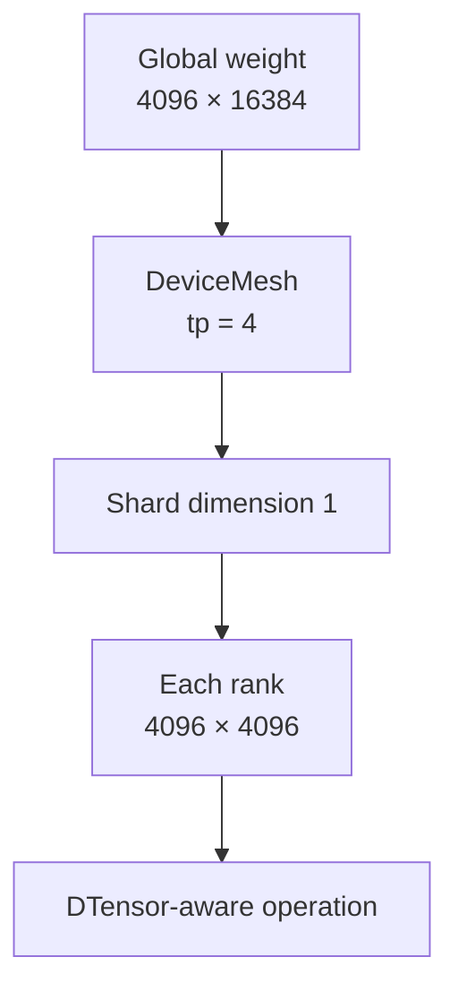

**PyTorch DTensor** represents one logical tensor whose storage is distributed across a `DeviceMesh`. Each rank holds a local tensor, while DTensor metadata records the global shape, mesh, and placement of data on every mesh dimension.

DTensor lets distributed code describe tensor layout directly instead of passing unrelated local shards with an implicit convention. PyTorch operations can propagate those layouts and insert required collective communication when an operation needs a different placement.

## Three placements

For each `DeviceMesh` dimension, a DTensor uses one of three placement types:

| Placement | Meaning | Typical communication when changed |
| --- | --- | --- |
| `Shard(dim)` | Split tensor dimension `dim` across mesh ranks | all-gather to replicate, all-to-all to reshard another dimension |
| `Replicate()` | Every rank holds complete value | scatter or local chunking to shard |
| `Partial(op)` | Each rank holds partial result awaiting reduction | all-reduce or reduce-scatter to materialize final value |

`Partial()` is not incomplete metadata or an error. It describes a mathematically valid intermediate. For example, a row-parallel matrix multiplication can produce partial sums that become replicated only after an all-reduce.

## Global tensor, local shards



All ranks agree that global weight shape is `[4096, 16384]`. With `Shard(1)` over four tensor-parallel ranks, each rank owns `[4096, 4096]`. Model code can retain global-shape meaning while runtime executes on local shards.

## Example

Run this sketch with `torchrun --standalone --nproc_per_node=4` on a host with four available CUDA devices. Bind each process to its local device before creating CUDA tensors.

```python
import os
import torch
from torch.distributed.device_mesh import init_device_mesh
from torch.distributed.tensor import Shard, distribute_tensor

torch.cuda.set_device(int(os.environ["LOCAL_RANK"]))
mesh = init_device_mesh("cuda", (4,), mesh_dim_names=("tp",))
weight = torch.randn(4096, 16384, device="cuda")

distributed_weight = distribute_tensor(
    weight,
    device_mesh=mesh,
    placements=[Shard(1)],
)

print(distributed_weight.shape)          # global: [4096, 16384]
print(distributed_weight.to_local().shape)  # local: [4096, 4096]
```

Every rank must construct the same mesh and call compatible DTensor operations in the same distributed order. By default, `distribute_tensor` uses mesh-group rank zero's tensor as source data; independent random tensors on the other ranks do not define different global weights. An inconsistent mesh can hang process-group initialization or send collectives through unintended rank groups.

## DeviceMesh and DTensor

`DeviceMesh` names and organizes ranks. DTensor says how one tensor is placed on that mesh.

A two-dimensional mesh might use dimensions `("dp", "tp")`. A parameter can be replicated over `dp` and sharded over `tp`. A later FSDP transform may shard parameters over `dp` as well. The same global tensor then carries two independent placement decisions.

PyTorch's native tensor-parallel APIs build on DTensor. FSDP2 also exposes sharded parameters as DTensors. This common representation makes tensor parallelism, data parallelism, checkpointing, and compiler work more composable than separate wrapper-specific shard types.

## Layout inference inserts communication

Layout propagation can make code concise while still inserting collectives. If one operation produces `Shard(1)` and the next requires `Replicate()`, DTensor must redistribute data. That may insert an all-gather. If output is `Partial("sum")`, materializing a replicated value requires a reduction.

Inspect layouts and communication when performance matters. A correct program can still redistribute on every layer because adjacent placement choices disagree.

## Common mistake

**A local shard stores one rank's portion of the global DTensor.** Calling `torch.save()` on one rank's `to_local()` tensor saves only that rank's values. A portable checkpoint also needs mesh and placement information so the global tensor can be reconstructed across intended shapes.

Use PyTorch Distributed Checkpoint or another DTensor-aware state-dict path. Test save and restore across intended mesh shapes before a long run. Consolidating a full checkpoint requires coordinated reads or gathers, not a single-rank file copy.

## Why it matters here

DTensor is the layout primitive beneath PyTorch-native tensor parallelism, FSDP2, and NeMo AutoModel. It offers a different distributed model representation from Megatron Core's model-specific parallel modules. Both can express sharding, but their module construction, checkpoint formats, process groups, and conversion paths differ.

Understanding global shape, local shape, mesh dimensions, and placement transitions makes those boundaries concrete. It also explains why a checkpoint conversion is more than renaming tensors: source and destination must agree on global values and reconstruct their chosen shard layouts.

## Official references

- [PyTorch distributed package and DeviceMesh](https://docs.pytorch.org/docs/stable/distributed)
- [PyTorch tensor parallelism API](https://docs.pytorch.org/docs/stable/distributed.tensor.parallel.html)
- [PyTorch tensor parallel tutorial](https://docs.pytorch.org/tutorials/intermediate/TP_tutorial.html)

## Related terms

- [PyTorch](glossary://pytorch)
- [Tensor](glossary://tensor)
- [Tensor parallelism](glossary://tensor-parallelism)
- [FSDP](glossary://fsdp)
- [Data parallelism](glossary://data-parallelism)
- [Process group](glossary://process-group)
- [All-gather](glossary://all-gather)
- [Reduce-scatter](glossary://reduce-scatter)
- [Model checkpoint](glossary://model-checkpoint)
