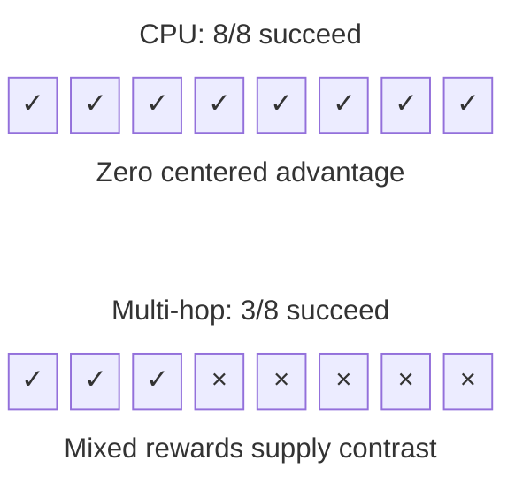

**Dynamic sampling** changes which tasks or prompts receive rollout budget based on current model behavior. In group-relative RL, it can replace tasks whose sampled rewards have no useful variation with tasks that still produce contrasting outcomes.

Dynamic sampling prioritizes groups with reward variation while retaining coverage across task difficulty. With binary rewards and group-centered advantages, groups where every rollout fails or every rollout succeeds have zero relative reward advantage. Graded failure rewards, KL penalties, or other auxiliary losses can still supply signal. Rebalancing changes the sampled task distribution; preserve coverage or apply an appropriate weighting scheme to keep the training objective aligned with the target distribution.

## Curriculum feedback loop

A sampler can estimate recent success rate, reward variance, judge disagreement, length, or tool-error patterns per task family. Replacement rules then rebalance batches while keeping coverage floors so rare domains aren't forgotten.

## Diagram

## Example

If simple CPU incidents produce 8/8 success while multi-hop dependency incidents produce 3/8, the sampler can spend more generation on the latter without deleting easy regression coverage entirely.

## Why it matters here

Dynamic sampling is disabled in the supplied GLM-5.3 candidate config. Measure the zero-variance group fraction first. Filtering already-generated groups can improve learner signal per training batch. Replacement groups consume additional generation and reward compute, so budget those costs alongside the signal gain.

## Related terms

- [GRPO](glossary://grpo)
- [Active learning](glossary://active-learning)
- [Reward function](glossary://reward-function)
- [Variance](glossary://variance)
- [Evaluation slice](glossary://evaluation-slice)
