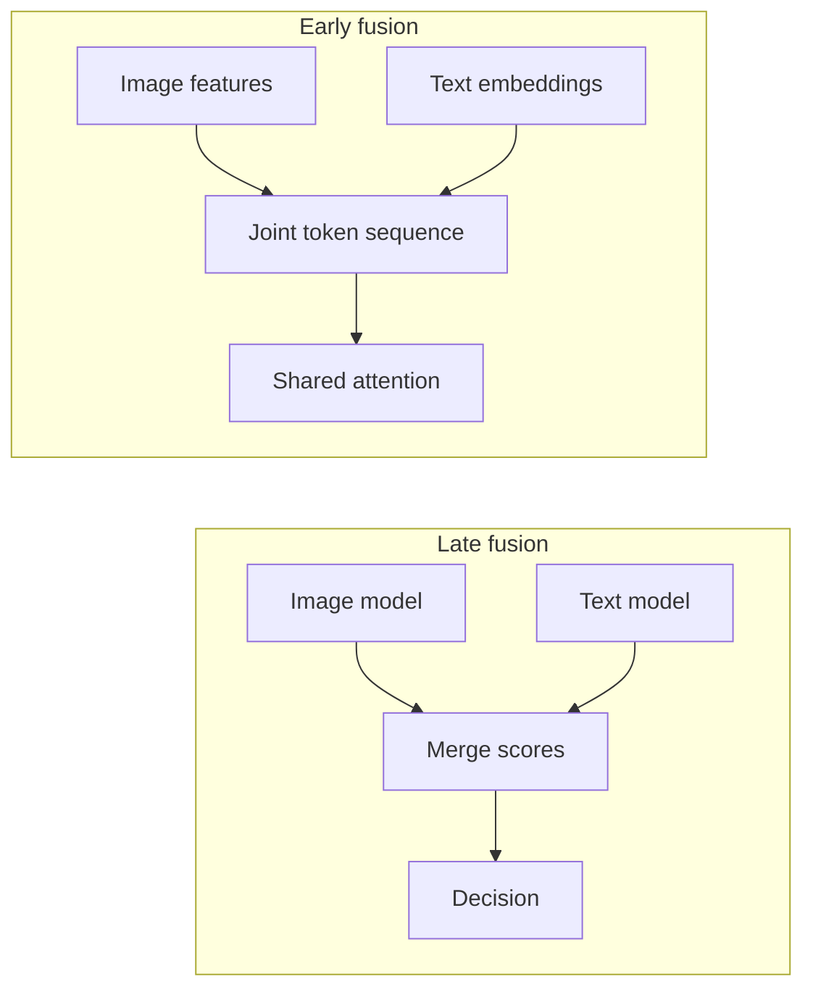

**Early fusion** combines multiple modalities or feature streams *before* most of the model reasons, so shared layers see joint inputs from the start of the stack. In classic multimodal ML this means feature-level merge (concatenate, sum, or project-then-stack raw or early features). In modern vision-language models it usually means turning image patches (or discrete image tokens) into the same width as text embeddings, packing them into one sequence, and running shared self-attention over the mixed stream so fine-grained cross-modal binding can form in early layers.

The opposite design is [late fusion](glossary://late-fusion): each modality keeps its own model until scores or decisions merge near the end. [Cross-attention](glossary://cross-attention) sits between those extremes: streams stay separate longer, and one side *reads* the other with $Q$ from the target and $K,V$ from the source instead of one joint self-attention grid.

## Diagram



## Intuition

When image patches and text tokens meet at a late head, each stream mostly reasons alone. Early fusion puts them in one residual stream so attention can bind "red" in the question to patch tokens that look red while those layers are forming features, before a classifier averages independent scores.

That power has a price. The shared stack pays attention cost on the *combined* length, KV-cache and prefill grow with every visual token, and a noisy or missing modality can corrupt the joint representation earlier than in a modular late-fusion system.

## How it works

A typical early-fusion VLM path:

1. **Encode vision.** A ViT (or image tokenizer) turns an image into $N_v$ vectors. Continuously projected patch features (common in adapter-style VLMs) or discrete codebook tokens (token-based early fusion, e.g. Chameleon) both land as a sequence of visual positions.
2. **Project to model width.** A linear map or small MLP sends vision vectors into the LLM embedding dimension $d$, matching text token embeddings.
3. **Pack one sequence.** Concatenate visual tokens with text tokens (order is a design choice: image-first, text-first, or interleaved). Optional modality tags or special start/end markers help the model know where the image block sits.
4. **Shared stack.** Self-attention and MLPs run over the full length $n = N_v + N_t$. Cross-modal interactions happen as ordinary attention edges inside that mixed sequence.

Survey taxonomy (Baltrušaitis et al., and later multimodal fusion surveys) also names **hybrid / intermediate fusion**: some unimodal depth, then merge mid-stack. Production systems often blur labels: a frozen vision encoder plus early concat into an LLM is "earlier" than score fusion but not as fully native as training one transformer from scratch on interleaved tokens.

## Example

A support VLM answers "which button is red?" on a UI screenshot:

| Stream | Tokens | Notes |
| --- | --- | --- |
| Image | $N_v = 256$ | $16\times16$ patches after projection to width $d$ |
| Text | $N_t = 40$ | question + system wrapper |
| Joint sequence | $n = 296$ | one causal (or bidirectional) attention grid |

Full attention's pairwise arithmetic scales with $n^2$, so length $296$ involves about $(296/40)^2 \approx 55\times$ as many pair interactions as length $40$ at the same depth. FlashAttention reduces memory traffic and intermediate storage, but retains quadratic arithmetic for full attention; whole-model latency need not grow by $55\times$. In a cached decoder, prefill materializes keys and values for all $296$ positions; decode then appends answer tokens on top of that multimodal [KV cache](glossary://kv-cache).

Binding can happen inside early layers wherever the attention mask permits it: a text query for "red" can attend to visual keys that encode the red control. With a causal mask, a text position can read visual positions only if they precede it. Joint processing enables this interaction; verify grounding through evidence and region-linked evaluation.

**Native token early fusion (Chameleon-style).** Meta's Chameleon quantizes a $512\times512$ image into $1024$ discrete image tokens from an $8192$-entry codebook, mixes them with text BPE tokens in one vocabulary, and trains a single transformer on interleaved documents. After that tokenization step, there is no separate continuous vision tower: every modality already lives in the shared token stream. That is early fusion taken all the way to a shared discrete representation.

## Worked numbers

Rough prefill KV memory for one request (keys and values, all layers), ignoring overhead:

$$
\text{bytes} \approx 2 \cdot L \cdot H_{\mathrm{kv}} \cdot d_{\mathrm{head}} \cdot n \cdot b
$$

with $L$ layers, $H_{\mathrm{kv}}$ KV heads, head dim $d_{\mathrm{head}}$, sequence length $n$, and $b=2$ bytes for FP16/BF16.

```python
def kv_bytes(layers, kv_heads, head_dim, seq_len, bytes_per=2):
    return 2 * layers * kv_heads * head_dim * seq_len * bytes_per

# 32 layers, 8 KV heads, d_head=128, image+text n=296 vs text-only 40
print(kv_bytes(32, 8, 128, 296) / 1e6, "MB multimodal")
print(kv_bytes(32, 8, 128, 40) / 1e6, "MB text-only")
# ~38.8 MB vs ~5.2 MB per request (illustrative; real engines add paging/overhead)
```

High-resolution images that expand to $N_v$ in the thousands dominate [context window](glossary://context-window) budget and [prefill](glossary://prefill) / TTFT long before the user question is long.

## Trade-offs

| Design | When streams meet | Strength | Cost / risk |
| --- | --- | --- | --- |
| Early fusion (joint sequence) | Input / early features | Fine-grained binding for grounded VQA, UI, charts | Longer $n$, larger KV, weak modality pollutes shared layers |
| Cross-attention fusion | Mid stack, asymmetric $Q$ vs $K,V$ | Keep a frozen encoder; cache source KV | Extra blocks; less free interleaving than one stream |
| Late fusion | Scores / decisions | Modular debug, easy ablations, missing-modality fallback | Misses token-level region-to-span binding |

Use early fusion when the task needs joint structure (pointing, OCR-heavy docs, "which region matches this phrase?"). Prefer late fusion when one modality only reranks, filters, or verifies another, or when you must fail independent branches separately (e.g. moderation specialists).

**Training and serving gotchas.** Text-only traffic needs training coverage and a valid input path; drop-modality augmentation, masks, or fallback paths can help depending on the architecture. Visual tokens can dominate length and gradient mass unless you balance sampling and resolution. Token-based early fusion also stresses optimization stability when modalities have different entropy (Chameleon used QK-Norm and related fixes for mixed-modal training). In production, measure TTFT and cache size with real image-token counts because text-only load tests omit visual-token costs.

## Why it matters here

Early fusion is a core architecture choice for multimodal LLMs, VLMs, and any stack that packs text with images, audio tokens, or structured feature tokens into one transformer. Curriculum material on vision encoders, attention types, context length, and serving memory all assume you can predict how early joint sequences change prefill, KV growth, and grounding quality versus late score merge.

## Related terms

- [Late fusion](glossary://late-fusion)
- [Cross-attention](glossary://cross-attention)
- [Vision-language model](glossary://vision-language-model)
- [Self-attention](glossary://self-attention)
- [KV cache](glossary://kv-cache)
