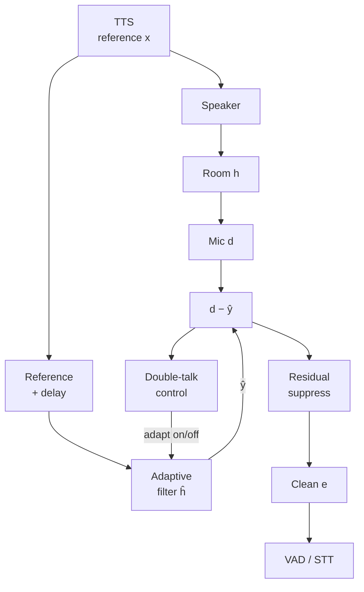

Echo cancellation, usually called **acoustic echo cancellation (AEC)**, reduces the system's own loudspeaker playback in the microphone signal so [voice activity detection](glossary://voice-activity-detection) and [speech-to-text](glossary://speech-to-text) can distinguish the user from the assistant. In a hands-free voice agent the far-end reference is the [text-to-speech](glossary://text-to-speech) (or other playout) stream. That audio leaves the speaker, travels through the room (and hardware), and re-enters the mic mixed with near-end user speech. AEC estimates that acoustic path, subtracts the predicted echo, and hands a residual capture stream to the rest of the stack. Cancellation can be incomplete and suppression can distort near-end speech.

Without AEC the agent can "hear" itself: VAD fires on its own voice, STT transcribes the last TTS phrase, and the turn-taking loop looks like an LLM bug if you only inspect final text. [Barge-in](glossary://barge-in) and continuous listening during playout both assume this low-level signal path works.

## How it works

Classical AEC uses a **reference-based adaptive filter** plus supporting stages:

1. **Reference (render / far-end).** The clean digital signal about to play (or just played) is buffered. Without a correct reference, cancellation cannot align to the echo.
2. **Delay estimation.** Playback buffers, DAC, acoustic travel, ADC, and capture buffers shift the echo relative to the reference. The offset varies by device and route. Cross-correlation or related methods estimate it so the filter looks at the right time window.
3. **Linear adaptive filter.** A long FIR filter $\hat{\mathbf{h}}$ models the loudspeaker–enclosure–microphone (LEM) impulse response. It filters the reference to predict echo $\hat{y}$, then forms the residual $e = d - \hat{y}$ from the mic signal $d$. Coefficients adapt online (commonly NLMS or frequency-domain block variants such as WebRTC's AEC3 partitioned filter).
4. **Double-talk control.** When user and agent speak at once, $e$ contains near-end speech. Adapting as if that were filter error corrupts $\hat{\mathbf{h}}$. Double-talk detection freezes or slows adaptation while still subtracting the current echo estimate.
5. **Residual echo suppression (non-linear processing).** Linear filters leave residual echo from model error, path changes, and speaker/amp non-linearity. A frequency-dependent suppressor attenuates leftover echo bands; comfort noise may fill unnatural gaps.

Production systems (browser capture stacks, OS voice modes, WebRTC AEC3) implement this pipeline with different quality and latency trade-offs. Product code usually *requests* AEC rather than reimplementing it, then verifies the real capture path.

## Formula

Model the mic as near-end speech $s$, residual noise $n$, and echo from far-end reference $x$ through the true acoustic path $\mathbf{h}$:

$$
d(n) = s(n) + n(n) + \mathbf{h}^\top \mathbf{x}(n)
$$

where $\mathbf{x}(n) = [x(n), x(n-1), \ldots, x(n-L+1)]^\top$ and $L$ is the filter length. Taps must cover the modeled echo tail; the required duration depends on the room and hardware.

The canceller maintains $\hat{\mathbf{h}}(n)$ and produces:

$$
\hat{y}(n) = \hat{\mathbf{h}}(n)^\top \mathbf{x}(n), \qquad e(n) = d(n) - \hat{y}(n)
$$

**Normalized LMS (NLMS)** updates when adaptation is allowed (not double-talk):

$$
\hat{\mathbf{h}}(n+1) = \hat{\mathbf{h}}(n) + \frac{\mu\, e(n)\, \mathbf{x}(n)}{\|\mathbf{x}(n)\|^2 + \varepsilon}
$$

Here $\mu$ is a step-size in $(0, 2)$ for classical stability bounds, and $\varepsilon > 0$ avoids division by zero when the reference is quiet. Normalization keeps updates stable when far-end energy swings.

**Echo return loss enhancement (ERLE)** measures how much the linear canceller attenuates echo (single-talk, echo-dominated windows):

$$
\mathrm{ERLE}(n) = 10 \log_{10} \frac{\mathbb{E}\{|y(n)|^2\}}{\mathbb{E}\{|e(n)|^2\}}
$$

where $y$ is the echo component in the mic. Estimate ERLE on echo-dominated windows, or use a controlled recording with known echo; near-end speech and noise contaminate the denominator during double-talk. There is no universal healthy dB cutoff across devices and rooms. A drop from a matched single-talk baseline can indicate misaligned delay, missing reference, or path mismatch.

## Diagram

## Example

A hypothetical laptop trace plays TTS at full speaker volume: *"Deployment api-v17 is still running."* The user starts to interrupt with *"stop it now."*

| Quantity | Illustrative value or behavior |
|---|---|
| Sample rate on capture path | $16$ kHz |
| Playout + capture + acoustic delay | $\sim 80$ ms (device-dependent) |
| Filter length $L$ for $\sim 200$ ms tail | $0.2 \times 16000 = 3200$ taps (time-domain scale; block/frequency designs partition this) |
| Mic during TTS only | mostly echo $y$ of the TTS phrase |
| After converged AEC | residual echo well below user speech energy |
| Without AEC | VAD treats TTS as user speech; STT may emit `deployment api-v17 is still running` as a "user" turn |

Successful AEC should reduce false VAD triggers during pure playout. Residual echo can still cross a speech threshold on individual frames. During double-talk, adaptation is controlled and residual processing preserves near-end speech; barge-in mute can fire on true user onset while ignoring the agent's own voice.

If the reference is taken *after* a client-side volume ramp, EQ, or mix that the speaker did not play, or if delay estimate is off by many milliseconds, ERLE collapses and the same TTS phrase reappears in the transcript. That failure starts in acoustic routing, before model reasoning.

## Production path

**Browser / WebRTC.** `getUserMedia` exposes an `echoCancellation` constraint (boolean or enumerated modes depending on the UA). Implementations vary by OS and browser; treat the constraint as a *request*, then read back actual track settings and test speakerphone, laptops, phones, and Bluetooth. WebRTC's widely deployed AEC3 uses continuous delay tracking, a partitioned frequency-domain linear filter, double-talk-aware adaptation, residual suppression, and comfort noise.

The current Media Capture specification distinguishes `"remote-only"` (incoming WebRTC peer audio) from `"all"` (all system playout). A boolean `true` leaves the removal scope to the browser. Remote-only removal can exclude local TTS; route local render audio through the cancellation path and verify the actual reference routing.

**Native OS.** iOS voice-chat audio session modes and Android `AcousticEchoCanceler` (OEM-dependent) may supply AEC without you running the filter. Quality and whether AEC is active at all depend on session mode and device.

**What you must still own:**

- Correct reference routing (what was actually rendered)
- Continuous capture during TTS if you want barge-in
- Real-device regression: close speaker–mic coupling, high volume, reflective rooms, headset vs speakerphone, Bluetooth route changes
- Downstream gates: do not treat residual-echo spikes as user turns

Symptoms of bad AEC: assistant's last sentence in the user transcript, false barge-in with no human speech, self-reply loops, VAD "speech" only while the speaker is active. These look like agent logic bugs until you inspect the raw capture path.

## Why it matters here

Voice agents on LeetLLM rely on a full-duplex media path. Echo cancellation is the precondition that makes [VAD](glossary://voice-activity-detection), [barge-in](glossary://barge-in), and streaming STT trustworthy while TTS plays. Model quality cannot fix a mic that still contains the loudspeaker. Curriculum system design for real-time voice therefore treats AEC as a first-class capture constraint: request it, verify settings, measure residual-echo false triggers, and test the hardware paths users actually use.

## Related terms

- [Voice activity detection](glossary://voice-activity-detection)
- [Barge-in](glossary://barge-in)
- [Speech-to-text](glossary://speech-to-text)
- [Text-to-speech](glossary://text-to-speech)
- [Endpointing](glossary://endpointing)
