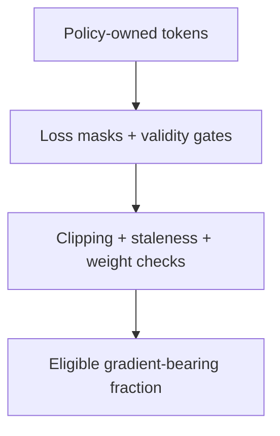

**Effective gradient-bearing token fraction** is share of policy-owned tokens still eligible to contribute nonzero policy-loss gradient after masks, validity gates, clipping, staleness rejection, and zero-weight conditions apply.

One operational definition is

$$
f_{\mathrm{eff}} =
\frac{\sum_t \mathbf{1}[m_t^{\mathrm{policy}}=1\;\land\;w_t\neq 0\;\land\;\text{token accepted}]}
{\sum_t \mathbf{1}[m_t^{\mathrm{policy}}=1]}.
$$

Here $w_t$ includes advantage and objective-specific weight. Exact acceptance predicate belongs to loss implementation.

This is an eligibility metric. It tracks tokens that can contribute to the objective; final parameter gradients can still be tiny, and contributions can cancel during reduction. The fraction catches failure hidden by average loss: valid actions may exist while most are zero-advantage, clipped, stale, nonfinite, or accidentally masked.

## Measurement contract

Log numerator and denominator, exclusion reason, token role, task family, policy age, and advantage sign. Separate observation tokens from model-owned action tokens. Report an empty batch as no sample; zero would imply a measured fraction.

## Example

Batch contains valid assistant tokens, but many belong to zero-advantage groups and another slice falls outside hard policy-ratio window. Raw token count looks healthy while effective fraction falls. Breakdown shows whether lost signal came from task sampling, clipping, staleness, or mask bug.

## Why it matters here

Trainer/rollout mismatch may widen only in low-probability tail. Global clipped fraction can look small while affected tokens carry rare tool choices or conclusions. Effective fraction plus slices shows whether optimizer still sees useful policy signal.

## Related terms

- [Loss mask](glossary://loss-mask)
- [Advantage](glossary://advantage)
- [Policy clipping](glossary://policy-clipping)
- [Goodput](glossary://goodput)
