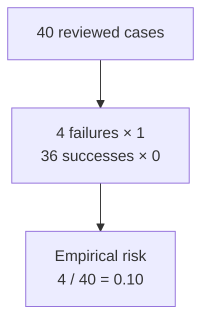

Empirical risk is the average loss a predictor incurs on a particular observed dataset. For examples $(x_i,y_i)$ and a predictor $h$, it is $\widehat L(h)=\frac{1}{n}\sum_{i=1}^{n}\ell(h(x_i),y_i)$. The value summarizes the rows actually measured; estimating future error requires representative sampling and accounting for any candidate selection on the same benchmark.

## Move from individual losses to an average

With binary correctness, loss zero means a correct answer and loss one means a failure. Other tasks can use squared error, cross-entropy, or application-specific costs, but any generalization argument must respect the loss function's actual range and sampling assumptions. Duplicated or correlated rows can make a large apparent sample weaker than its row count suggests.

## Example

A request router fails four reviewed cases and succeeds on 36. Its empirical risk on those 40 rows is $4/40=0.10$. That statement is directly observable. Saying its future failure probability is exactly 10% goes further: future traffic can differ, the sample is finite, and the router may have been selected after seeing these same labels.

## Why it matters here

AI evaluation dashboards routinely display benchmark error as if it were deployment truth. Naming empirical risk keeps the observed sample separate from the unknown target population and makes model selection, holdout hygiene, and uncertainty qualification explicit.

## Related terms

- [Population risk](glossary://population-risk)
- [Generalization gap](glossary://generalization-gap)
- [Loss function](glossary://loss-function)
- [Train, validation, and test split](glossary://train-validation-test-split)
