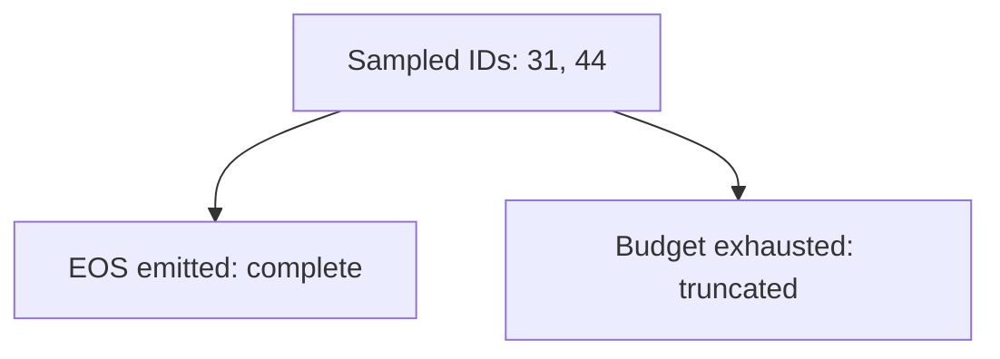

An end-of-sequence (EOS) token is a special token whose configured role marks a sequence as complete. Generation commonly stops when the model emits one of the configured EOS IDs. That event differs from exhausting a token budget, matching a text stop string, or pausing to execute a tool call.

## Message endings and sequence endings

Chat formats can distinguish the end of a message, the end of an assistant turn, and a handoff to tools. Some runtimes configure several special IDs as stopping conditions. Identify each marker's role from the model's tokenizer, chat template, and generation configuration.

[Hugging Face's chat-template guide](https://huggingface.co/docs/transformers/main/en/chat_templating) explains how templates place control tokens around messages. Adding special tokens again after templating can duplicate boundaries and produce a different input.

## Example

A sampled answer has IDs `[31, 44, 2]`, where this illustrative tokenizer assigns EOS to 2. Natural completion records that terminal token and its stop reason. If generation instead reaches a two-token cap after `[31, 44]`, the record is truncated. Both return text, but only one observed the policy choosing to finish.

## Why it matters here

Termination changes token masks, likelihood sums, reward eligibility, and serving capacity. When EOS is also used for padding, explicit masks identify which occurrences are padding. Preserve sequence boundaries, then train and evaluate with the intended stop policy and record cutoffs separately from completed answers.

## Related terms

- [Token](glossary://token)
- [Beginning-of-sequence token](glossary://beginning-of-sequence-token)
- [Chat template](glossary://chat-template)
- [Loss mask](glossary://loss-mask)
- [RL rollout](glossary://rl-rollout)
