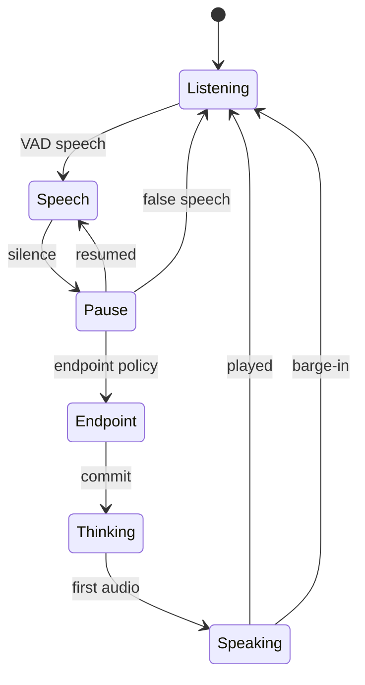

Endpointing (also called phrase endpointing or end-of-turn detection) decides when a speaker has finished a conversational turn so the system can commit the captured audio or transcript and start the assistant response. [Voice activity detection](glossary://voice-activity-detection) answers "is speech present in this frame?"; endpointing answers "is the user's *turn* complete enough to act on?" A mid-utterance pause is silence for VAD, while product context determines whether it marks the end of a turn.

In a streaming voice stack the endpoint is the commit boundary for acting on the captured turn. Some stacks begin speculative LLM prefill or generation before that boundary and cancel it when speech resumes. Commit too early and you cut the user off, split one thought into several agent replies, or fire irreversible tools on a partial request. Commit too late and time-to-first-audio stretches by hundreds of milliseconds to seconds, which often dominates the latency budget more than a few extra milliseconds of model inference.

## How it works

Production systems usually combine several signals instead of relying on one global silence timer:

1. **Acoustic presence (VAD).** Frame-level speech/non-speech (for example Silero VAD) starts capture, feeds [barge-in](glossary://barge-in), and starts a silence clock when speech drops out.
2. **Silence / VAD endpointing.** After speech→silence, wait a fixed delay $d$ (for example $300$–$800$ ms as a tuning range). When silence duration $\ge d$, declare an endpoint. [Deepgram's `endpointing`](https://developers.deepgram.com/docs/endpointing) is milliseconds of silence and sets `speech_final`; its documented default is 10 ms, so choose a conversational delay for the product's turn-taking goals. LiveKit's current Python option is `endpointing.min_delay`, normally 0.5 seconds; VAD mode waits for the larger of that delay and the VAD's own silence requirement.
3. **Transcript-gap endpointing.** Some STT stacks (for example Deepgram `UtteranceEnd`) fire when word timings show a long enough gap between words, which can still work when background noise keeps pure VAD from seeing "silence."
4. **Semantic end-of-turn.** A model estimates whether the utterance is a complete thought. [LiveKit supports both text and audio turn detectors](https://docs.livekit.io/agents/logic/turns/turn-detector/), and [OpenAI Realtime offers `semantic_vad`](https://developers.openai.com/api/docs/guides/realtime-vad) with an eagerness setting. Incomplete trails such as "the incident id is" can keep the floor open after a pause; complete commands such as "stop deployment 4219" can close sooner. These predictions can still make mistakes.
5. **Hybrid and catch-all.** Semantic early commit plus a hard maximum silence so unusual speech patterns still terminate. [AssemblyAI Universal-3.5 Pro Realtime](https://www.assemblyai.com/blog/turn-detection-endpointing-voice-agent) uses `min_turn_silence`, `max_turn_silence`, and modes. The older `end_of_turn_confidence_threshold` is deprecated and is not supported by that model.
6. **Manual / push-to-talk.** Explicit commit from a UI button or keyphrase when open-mic turn-taking is too risky (noisy floors, multi-party rooms).

The product dial is patience versus speed. Aggressive settings feel snappy on short commands and feel rude on digit strings, addresses, and thinking pauses. Patient settings feel polite and inflate endpointing latency, which is often the largest single slice of voice agent latency.

## Example

An operator says: "The incident id is forty-two... nineteen." Between "forty-two" and "nineteen" there is a $700$ ms pause while they read the screen.

| Policy | What happens | Outcome |
|---|---|---|
| Fixed silence $d = 400$ ms | Endpoint fires after "42" | Agent starts: "Looking up incident 42..." while the user is still speaking; false cutoff |
| Fixed silence $d = 1200$ ms | Waits through the pause | Correct incident `4219`, but every short "yes" also waits $\approx 1.2$ s of dead air |
| Semantic + min silence | If context identifies "42" as an unfinished ID, extend the wait; after "19", commit after a short silence | Can capture `4219` without a global $1.2$ s wait, but a detector may mistake "42" for a complete ID |

Concrete knobs from the linked provider documentation (model-specific, always re-measure on your audio):

```text
# Silence / VAD style
silence_duration_ms = 500         # OpenAI Realtime server_vad example, milliseconds
endpointing.min_delay = 0.5       # LiveKit Python standard default, seconds
# LiveKit audio-detector default is 0.3 s; Node uses minDelay in milliseconds

# AssemblyAI Universal-3.5 Pro Realtime, balanced mode
mode = "balanced"
min_turn_silence = 128            # milliseconds
max_turn_silence = 1280           # milliseconds, force-end backstop
```

For command UIs ("mute mic", "next track") shorter silence is fine. For order IDs, phone numbers, and addresses prefer semantic patience or a mode-specific longer $d$. Measure false cutoffs and delayed starts on those slices separately; a single global timeout almost never fits both.

## Diagram



Endpointing owns the `Pause → Endpoint` edge. [Barge-in](glossary://barge-in) owns interrupting the assistant while it is speaking; both need clean mic signal and usually [echo cancellation](glossary://echo-cancellation).

## Signals and failure modes

Useful inputs beyond raw silence: stable STT tokens (partials that stop revising), punctuation and syntactic completeness, EOU model confidence, digit/ID patterns, prosody when available, conversation role (question vs statement), and UI mode (dictation vs command vs open chat).

What fails in production:

- **Noisy rooms and double-talk.** Background music or TV keeps VAD in "speech," so silence-based endpointing never fires; word-gap or semantic methods help, as does noise cancellation.
- **False cutoffs on thinking pauses.** Incident IDs, spelling, and mid-thought "um..." look like endpoints under short $d$.
- **False patience.** Incomplete STT ("cancel ord...") plus a semantic model that waits forever; you still need a max silence and a user-turn time limit.
- **Confusing STT finals with turns.** `is_final` / interim stability is about transcript revision, not conversational floor-yielding. Deepgram's `speech_final` is closer to an acoustic endpoint; do not treat every finalized chunk as "user is done talking."
- **Mode mismatch.** Dictation wants long patience; IVR commands want short. One threshold across both creates either interruptions or lag.
- **Echo and self-speech.** Without AEC, the assistant's own TTS can restart the speech clock or pollute the transcript, which looks like an endpointing bug when the root cause is the audio path.

Metrics that matter: false cutoff rate, delayed-start / dead-air time after true end of speech, endpointing latency (last speech frame → commit), task completion on ID-entry flows, and p95 time-to-first-audio broken out by mode. LiveKit reported that its tested combination of a text EOU model and VAD reduced unintentional interruptions relative to VAD alone. Measure the same outcomes on your audio, models, and settings to estimate the effect for your path.

## Why it matters here

On LeetLLM, endpointing sits in the real-time voice agent curriculum next to VAD, streaming STT, barge-in, and TTS. It is the policy that turns continuous audio into discrete user turns the LLM can answer. Engineers who only optimize model TTFT while leaving a blunt $800$ ms silence timer in place will still ship agents that feel either interruptive or sluggish. Good endpointing is context-aware patience: short for clear, complete commands; longer for incomplete syntax and digit sequences; hybrid when you can afford a small EOU model.

## Related terms

- [Voice activity detection](glossary://voice-activity-detection)
- [Speech-to-text](glossary://speech-to-text)
- [Barge-in](glossary://barge-in)
- [Echo cancellation](glossary://echo-cancellation)
- [P95 latency](glossary://p95-latency)
