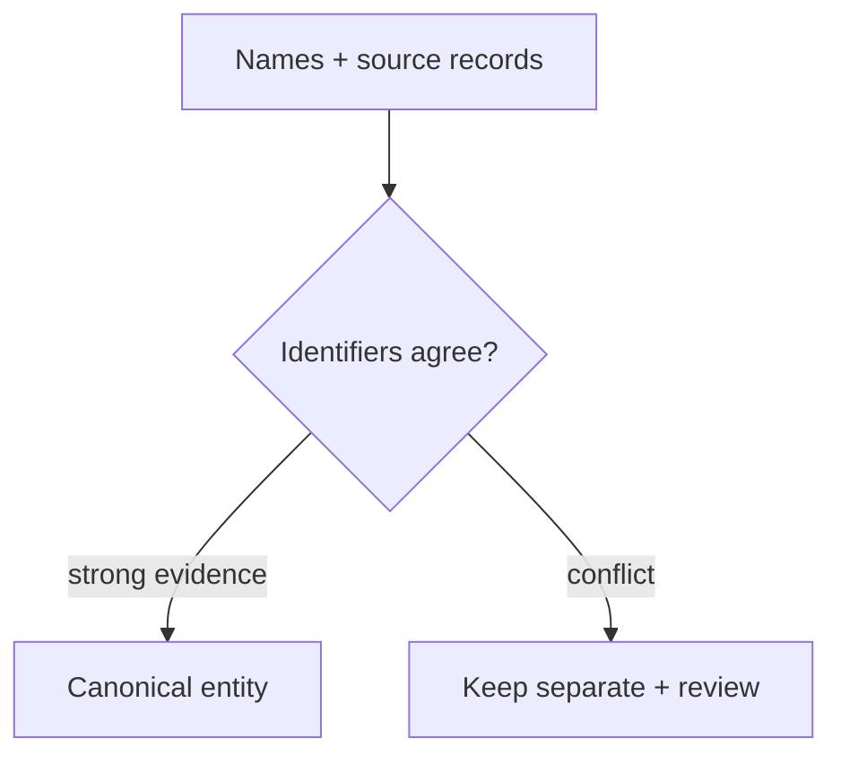

**Entity resolution** decides whether multiple names, mentions, or records describe the same real-world entity. A reliable graph merges records when identifying evidence satisfies a matching policy. It records uncertainty and preserves the source records behind each proposed merge.

In an incident knowledge graph, `inference-api`, `inference_api`, and `svc-482` may refer to one service. They may also identify separate deployments in different tenants or environments. Microsoft's [GraphRAG indexing overview](https://microsoft.github.io/graphrag/index/overview/) describes how extracted entities and relationships become downstream graph artifacts. A name-only merge can create false relationships that survive into graph traversal, community summaries, generated answers, and security-sensitive decisions.

## Compare mentions before merging identities

## Example

An incident report names `inference-api`, a trace tags `service_id=svc-482`, and a runbook calls the same system `Inference API`. Matching tenant, service identifier, repository, and deployment environment supports a merge. A second customer also has a service named `inference-api`, but its tenant and service identifier differ. Those entities must remain separate even when their embedding similarity is high.

Store merge lineage, confidence, source identifiers, and a reversible audit history. Treat cluster assignments as candidate matches and send uncertain merges for review. Recompute or invalidate downstream summaries when a merge changes so stale graph artifacts cannot expose incorrect relationships.

## Why it matters here

GraphRAG quality depends on accurate nodes and edges. Entity-resolution errors can turn a precise local question into a false cross-service explanation or connect documents across tenant partitions. Evaluate merge precision, missed links, and authorization effects separately from answer fluency.

## Related terms

- [GraphRAG](glossary://graphrag)
- [lineage](glossary://provenance)
- [Tenant isolation](glossary://tenant-isolation)
- [Embedding](glossary://embedding)
