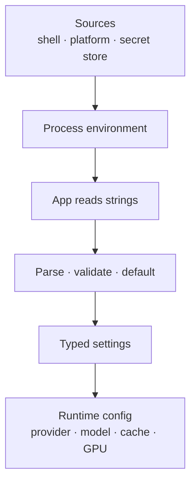

An environment variable is a named value that the operating system (or a parent process) attaches to a running process as part of its *environment*. On [POSIX systems](https://pubs.opengroup.org/onlinepubs/9799919799/basedefs/V1_chap08.html) the process holds `NAME=value` byte strings: names cannot contain `=`, and neither names nor values can contain a null byte. Languages commonly surface them as strings through `os.environ` / `process.env` / `getenv`. The parent can set the list at `exec`, the shell can `export` into children, and platforms such as Docker, Kubernetes, and Cloud Run inject keys when a container starts. Numbers, booleans, and lists only exist after your code parses them.

Environment variables are the standard way to keep *deploy-varying* config out of the image and the repo. The same binary can hit a different model endpoint, cache root, GPU mask, or secret reference because the process environment changed, not because you rebuilt code.

## Intuition

Treat env as a small, flat control plane for one process. Image layers answer "what code and files start?"; env answers "which lane, which credentials, which external paths?" for *this* run. Two containers with the same image digest and different env can behave like different products. That is useful when deliberate (staging vs prod) and dangerous when accidental (a missing key, a wrong route, a secret leaked into logs).

The [twelve-factor](https://12factor.net/config) rule of thumb is: store config that varies between deploys in the environment, as independent keys, not as a committed "environment blob." Prefer one key per concern (`MODEL_ROUTE`, `HF_HOME`) over a single opaque JSON blob unless you have a typed config loader.

## How it works

1. **Parent builds the map.** Shell `export KEY=value`, `docker run -e KEY=value`, Cloud Run `--set-env-vars`, Kubernetes `env` / `envFrom`, or a process supervisor sets the child's environment before start.
2. **Child inherits a copy.** After start, the OS environment is process-local. Changing env in one process does not rewrite another process's map. To apply a new environment, restart or re-exec the affected process; a shared config service is a separate way to deliver live updates.
3. **App reads strings.** Python `os.environ["OPENAI_API_KEY"]` raises if missing; `os.getenv("PORT", "8080")` returns a default. Typed frameworks (Pydantic Settings, etc.) parse, validate, and fail fast at import or startup.
4. **Precedence is layered.** Dockerfile `ENV` sets image defaults. Platform service config usually overrides those defaults. Cloud Run documents that a service-level variable of the same name wins over the image default. Reserved platform keys (for example Cloud Run's injected `PORT`) must not be redefined by the app.

Nothing in the OS types env values. `"false"`, `"0"`, and `"no"` are different strings until *you* define a parsing convention. Missing keys are often more dangerous than wrong keys: an empty provider key may only fail on the first live request.

## Example

A thin LLM API gateway image is the same in every deploy. Runtime env selects the live behavior:

```bash
# Non-secret config (safe to show in deploy diffs and non-secret logs)
export MODEL_ROUTE=fast                    # which provider / model lane
export HF_HOME=/var/cache/huggingface      # Hub / transformers cache root
export CUDA_VISIBLE_DEVICES=0,1            # which GPUs this process may see
export LOG_LEVEL=INFO
export PORT=8080                           # often injected by the platform

# Secrets: inject at runtime from a secret manager, never bake into the image
export OPENAI_API_KEY=...                  # prefer Secret Manager → env injection
```

Validate before accepting traffic:

```python
import os
from dataclasses import dataclass

ALLOWED_ROUTES = frozenset({"fast", "quality", "offline"})

@dataclass(frozen=True)
class Settings:
    model_route: str
    openai_api_key: str
    hf_home: str
    port: int

def load_settings() -> Settings:
    route = os.environ.get("MODEL_ROUTE", "fast")
    if route not in ALLOWED_ROUTES:
        raise SystemExit(f"MODEL_ROUTE must be one of {sorted(ALLOWED_ROUTES)}, got {route!r}")
    key = os.environ.get("OPENAI_API_KEY", "").strip()
    if not key:
        raise SystemExit("OPENAI_API_KEY is required")
    try:
        port = int(os.environ.get("PORT", "8080"))
    except ValueError:
        raise SystemExit("PORT must be an integer") from None
    if not 1 <= port <= 65535:
        raise SystemExit("PORT must be between 1 and 65535")
    return Settings(
        model_route=route,
        openai_api_key=key,
        hf_home=os.environ.get("HF_HOME", os.path.expanduser("~/.cache/huggingface")),
        port=port,
    )

settings = load_settings()  # fail at startup, not mid-request
```

Concrete ML knobs that almost always arrive via env:

| Variable | Typical use |
| --- | --- |
| `CUDA_VISIBLE_DEVICES` | Restrict which physical GPUs a process sees (vLLM and CUDA stacks read this) |
| `HF_HOME` / `HF_HUB_CACHE` | Redirect Hugging Face Hub and library caches off a tiny home volume |
| `OPENAI_API_KEY`, `ANTHROPIC_API_KEY` | Provider credentials (inject from a secret store in prod) |
| `VLLM_*` | vLLM system knobs (logging, cache roots, engine timeouts); do not confuse with the public API listen port |
| `MODEL_ROUTE`, feature bootstrap keys | App-level lane selection when a full flag service is not yet wired |

Cloud Run's [service environment documentation](https://docs.cloud.google.com/run/docs/configuring/services/environment-variables) specifies a maximum of 1000 variables and a maximum variable length listed as “32 Kb.” Config changes create a new revision. Cloud Run recommends [Secret Manager for API keys](https://docs.cloud.google.com/run/docs/configuring/services/secrets) rather than plain env literals, and can still *surface* a secret as an environment variable at instance start so app code keeps calling `os.environ`.

## Diagram



## Secrets versus config

**Config** (routes, log level, cache paths, non-secret feature bootstrap) belongs in env when it must change per deploy without a rebuild. Diff it in reviews. Log a redacted summary at startup next to the image digest.

**Secrets** (provider keys, DB passwords, signing material) may *appear* in the process environment after injection, but should not live as plaintext in git, Dockerfiles, or CI logs. Prefer short-lived credentials and a secret manager; on Cloud Run, pin secret *versions* when mounting secrets as env so rotation is intentional. Never put a server-side API key in a public frontend `NEXT_PUBLIC_*` (or similar) variable: anything shipped to the browser is not a secret.

Child processes inherit the parent's environment unless you scrub it. Sandboxes and agent tool runners should start with an allowlisted env, not the full ambient host map, so a job cannot see `AWS_SECRET_ACCESS_KEY` or your laptop's `OPENAI_API_KEY` by accident.

## Why it matters here

On LeetLLM-style stacks and production LLM services, environment variables often decide which provider route is live, where weights and Hub caches land, which GPUs a worker sees, and whether a safety or offline mode is on. Same image, different env: staging can look healthy while prod is on the wrong model lane. Treat required keys as a startup contract, keep secrets out of the image, and record non-secret env (or a config hash) beside the image digest when debugging "works in staging, fails in prod."

## Related terms

- [Secrets management](glossary://secrets-management)
- [Container image](glossary://container-image)
- [Feature flag](glossary://feature-flag)
- [Google Cloud Run](glossary://google-cloud-run)
- [Bounded execution environment](glossary://bounded-execution-environment)
