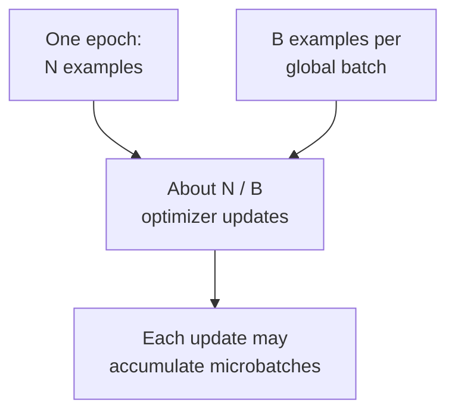

An **epoch** conventionally means one complete pass through a finite training set: every training example is presented once (in some order) before the next pass begins. [Google's ML glossary](https://developers.google.com/machine-learning/glossary/fundamentals#epoch) uses that definition. Check sampler behavior because padding or replacement can repeat rows and `drop_last` can omit them. That unit sits *above* batches and optimizer steps. A **batch** is the set of examples used in one forward/backward pass. Here a **step** means one optimizer update, usually after one batch, or after several microbatches when you accumulate gradients; some tools use “iteration” for a microbatch instead. An epoch is the outer loop that keeps requesting batches until the loader is exhausted once.

Epochs matter most when the dataset is finite, indexable, and you intend each record to appear a known number of times. They are less useful as the main progress unit when you stream web-scale mixtures and stop at a token or FLOP budget instead.

## Formula

For $N$ training examples and batch size $B$ (no gradient accumulation, no multi-GPU data parallel scaling):

$$
\text{steps per epoch} = \left\lceil \frac{N}{B} \right\rceil
$$

If you drop the incomplete last batch (`drop_last=True` in PyTorch, `dataloader_drop_last` in Hugging Face), use floor division instead:

$$
\text{steps per epoch} = \left\lfloor \frac{N}{B} \right\rfloor
$$

With gradient accumulation of $G$ microbatches per optimizer update, microbatch forwards per epoch stay about $N/B_{\text{micro}}$, while **optimizer steps** per epoch fall by roughly a factor of $G$:

$$
\text{optimizer steps per epoch} \approx \frac{N}{B_{\text{micro}} \cdot G}
$$

With data-parallel world size $W$, the **global** batch size is $B_{\text{micro}} \cdot G \cdot W$, and optimizer steps per epoch become about $N / (B_{\text{micro}} \cdot G \cdot W)$. Hugging Face `Trainer` exposes this as `num_train_epochs` (full or fractional passes) versus `max_steps` (hard stop on optimizer steps that overrides epoch count when set positive).

Those formulas assume one training **example** becomes one sequence (or one row in the dataloader). **Packing** for LM SFT concatenates many short rows into packed windows, so steps and tokens per epoch track the packed sequence count (and total tokens), not the raw example count $N$. After you enable packing, recompute steps/epoch from packed batches or you will mis-set `num_train_epochs`.

## Example

You fine-tune an instruction model on $N = 10{,}000$ examples with per-device batch size $B = 8$, gradient accumulation $G = 4$, and a single GPU ($W = 1$).

- Microbatches per epoch: $10{,}000 / 8 = 1{,}250$
- Full accumulation groups: $\lfloor 1{,}250 / 4 \rfloor = 312$, remainder $2$ microbatches
- Optimizer steps per epoch: $312$ if the leftover is dropped, or $313$ if the trainer flushes a partial accumulation (common default)
- Global examples per full optimizer step: $8 \times 4 = 32$

Train for 3 epochs: about $936$ to $939$ optimizer steps, and each example is seen about three times (modulo shuffle and dropped remainders). With no dropping or repeated sampling, epoch 1 covers every row once and epoch 3 gives $3N$ example exposures. Choose the epoch count using held-out behavior: more passes can reduce train loss while validation performance stalls or worsens, with no universal 1–3-pass cutoff. On a 1T-token pretraining mixture, "3 epochs" is rarely the control knob; people schedule by tokens seen, steps, or compute instead.

```python
# Conceptual loop; call set_epoch so DDP shuffles change each pass
for epoch in range(num_epochs):
    if hasattr(train_loader.sampler, "set_epoch"):
        train_loader.sampler.set_epoch(epoch)
    for batch in train_loader:  # one full pass = one epoch
        loss = model(batch).loss
        loss.backward()
        optimizer.step()
        optimizer.zero_grad()
```

## Diagram



## Intuition

One epoch traverses the sampler's current ordering. Each batch produces an optimizer step (or part of one under gradient accumulation). Shuffle between epochs so the model does not see the same batch composition repeatedly. In multi-GPU data parallel training, coordinate sampling across ranks and call [`DistributedSampler.set_epoch(epoch)`](https://docs.pytorch.org/docs/stable/data.html#torch.utils.data.distributed.DistributedSampler) in PyTorch so shuffled ordering changes. Its default `drop_last=False` adds repeated indices to make the dataset evenly divisible across ranks; `drop_last=True` drops the tail instead. Thus rank partitions need not be disjoint sets of original records. Forgetting `set_epoch` can make every epoch reuse the same per-rank order.

## When epochs stop being the main unit

In web-scale **pretraining** or pure streaming (`IterableDataset` without a true length), "epoch" is often bookkeeping fiction. You may sample from a mixture with weights, deduplicate imperfectly, upsample rare domains, or stop at a token budget before every record appears exactly once. Hugging Face `max_steps` exists partly for this: you run a fixed number of optimizer updates and cycle data as needed. In those runs, **tokens seen**, **mixture weights**, and **optimizer steps** report progress more honestly than epoch count.

Even on finite SFT data, one epoch over 1M clean demos exposes the model to a different volume and diversity of examples than one epoch over 50k near-duplicates. Track unique examples and tokens alongside epoch number. With packing, "one epoch" can mean far fewer optimizer steps than $N/B$; whether every row and token is retained depends on the packer's truncation and remainder policy.

## What to track

- Optimizer steps, examples or tokens seen, and epoch index
- Train vs validation loss (or task metrics) as epochs accumulate
- Shuffle seed / `set_epoch` behavior under DDP
- Whether the last batch is dropped and whether accumulation leftover is flushed
- For LMs: tokens per epoch and total tokens, which often predict compute better than "epoch 2 of 3"

## Why it matters here

Epochs are the bridge between "how big is my dataset?" and "how long did I train?" before you move to token-budget language used in large-scale pretraining. Curriculum work on SFT, LoRA, and classical ML still quotes `num_train_epochs`; production LLM pretraining rarely does. Knowing when to use epochs, when to switch to steps or tokens, and how batch size and accumulation change steps per epoch keeps training plans and cost estimates honest.

## Related terms

- [Pretraining](glossary://pretraining)
- [Supervised fine-tuning](glossary://supervised-fine-tuning)
- [Optimizer](glossary://optimizer)
- [Overfitting](glossary://overfitting)
- [Train, validation, and test split](glossary://train-validation-test-split)
