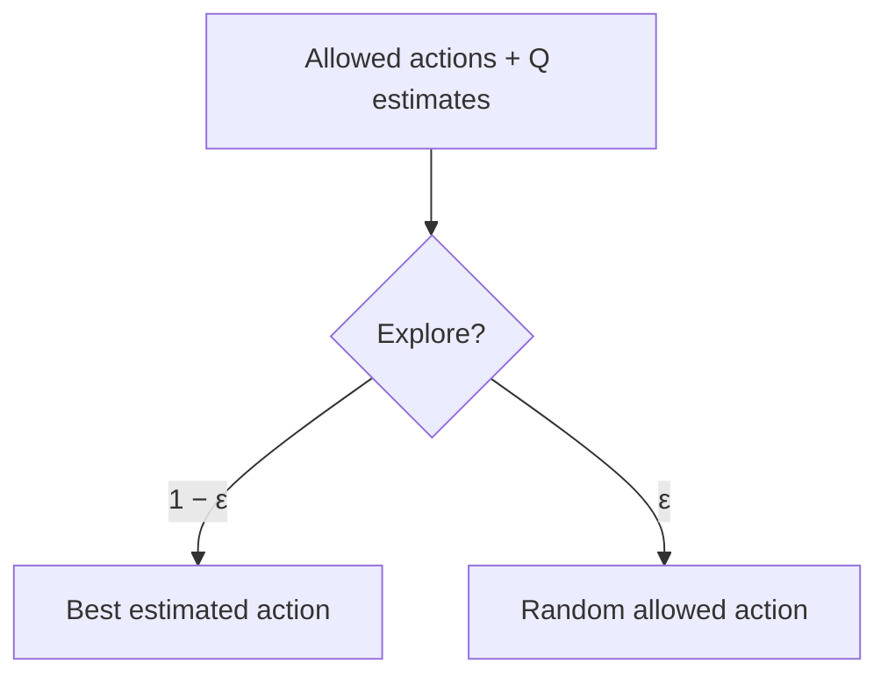

Epsilon-greedy is an action-selection policy that usually chooses the currently highest-valued action but occasionally explores a random action. For $0\le\varepsilon\le1$, with probability $1-\varepsilon$ it selects a greedy action; with probability $\varepsilon$ it samples from the permitted action set. Positive exploration gives alternatives a chance after early noisy estimates. Adequate state coverage and convergence also depend on the exploration schedule, environment, and learning assumptions. At $\varepsilon=0$ the policy never explores; a schedule that decays too quickly can stop adequately testing alternatives.

## Coverage doesn't imply safety

If the exploratory draw is uniform over all $m$ available actions and the greedy winner is unique, its total selection probability is $(1-\varepsilon)+\varepsilon/m$ because exploration can select it too. Each other action receives $\varepsilon/m$. Exploration must operate only over authorized, safe actions. A costly production write, unsafe permission change, or unreviewed customer impact cannot become permissible merely because an algorithm needs more coverage.

## Example

An access-review agent can request evidence, ask a reviewer, or automatically approve a request. With $\varepsilon=0.1$ and two permitted actions, evidence and review, the current greedy choice is selected with probability $0.9+0.1/2=0.95$. The alternative receives probability 0.05. Automatic approval is excluded from the permitted set when policy forbids it; it receives zero probability regardless of the exploration rate.

## Why it matters here

Reinforcement-learning lessons separate the behavior policy that collects experience from the action values being learned. Epsilon-greedy exposes the relationship between exploration, off-policy learning, authorization, and the coverage assumptions required before trusting a learned workflow policy.

## Related terms

- [Q-learning](glossary://q-learning)
- [Markov decision process](glossary://markov-decision-process)
- [Off-policy learning](glossary://off-policy)
