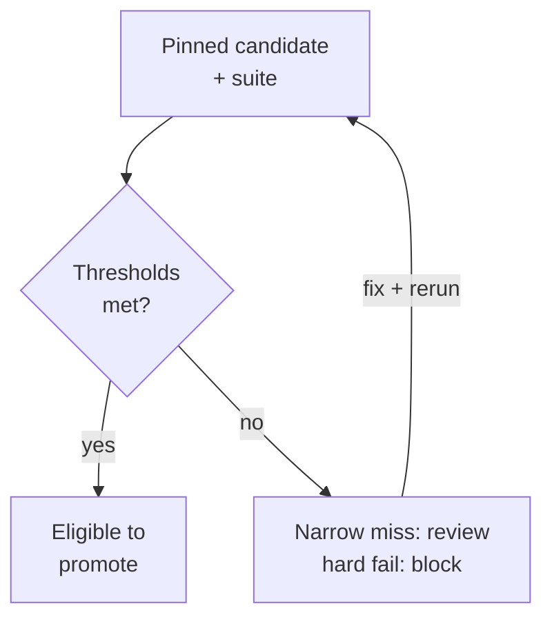

An **eval gate** is a release checkpoint that **blocks promotion** of a model, prompt, retriever, agent, or full AI system when measured behavior on a known evaluation suite falls below required thresholds. An eval *report* tells you what happened. An eval *gate* decides whether the change is **allowed** to move forward: merge, deploy, register, or open more traffic.

In software CI, quality gates enforce coverage or test pass rate before code advances. In ML and LLM systems, gates evaluate observable behavior alongside code shape. A prompt edit can keep every unit test green while citation accuracy, safety refusals, or tool-call validity silently regress. The gate turns a frozen [offline evaluation](glossary://offline-evaluation) into an automatic go/no-go, usually by combining an [eval harness](glossary://eval-harness), a versioned [golden dataset](glossary://golden-dataset) or [regression suite](glossary://regression-suite), numeric thresholds, and a fail-closed decision in CI/CD.

Good gates are boring on purpose: known dataset version, known metric definitions, known thresholds (absolute floors and allowed regressions), known slices, known owner, and a known override path with expiry. Teams ship around dashboards; they cannot ship around a blocked pipeline without leaving an audit trail.

## Intuition

Treat the eval gate as a **contract between product risk and release velocity**. The harness runs the candidate. Graders (deterministic checks, rubrics, or [model judges](glossary://model-judge)) produce per-row and aggregate scores. The gate applies thresholds and returns a discrete release decision such as promote, hold for human review, or block/rollback. Everything else (pretty charts, exploratory metrics) can inform the team without becoming a blocker.

AI releases need more than unit tests because model behavior can regress without changing API shape, types, or HTTP status codes. Privacy leaks, unsupported claims, wrong-tenant retrieval, and broken refusals often look like "successful" responses at the protocol layer. The gate is where those product-visible failures become release failures.

## Diagram



## How it works

1. **Pin the candidate and the suite.** Record model id/snapshot, prompt version, retriever/index version, tool schema, temperature, harness git SHA, and dataset commit. If any of those drift silently, a score change is uninterpretable.
2. **Run the harness.** Execute every eval row (or a declared stratified sample), capture outputs and traces, grade them, and write artifacts (per-row results, failing ids, latency, cost).
3. **Aggregate with denominators.** Report pass rates, score means, p95 latency, and skip/timeout counts. Always show support size per [evaluation slice](glossary://evaluation-slice).
4. **Apply the gate contract.** Compare metrics to absolute floors and/or allowed deltas versus a baseline (previous production or last green run). Safety and policy rows often use zero-tolerance absolute floors; softer quality metrics often gate on regression size so stable residual error does not block forever.
5. **Emit a decision and evidence.** Pass, hold, or block. On failure, include concrete row ids and traces so engineers can investigate the decision. Store it with artifact versions so overrides and postmortems can reconstruct why the gate fired.

A multi-metric gate is common in production LLM apps. Research and practice treat release readiness as a **vector of constraints** spanning task success, safety, latency, evidence/citation, and cost. Every hard dimension must clear its floor, and a catastrophic slice can block promotion even when the global average remains healthy.

## Gate contract

Version the gate definition next to the code it protects. At minimum name:

| Field | Why it exists |
|---|---|
| Dataset / suite version | Makes score deltas attributable |
| Metric definitions + graders | Stops silent redefinition of "pass" |
| Thresholds and directions | Absolute floor, max regression, or both |
| Critical slices | Stops average-hiding of high-risk failures |
| Sample size / runtime budget | Keeps the gate usable on every relevant change |
| Owner | Who updates thresholds and triages flakes |
| Override process | Reason, approver, expiry, follow-up |
| Artifact location | Where rows, traces, and reports live |

Trigger the gate when behavior can change: model or provider config, prompts, retrieval/chunking/rerank settings, tool schemas, and safety policy. Infrastructure edits that affect timeouts, batching, numerical precision, or routing can also change behavior and need relevant evaluations. Edits with no behavioral effect can stay on unit tests and [smoke tests](glossary://smoke-test).

Separate **hard blockers** from **advisory metrics**. Blocking on every noisy judge score trains people to force-merge. Blocking on zero-tolerance safety, tenant isolation, schema validity, and agreed quality floors trains people to fix real damage.

## Example

A support RAG team is promoting a new cross-encoder reranker. The offline gate runs a frozen suite of $N = 400$ held-out tickets (dataset commit `ds@a3f7c9d`), graded by citation match, refusal correctness, and schema-valid tool args, plus p95 end-to-end latency on the same harness.

Declared thresholds (illustrative product policy):

| Metric | Floor | Max allowed regression vs prod baseline |
|---|---|---|
| Citation accuracy (pooled) | $\ge 0.92$ | $\le 0.02$ drop |
| Tenant-isolation failures | $= 0$ | none |
| Policy-refusal pass rate | $\ge 0.98$ | $\le 0.01$ drop |
| p95 latency | $\le 2.5\,\mathrm{s}$ | $\le +300\,\mathrm{ms}$ |

Candidate results (baseline citation accuracy 0.94, refusal pass rate 0.99, and p95 latency 2.0 seconds):

- Citation accuracy $0.905$ (baseline $0.94$) → fails floor and regression budget
- Tenant isolation $0$ failures → pass
- Policy refusal $0.99$ → pass
- p95 latency $2.1\,\mathrm{s}$ → pass

**Gate decision: block.** The failure message should list the worst slices (for example `long_pdf_table`, `multi_hop_policy`) and the failing row ids so an engineer can open traces without re-running the full suite. A force-promote would require an owner override with reason, expiry, and a tracked follow-up; without that process the "gate" is documentation.

After a fix (prompt packing + index filter), the same suite hits citation $0.93$ and all other floors. Offline gate goes green; the team still runs a small [canary rollout](glossary://canary-rollout) because live traffic can expose length distributions and cache effects the frozen set misses.

Minimal decision sketch matching the table (zero-tolerance hard checks, plus absolute floors and regression budgets). Invalid measured rates or latencies block promotion. The harness must also enforce nonempty required slices and sufficient completed rows; the aggregate inputs alone cannot prove that support. Omits the optional hold band for brevity:

```python
from math import isfinite

def gate_decision(
    citation_acc: float,
    isolation_fails: int,
    refusal_pass: float,
    p95_s: float,
    *,
    citation_base: float,
    refusal_base: float,
    p95_base_s: float,
    citation_floor: float = 0.92,
    citation_max_drop: float = 0.02,
    refusal_floor: float = 0.98,
    refusal_max_drop: float = 0.01,
    p95_floor_s: float = 2.5,
    p95_max_reg_s: float = 0.3,
) -> str:
    rates = (citation_acc, citation_base, refusal_pass, refusal_base)
    latencies = (p95_s, p95_base_s)
    if not all(isfinite(x) and 0 <= x <= 1 for x in rates):
        return "block"
    if not all(isfinite(x) and x >= 0 for x in latencies):
        return "block"
    hard_ok = isolation_fails == 0
    quality_ok = (
        citation_acc >= citation_floor
        and (citation_base - citation_acc) <= citation_max_drop
        and refusal_pass >= refusal_floor
        and (refusal_base - refusal_pass) <= refusal_max_drop
        and p95_s <= p95_floor_s
        and (p95_s - p95_base_s) <= p95_max_reg_s
    )
    return "promote" if hard_ok and quality_ok else "block"
```

## What belongs behind a gate

Gate behavior that must not silently regress:

- Privacy and tenant isolation (any unauthorized chunk is a hard fail)
- Tool-argument validity and schema contracts
- Refusal and safety policy on known attack/edge rows
- Citation or evidence support where the product claims grounded answers
- Critical product slices (language, document type, high-value journeys)
- Catastrophic latency or cost budgets agreed with ops
- Incident regressions (cases that already burned users once)

Reserve blocking gates for metrics the team will defend in a postmortem and maintain as the product evolves. Track judge-style scores, exploratory long-tail slices, and research benchmarks as signals until they become release requirements.

## Threshold design under noise

LLM evals are partly probabilistic: sampling, judge variance, timeouts, and rate limits all inject noise. Absolute single-score cutoffs fail in two ways: too tight (false blocks, force-merge culture) or too loose (never fires). Practical patterns:

- **Zero-tolerance hard fails** for safety, isolation, and schema breaks (count-based, not "average safety").
- **Regression gates** on quality metrics: block when fail rate or score worsens by more than $\delta$ versus a pinned baseline, even if still above a loose absolute floor.
- **Hold band** for narrow misses that need human triage rather than automatic promote or automatic block.
- **Slice floors** so a small high-risk cohort cannot hide inside a healthy average.

If $m$ is the measured metric and $\tau$ the absolute floor (higher-is-better), the simplest hard rule is $m \ge \tau$. A regression-aware rule also requires $m_{\mathrm{base}} - m \le \delta$ (or the analogous form for lower-is-better metrics such as latency). Calibrate $\tau$ and $\delta$ from historical green runs and product risk, then freeze them in version control.

## Trade-offs

| Choice | Gain | Cost |
|---|---|---|
| Large suite every PR | High coverage | Slow CI, flake pressure, eval fatigue |
| Tiny fast gate + full suite on main | Fast local loops | Misses rare failures until later |
| Strict absolute floors | Simple policy | Noise and judge drift cause false blocks |
| Delta-only gates | Stable residual error tolerated | Slow quality rot can stay under $\delta$ for weeks |
| Judge-heavy grading | Covers open-ended answers | Judge/prompt drift becomes a measurement bug |
| Deterministic checks only | Cheap, stable | Misses semantic regressions |

Run offline eval gates before user-visible exposure, then use [shadow traffic](glossary://shadow-traffic) and canaries to catch production-only distributions. A green result supports release decisions when the suite is current and uncontaminated. Repeatedly selecting fixes on the same held-out suite turns it into development data; use a separate protected holdout or fresh cases to assess the selected release.

## Why it matters here

LeetLLM lessons treat eval gates as the mechanism that turns teaching fixtures, red-team cases, and production incidents into **release discipline** for LLM, RAG, and agent systems. System-design and behavioral interviews expect you to name how a prompt or model change is blocked, what thresholds apply, who can override, and how failing rows are inspected. Without a gate, quality evidence is optional; with one, regressions become first-class release failures.

## Related terms

- [Eval harness](glossary://eval-harness)
- [Golden dataset](glossary://golden-dataset)
- [Evaluation slice](glossary://evaluation-slice)
- [Offline evaluation](glossary://offline-evaluation)
- [Canary rollout](glossary://canary-rollout)
