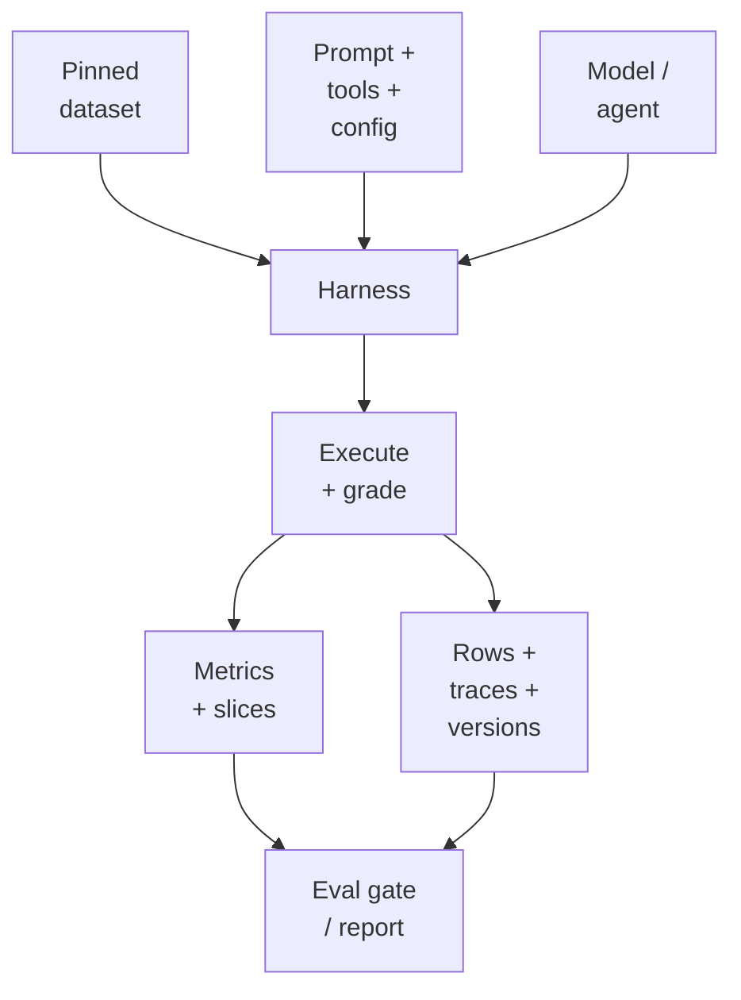

An **eval harness** is the runnable system that turns a dataset and a model (or agent) into scored results: it loads test cases, builds prompts or tool environments, calls the system under test, grades outputs, aggregates metrics, and writes artifacts under pinned versions of data, code, and config.

The word shows up in two related senses. In academic LLM eval, a harness such as EleutherAI's [lm-evaluation-harness](https://github.com/EleutherAI/lm-evaluation-harness) or Stanford HELM is a shared library so many models face the same tasks, prompts, and metrics. In product and agent work, the harness is everything around the model on a task: control loop, tools, memory or compaction, retries, timeouts, graders, and sandbox. In both senses the score describes the full system and setup, including its weights, prompts, tools, and evaluation protocol.

## Intuition

An evaluation fixes the path from an input row to a grade and records enough version metadata for an engineer to attribute score movement. The harness implements that path.

Without it, people mix model changes with silent script edits, prompt drift, different few-shot packs, flaky graders, or a different agent scaffold. Two papers reporting "MMLU 72%" or two PRs reporting "citation accuracy +3%" may not be comparable if the harness differs. [HELM's design goal](https://crfm.stanford.edu/2022/11/17/helm.html) was exactly this: dense comparison under *standardized conditions*, with raw prompts and completions released for audit. [OpenAI's frontier-eval guidance](https://openai.com/index/trustworthy-third-party-evaluations-foundations/) makes the same point for agents: tools, budget, retries, and context management can materially change measured capability even with fixed model weights.

Think of the harness as the eval equivalent of a test runner plus test case loader plus assertion library, with extra machinery for sampling, tool use, and non-deterministic graders.

## How it works

A production-grade harness usually owns these stages end to end:

1. **Load and pin.** Resolve dataset version, task config, prompt templates, few-shot examples, model route, tokenizer or chat template, tool schemas, and harness git SHA.
2. **Build the request.** Format each test case into the model-facing interface (completion prompt, chat messages, or agent environment with tools and files).
3. **Execute.** Call the system under test with fixed decoding settings where possible; enforce timeouts, concurrency limits, retries, and sandboxes for code or tools.
4. **Grade.** Score with exact match, unit tests, rubrics, or a [model judge](glossary://model-judge). Record skips, timeouts, parse failures, and refusals as first-class outcomes so evaluation denominators stay explicit.
5. **Aggregate and emit artifacts.** Compute metrics and slices; write per-row traces, aggregate JSON, and run metadata so failures are replayable.

Shared research harnesses (lm-eval, HELM, OpenAI Evals) standardize steps 1-5 across models. Product harnesses often specialize step 3: a coding-agent harness may clone a repo, apply a patch, and run hidden tests; a RAG harness may freeze the index and citation policy for the run.

## Diagram

## Example

You ship a support bot that must cite policy docs. The harness freezes:

- **Data:** golden set `support-qa@v14` with $200$ tickets ($160$ must-answer, $40$ must-abstain).
- **System:** prompt template `reply-v7`, retriever index `policies@2026-03-01`, temperature $0$, max $512$ output tokens.
- **Graders:** exact citation-id match, answer span overlap, abstention label; judge only for "tone" after deterministic checks pass.
- **Artifacts:** per-row input, retrieved chunks, model output, grader decisions, latency; plus `harness@git:a1b2c3d`, model id, and dataset SHA.

Baseline run scores citation-decision accuracy $0.91$ across all $200$ rows (including correct no-citation decisions for abstentions), abstention $F_1$ $0.88$, and p95 latency $1.4$s. After a prompt tweak the harness reports citation-decision accuracy $0.84$: correct rows fall from $182$ to $168$. Diffing [eval rows](glossary://eval-row) shows $18$ new citation misses, all on multi-doc tickets, and $4$ recovered cases, a net loss of $14$, with the same dataset and grader versions. That makes the measured regression inspectable instead of a mystery dashboard drop. Re-running the same harness commit and dataset should reproduce grades within known nondeterminism bounds (sampling, judge variance, network flake).

For coding agents the same idea is SWE-bench style: clone repo, apply patch, run tests in a clean environment, score resolved/not. Changing the agent scaffold (retries, test feedback, context compaction) changes the harness; report the result as a system change alongside any model upgrade.

## What it owns

The harness owns **setup, execution, grading, aggregation, and artifacts**. At minimum it should persist:

| Artifact | Why |
|---|---|
| case ID + dataset version | Replay the case |
| Prompt / policy / tool schema versions | Separate script drift from model drift |
| Model id, decoding params, seed if any | Reproduce generation |
| Raw outputs and tool traces | Debug without re-running |
| Grader version and decision | Catch grader regressions |
| Timeouts, skips, errors, denominators | Honest metrics (no silent row drops) |
| Harness git SHA + config hash | Prove the runner itself is pinned |

If a failing score has no row-level trail, the harness is incomplete.

## Trade-offs

- **Standardized vs max-elicitation harness.** A fixed harness is best for comparing systems under the same conditions. A stronger scaffold (more tools, retries, token budget, compaction) can raise capability scores but weakens apples-to-apples comparison unless you label the claim.
- **Deterministic graders vs judges.** Unit tests and exact match are stable and cheap; judges cover fuzzy quality but add variance, position bias, and another version pin.
- **Speed vs coverage.** Full offline suites catch regressions; they cost tokens and wall time. Smoke slices and nightly full runs are a common split.
- **Strict isolation vs realism.** Sandboxes and frozen indexes improve reproducibility; live tools and live indexes look more like production but make scores harder to attribute.

## Why it matters here

Curriculum and production work both depend on scores that reflect the intended behavior. A stable harness separates model behavior from script, prompt, grader, and agent-scaffold changes so benchmark tables and release dashboards can power an [eval gate](glossary://eval-gate). It makes offline regression debugging, model comparisons, and agent trajectory scoring defensible through shared test cases, a stable environment schema, and inspectable artifacts.

## Related terms

- [Eval gate](glossary://eval-gate)
- [Golden dataset](glossary://golden-dataset)
- [Model judge](glossary://model-judge)
- [Eval row](glossary://eval-row)
- [Offline evaluation](glossary://offline-evaluation)
