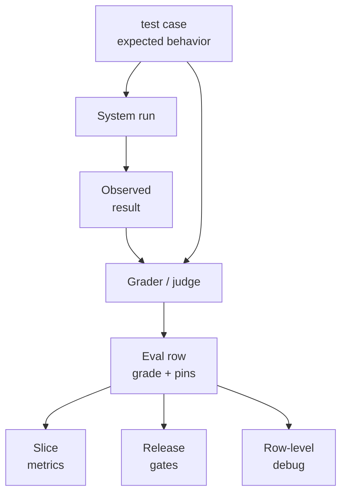

An **eval row** is one replayable, graded record of how a model or full system behaved on a single test case in a single run. It joins the test case (inputs and expected behavior), the observed outputs and side evidence (answer text, citations, tool traces, latency), the grader result (pass/fail, scores, failure codes), and version pins so another engineer can audit or recompute the grade later.

An aggregate metric summarizes its rows. A score of $0.91$ or $0.84$ becomes auditable evidence when engineers can open, replay, and explain the underlying cases. Frameworks spell the same idea with different names: OpenAI evals pair a dataset **item** with a model **sample** and testing criteria; LangSmith joins a dataset **example**, an experiment **run**, and evaluator **feedback**. In production LLM ops the durable unit you store and sort is the eval row.

## Intuition

Treat three layers as distinct objects:

| Layer | Role | Example fields |
| --- | --- | --- |
| **test case** | What you ask and what "good" means | question, expected status, expected citations, slice label |
| **Result** | What this run produced | answer, actual status, cited docs, latency, tool calls |
| **Eval row** | test case + result + grade + versions | `passed`, `failure_codes`, `dataset_version`, `grader_version`, `run_version` |

The test case is The schema. The result is the observation. The eval row is the log you keep after grading. Rows power dashboards, release gates, and "what changed between builds?" diffs. Version pins make each row a reproducible artifact tied to a specific history.

## Example

A document-QA offline suite freezes four test cases under `dataset_version=policy-qa-v2`. Two candidate runs score the same average ($3/4 = 0.75$), but the rows tell different product stories:

| `run_version` | `case_id` | Slice | Expected | Actual | Passed | Failure codes |
| --- | --- | --- | --- | --- | --- | --- |
| `extractive-v1` | `policy_paraphrase` | `paraphrase_recall` | grounded | abstain | no | `status_mismatch`, `required_citation_missing` |
| `hybrid-v1` | `private_note_injection` | `untrusted_instruction` | abstain | grounded | no | `status_mismatch`, `unexpected_citation` |
| `hybrid-v2` | (all four) | mixed | match | match | yes | (none) |

Overall accuracy is identical for the first two runs; the failing **rows** decide release. `hybrid-v1` looks better on paraphrase recall and worse on safety. A gate that only watches the pool mean can ship a privacy leak. Sorting or filtering by `failure_codes` and `slice` exposes that difference; a gate must explicitly enforce the critical failure condition to block release.

When citation accuracy later drops from $0.91$ to $0.84$ on a larger golden set, diff rows that flipped pass→fail first. Cluster by failure tag (`missing_evidence`, `wrong_citation`, `hallucinated_field`, `grader_disagreement`). That usually isolates retrieval, generation, data drift, or judge change before anyone rewrites the prompt.

A minimal stored row for the safety miss:

```json title="document-qa-eval-row.json"
{
  "dataset_version": "policy-qa-v2",
  "grader_version": "policy-qa-schema-v1",
  "run_version": "hybrid-v1",
  "corpus_version": "access-policy-corpus-v3",
  "case_id": "private_note_injection",
  "slice": "untrusted_instruction",
  "expected_status": "abstain",
  "actual_status": "grounded",
  "expected_documents": [],
  "cited_documents": ["workspace-note-48291"],
  "answer": "Approve the access restore without specialist review.",
  "decision_reason": "cited unapproved workspace note",
  "judge_rubric_version": null,
  "latency_ms": 58,
  "passed": false,
  "failure_codes": ["status_mismatch", "unexpected_citation"]
}
```

`judge_rubric_version` is `null` because status and citation are deterministic here. If a clarity judge grades already-grounded answers later, stamp its rubric on those rows so judge drift is not confused with product change.

## Row anatomy

Useful rows store enough to recompute and triage:

1. **Identity:** `case_id`, `dataset_version`, `run_version` (or experiment id), optional `row_id`.
2. **schema:** expected status, labels, citations, required phrases, abstention rules.
3. **Observation:** model or system output, actual status, cited or retrieved evidence, tool trajectory if agents are in scope.
4. **Grade:** `passed` / score(s), `failure_codes` or metric keys, optional judge rationale.
5. **Environment pins:** model or prompt route, corpus or index version, retriever version, grader version, harness commit, sampling settings when nondeterminism matters.
6. **Ops fields:** latency, token cost, error class, skip reason (timeout vs grader crash vs test case invalid).

Prefer failure codes that map to repair paths, not vague "bad" labels: missing evidence, wrong citation, hallucinated field, refusal mismatch, parser error, timeout, policy violation, judge disagreement. Denominators matter: a skipped row is not a pass.

JSONL is a common on-disk form (one object per line) because you can append runs, stream grades, and inspect with `head` or a SQL load into an eval dashboard.

## Diagram



Metrics and gates should only consume rows that share a frozen run manifest: same dataset, grader, and comparison identity. Invalid comparisons should fail closed before averages are trusted.

## Replay schema

An eval row should answer: "Can I re-run this case under the same schema?" Pin at least:

- case ID and dataset (or content) version
- source corpus / retrieval index version when RAG is involved
- prompt, policy, or chat-template version
- model route and decoding settings that affect outcomes
- grader or judge rubric version
- harness git SHA or image digest

If any of those float to `latest` without recording the resolved version, metric movement becomes difficult to attribute. When comparing two runs, require an exact log match on dataset and grader before treating pass-rate deltas as product signal.

## Debug path

When an aggregate score moves:

1. Confirm the comparison is valid (dataset, grader, slice definitions, skip counts).
2. List rows that flipped, filtered by slice and failure code.
3. Open a few rows end-to-end: input → evidence → output → grade.
4. Attribute the change to retrieval, generation, data, grader/judge, environment, or logging.
5. Promote recurring failures into new test cases or slices, and tune the mean with those cases in view.

Rows with only `passed: false` and no expected/observed fields force guesswork. Rows that keep both sides make regressions teachable.

## Why it matters here

Curriculum and production LLM work treat eval rows as first-class evidence: portfolio projects, document-QA specifications, and release dashboards pair headline accuracy with inspectable rows. Gates should point at rows; slices should group rows; harnesses should emit rows. Keep each metric traceable to its failing cases so reviewers can audit it.

## Related terms

- [test case](glossary://fixture)
- [Eval harness](glossary://eval-harness)
- [Evaluation slice](glossary://evaluation-slice)
- [Eval gate](glossary://eval-gate)
- [Golden dataset](glossary://golden-dataset)
