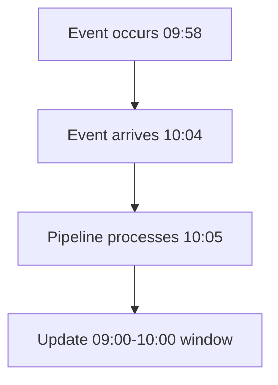

Event time is when a real-world observation happened, as distinct from processing time or arrival time, when a pipeline received or processed it. Streaming feature computations often group data into event-time windows so delayed events contribute to the period they describe. Historical feature correctness still requires checking when each event actually became available to the prediction system.

## Three clocks, two correctness questions

An interaction may happen at 09:58, arrive at 10:04, and be processed at 10:05. It belongs to a 09:00-10:00 event-time window, but a prediction made at 10:00 could not have used it. Event time answers which historical window the event describes. Availability time answers whether that event was knowable when a prediction was produced. Confusing the two creates point-in-time leakage.

Watermarks and the configured lateness policy determine whether a delayed event updates a retained window, is routed elsewhere, or is dropped. Availability should mark when the relevant data or derived feature was usable by serving, which can be later than raw arrival.

## Example

A feature pipeline counts purchases completed before a 10:00 recommendation request. A purchase timestamped 09:58 arrives at 10:04. The event belongs to the earlier business window, but including it in a reconstructed 10:00 training row gives the model knowledge that online serving didn't have. Record both event timestamp and availability timestamp, then require both to be no later than the historical prediction time.

## Why it matters here

Batch backfills, streaming aggregations, feature stores, ranking models, and forecasting pipelines all need consistent clock semantics. Correct event-time handling prevents stale-watermark confusion, future-looking training rows, and disagreement between offline feature reconstruction and online predictions.

## Related terms

- [Point-in-time join](glossary://point-in-time-join)
- [Feature freshness](glossary://feature-freshness)
- [Data leakage](glossary://data-leakage)
